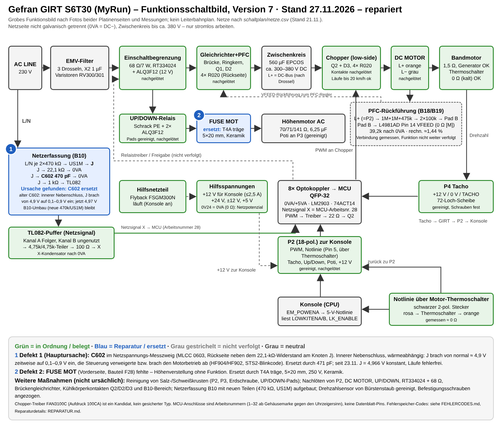

# Technogym MyRun – Reparatur der Steuerung GIRT S6T30 und BLE-Diagnose

**English summary.** This repository documents the repair of a used Technogym MyRun treadmill whose lower-kit controller (Gefran GIRT S6T30) refused to start or aborted runs (console faults HF904/HF902/HF901) and whose incline did not move. Root causes: a leaky 0603 ceramic capacitor (C602, about 470 pF) in the mains-voltage sensing branch, and a missing T4A fuse (FUSE MOT) in the incline motor circuit. Both parts cost only cents to a few euros. The repo contains the repair notes, a photo atlas with a coordinate grid, a reconstructed schematic, a block diagram, hardware notes, error-code notes and Python/BLE diagnostic scripts (using `bleak`). The documentation is in German. Use at your own risk; the mains side of the board is not isolated.

## Status

**Repariert (Stand 27.11.2026).** Seit dem Austausch von C602 am 23.11.2026 laufen mehrere Trainings ohne Fehler (Läufe bis 20 km/h, 6,6 km/h bei 12 % Steigung). Die Höhenverstellung funktioniert nach dem Ersatz der Sicherung FUSE MOT.

## Problem

- Fehlstarts und Abbrüche: Konsole zeigt **HF904** (Start ohne Drehzahl), **HF902** (Abbruch im Lauf) oder **HF901** (Fehler im Wartezustand); die Motorsteuerung verweigert den Motorbetrieb.
- LED STS2 auf der GIRT blinkt (8×, teils 4×), die Relais klicken.
- Höhenverstellung ohne Funktion.
- Über BLE ist der Fehlerspeicher (`@RERRORLOG#`) lesbar, siehe [FEHLERCODES.md](docs/FEHLERCODES.md) und die [Beispiel-Logs](docs/beispiel_logs/README.md) (Fehlstart vor und guter Lauf nach der Reparatur).

## Ursache und Reparatur

| | Defekt 1: Kondensator C602 | Defekt 2: Sicherung FUSE MOT |
|---|---|---|
| Bauteil | SMD-Keramikkondensator (MLCC) 0603, ca. 470 pF; „C602“ ist eine Schaltplan-Referenz, kein Aufdruck auf der Platine, erkennbar neben dem Widerstand „2212“ | Feinsicherung 5 × 20 mm, T4A träge, 250 V |
| Lage | Rückseite (Lötseite), Feld E6 (±1 Feld), neben dem Widerstand „2212“ (22,1 kΩ) | Vorderseite, Feld J2 (Bauteil F28) |
| Fehlerbild | Innerer, wärmeabhängiger Nebenschluss im Netzspannungs-Messzweig: der Messknoten J brach von ca. 4,9 V zeitweise auf 0,1–0,9 V ein; die Steuerung verweigerte bzw. brach den Motorbetrieb ab (HF904/HF902) | Sicherung fehlte (Glaskörper weg): Höhenverstellung ohne Funktion |
| Ersatz | 470 pF, 0603, ≥ 50 V, C0G/NP0 (eingebaut: 471 pF aus Sortiment, gemessen 460 pF) | T4A/250 V träge, Keramik |
| Einzelpreis | ca. 0,10–0,30 € ([DigiKey](https://www.digikey.fr/en/products/detail/yageo/CC0603FRNPO9BN471/8024989) 0,29 €; Großmenge ca. 0,015 € bei [RS](https://de.rs-online.com/web/p/products/2006499P)) | ca. 0,20–2 € ([Conrad ESKA 522.723](https://www.conrad.de/de/p/eska-8522723-8522723-feinsicherung-o-x-l-5-mm-x-20-mm-4-a-250-v-traege-t-inhalt-1-st-537316.html), 1,92 €) |

Nachweis, Fotos und Lagebegründung: [docs/REPARATUR.md](docs/REPARATUR.md) ([PDF](docs/REPARATUR.pdf)).
Beleglage: Der Wärmetest (J-Einbruch beim alten C602, stabile 4,966 V mit neuem Teil) ist gemessen; dass genau dieser Einbruch die Fehlermeldungen auslöst, ist abgeleitet, da die Firmware nicht dokumentiert ist.

**Weitere Maßnahmen** (keine nachgewiesene Ursache): Die Netzerfassung B10 wurde mit neuen Teilen aufgebaut (je Seite 2 × 470 kΩ + US1M); dieser Umbau ist weiterhin eingebaut und im [Schaltplan](docs/schaltplan/README.md) als Ist-Blatt dokumentiert. Außerdem wurden Salz-/Schweißkrusten gereinigt, mehrere Lötstellen nachgelötet und der Drehzahlsensor von Bürstenstaub befreit.

**Hinweis lockerer Netzstecker:** Am 24.11. fiel das Gerät während der Höhenverstellung aus, weil der Kaltgerätestecker locker saß (Knistern/Funken). Stecker und Buchse sollten geprüft und bei Bedarf getauscht werden.

## Bezeichnungen

Im Repo gibt es mehrere Namenssysteme nebeneinander: das Koordinatenraster A–L / 1–6 des Fotoatlas, die Bereichs-IDs F1–F33 (Vorderseite) und B1–B21 (Rückseite) der Platinenübersicht, die Bauteilreferenzen des rekonstruierten Schaltplans (z. B. C602, R601, U602), die Aufdrucke auf der Platine (z. B. FUSE MOT, P2, SMD-Code „2212“) sowie eigene Knotennamen und MCU-Arbeitsnummern. Die Schaltplan-Referenzen wurden beim Rekonstruieren vergeben und stehen nicht auf der Platine; F27 (Relais RT334024) und F28 (Bereich der Sicherung FUSE MOT) sind leicht zu verwechseln. [docs/BAUTEILE.md](docs/BAUTEILE.md) ordnet die Systeme einander zu, ohne etwas umzubenennen.

## Hardware-Überblick



| Dokument | Inhalt |
|---|---|
| [HARDWARE.md](docs/HARDWARE.md) | Baugruppen, Bauteile, Steckverbinder P2/P4, LEDs, Korrosionsbefund |
| [BAUTEILE.md](docs/BAUTEILE.md) | Bauteilregister: Raster, F-/B-IDs, Schaltplan-Referenzen, Aufdrucke und Knotennamen einander zugeordnet |
| [Fotoatlas](docs/fotoatlas/README.md) | Alle Originalfotos beider Platinenseiten, zugeordnet zum Raster A–L / 1–6 |
| [Platinenübersicht mit Koordinaten (PDF)](docs/GIRT_Platinen_Uebersicht.pdf) | Gesamtübersicht Vorder-/Rückseite mit Koordinatenraster (Stand 27.11., v3, mit Markierung der beiden Defekte) |
| [Schaltplan](docs/schaltplan/README.md) | Rekonstruierter Schaltplan (KiCad, PDF, SVG), Original und B10-Umbau |
| [MCU-Pins](docs/mcu_pins/README.md) | Arbeitsnummern 1–32 des Mikrocontrollers (keine Datenblatt-Pins) |
| [FEHLERCODES.md](docs/FEHLERCODES.md) | HF-Codes, err-Anzeigen, STS2-Blinkcodes, Fehlerspeicher |
| [BLE_PROTOKOLL.md](docs/BLE_PROTOKOLL.md) | Beobachtetes Bluetooth-Protokoll (FTMS und Technogym-Textkanal) |
| [PHOTO_INVENTORY.md](docs/PHOTO_INVENTORY.md) | Bauteilinventar aus den Makrofotos |

Der Schaltplan ist aus Messungen und Fotos rekonstruiert, kein Herstellerplan.

## Skripte

Python-Werkzeuge zur Diagnose über Bluetooth LE (Details, alle Optionen und Sicherheitsstufen: [docs/SKRIPTE.md](docs/SKRIPTE.md)).

| Skript | Zweck | Bewegt das Band? |
|---|---|---|
| `myrun_dump.py` | einmaliger Diagnosebericht (Firmware, Fehlerspeicher, Status, I/O) | nein |
| `myrun_probe.py` | Lesebefehle durchprobieren | nein |
| `myrun_renc_watch.py` | Encoder (`@RENC#`) mitschreiben | nein |
| `myrun_fast_monitor.py` | schneller Monitor mit TXT/CSV; Modi `--listen-only`, `--listen-poll`, `--no-start`, aktiv | nur im aktiven Modus |
| `myrun_fault_monitor.py` | älterer Fehlerübergangsmonitor | ja (START) |
| `myrun_incline_test.py` | kurzer Höhenverstellungstest | ja (START, Neigung) |

Voraussetzungen: Linux mit BlueZ, Python 3, `bleak`. Andere BLE-Verbindungen (Technogym-App, nRF Connect, qdomyos-zwift) vorher trennen.

```bash
pip install bleak
python3 myrun_dump.py --address BLE_ADRESSE --output diagnosebericht.txt
```

`BLE_ADRESSE` durch die Adresse des eigenen Laufbands ersetzen.

## Sicherheit

- **Netzspannung:** Die Netzseite der GIRT ist nicht galvanisch getrennt (0VA = DC−). Der Zwischenkreis-Elko (560 µF/400 V) liegt bis ca. 380 V DC. Nur stromlos und mit Fachkenntnis arbeiten, den Elko vorher messen bzw. entladen. Sicherungen nur durch den vorgegebenen Typ ersetzen.
- **Aktive Skripte** (`myrun_fast_monitor.py` im aktiven Modus, `myrun_fault_monitor.py`, `myrun_incline_test.py`) senden echte START-/Neigungsbefehle. Dabei darf niemand auf dem Band stehen, der Not-Stopp muss erreichbar sein, das Gerät muss vollständig montiert und mechanisch sicher sein. Ein Software-STOP ersetzt nicht den physischen Not-Stopp; bei einem Hardwarefehler kann er fehlschlagen. FTMS START fordert auch ohne Geschwindigkeitsbefehl 1,2 km/h an.
- Die Skripte schreiben keine Reset-/Kalibrier-Befehle und kein `@SETDATE` (das würde die Zeitstempel des Fehlerspeichers verfälschen).

## Archiv

Der Branch [`archiv-vor-aufraeumen-2026-11-27`](https://github.com/kmoellenhoff/myrun_diagnostics/tree/archiv-vor-aufraeumen-2026-11-27) enthält den vollständigen Stand vor dem Aufräumen: Messprotokolle, Messpläne, Neubewertungen, Rohlogs, Messregister und den Schaltplan-Generator.

## Getestetes Gerät

Technogym MyRun (DCKA-Serie), Unterteil Gefran GIRT S6T30, Platine ECS2458-6, Konsolen-Firmware `WFW0699_BA30.35167`. Andere Hardware- oder Firmwarestände können sich anders verhalten. Mehr dazu in [HARDWARE.md](docs/HARDWARE.md).

## Haftungsausschluss und Lizenz

Private, nicht kommerzielle Reparaturdokumentation und experimentelle Werkzeuge, bereitgestellt wie besehen, ohne Gewähr und ohne Support; Nutzung auf eigenes Risiko. Das Projekt steht in keiner Verbindung zu Technogym, Gefran oder WEG. Technogym und MYRUN sind Marken ihrer Inhaber. Die BLE-Initialisierung wurde teilweise anhand des Open-Source-Projekts [qdomyos-zwift](https://github.com/cagnulein/qdomyos-zwift) (GPL-3.0) nachvollzogen; dieses Repository enthält eine eigene Python-Implementierung. Arbeiten an der netzbetriebenen Platine können lebensgefährlich sein.

Copyright (c) 2026 Klaus Möllenhoff, Lizenz: [EUPL-1.2](LICENSE).
