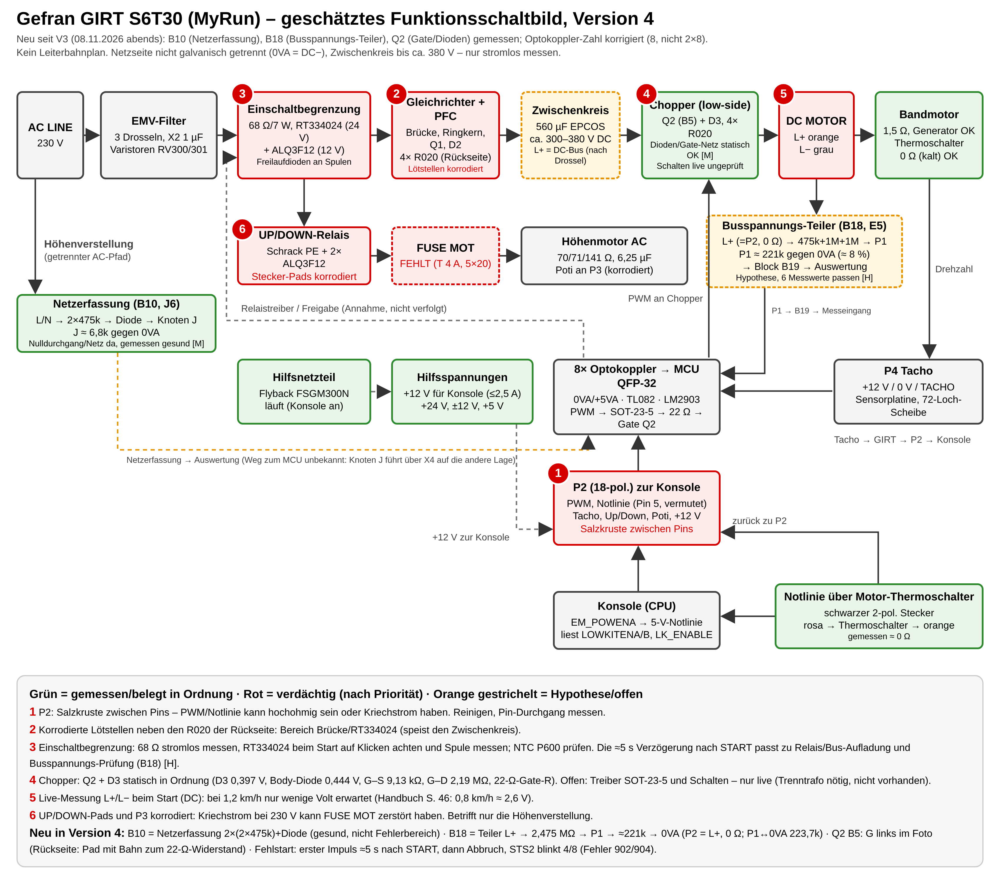
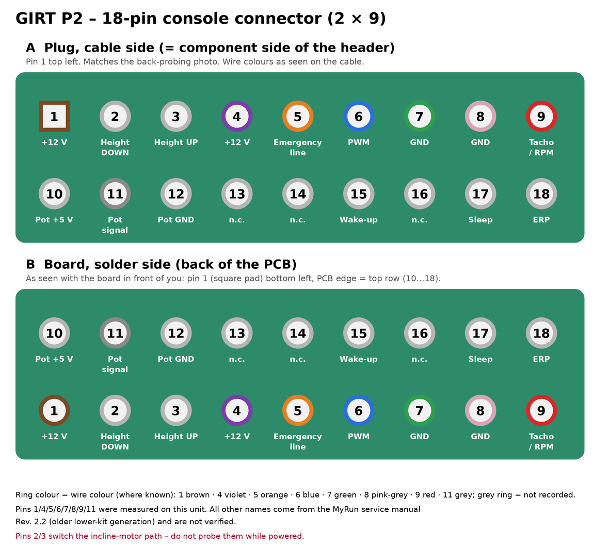
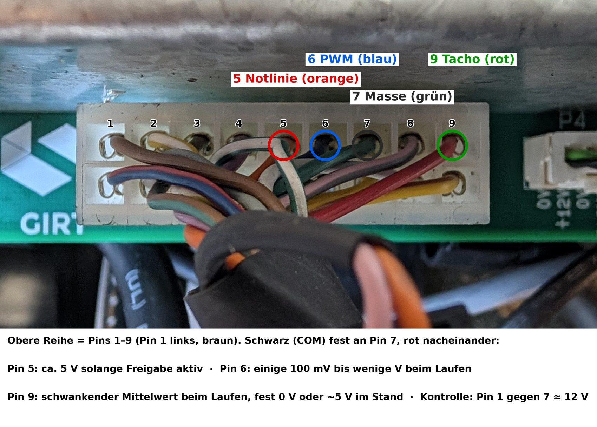
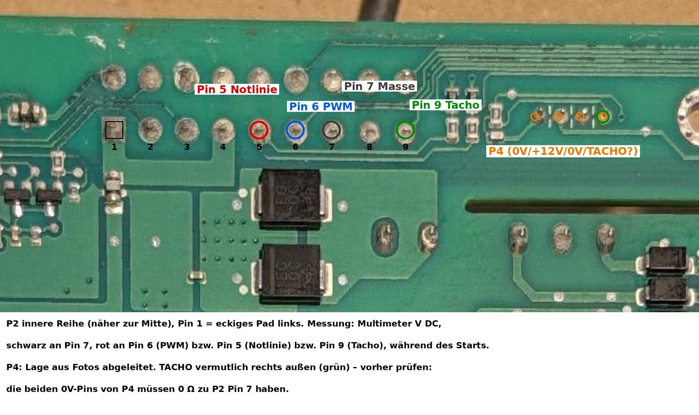
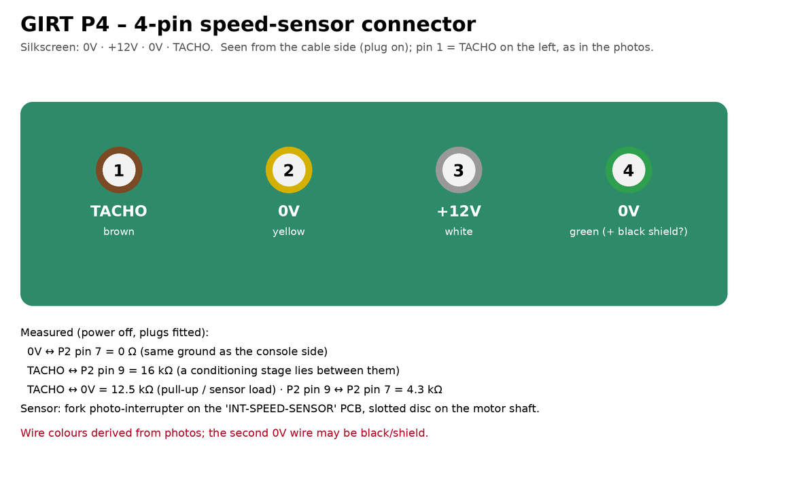
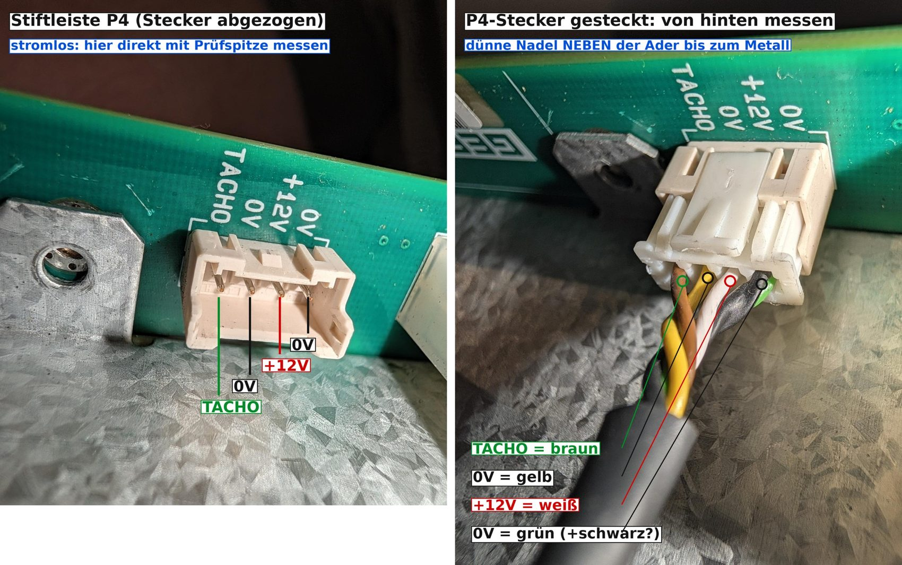
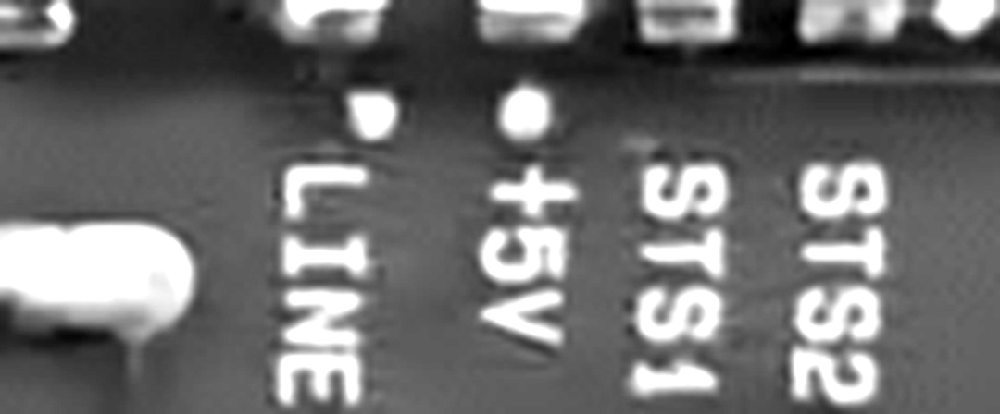
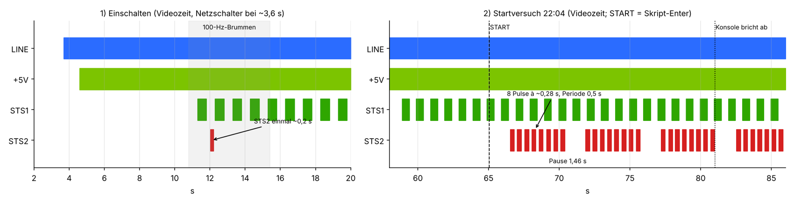
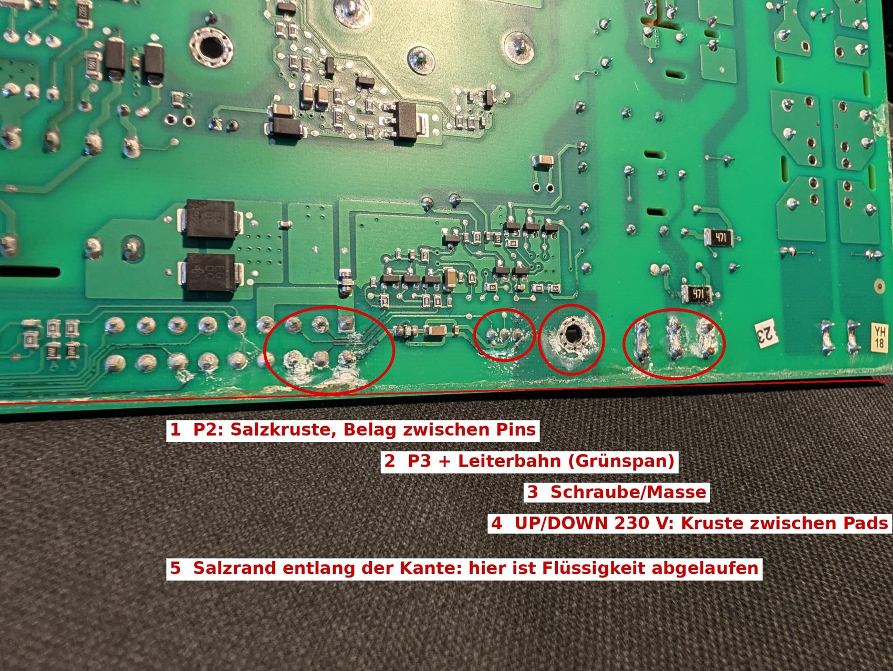
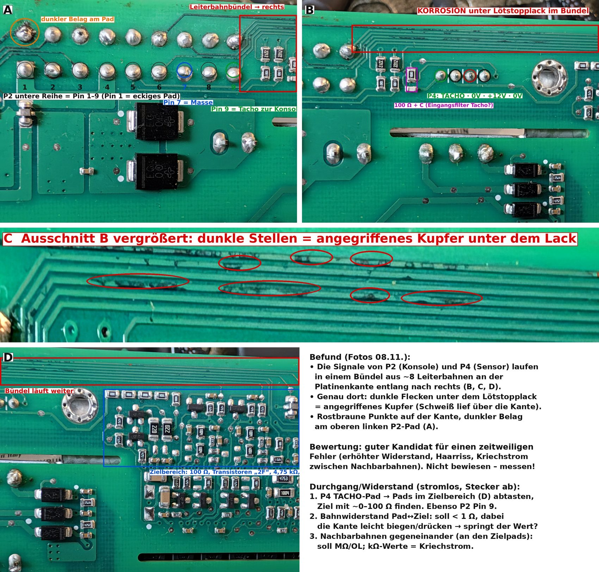

# Technogym MyRun – lower kit hardware notes (Gefran GIRT S6T30)

Reverse-engineering notes for the lower kit ("GIRT") of a used Technogym MyRun, collected while repairing one unit. There is **no schematic** for this board. Everything below is either measured on this unit, observed (photos, videos, BLE logs), taken from service manuals of related Technogym drives, or marked as inference.

> **Confidence tags** used throughout: **[M]** measured on this unit · **[O]** observed (photo, video, BLE log) · **[Man]** from a manual of this or a related drive, not verified here · **[I]** inference / hypothesis.

> **Safety.** The GIRT is **not galvanically isolated on the mains side**. The DC-link capacitor (EPCOS 560 µF) holds up to ~380 V DC. Measure it (and discharge it through a resistor if above 5 V) before touching the board. Measure live only with leads clamped on while the unit is de-energised. The voltage at *DC MOTOR* rises steeply with belt speed. Never connect anything to the debug header P70 (mains side). Never measure resistance under voltage.

Unit documented: MyRun serial `DCKA2B021008231`, console firmware `WFW0699_BA30.35167`, lower kit Gefran GIRT S6T30, part `0WR01179AG`, board `ECS2458-6` / `ESE6114`, GIRT firmware release 10.05, HW release AG. Name plate: *Gefran Drives and Motion S.r.l., Gerenzano (VA)* (the drives division is now WEG Automation Europe), main power out 0–370 V DC, 1.5 kW **[O]**.

## 1. Overview

*The block diagram is an estimate built from photos of both board sides (German labels); numbers mark the suspicion ranking at the time of drawing, not a verified fault location.*

The belt motor is a **brushed DC motor driven by a chopper from the rectified mains** (not an AC inverter drive). The console (CPU board in the handlebar) commands the GIRT over P2: an enable/emergency line, a PWM set-point and tacho feedback. The GIRT's microcontroller (QFP-32, mains side) is separated from the console side by 8 Vishay VO617A-8 optocouplers in one column (further ones elsewhere not excluded) **[O]**.

## 2. Board areas and identified parts

| Area | Parts | Function | Tag |
|---|---|---|---|
| Mains input | EMI filter with 3 chokes, X2 1 µF, varistors RV300/RV301 | filtering | [O] |
| Inrush limiter | Schrack RT334024 relay (24 V DC coil, 16 A) + white 7 W 68 Ω resistor | soft start / main relay | [O] |
| Rectifier / PFC | bridge rectifier (heat sink right), Q1, D2, 4 × R020 shunts on the back | DC link supply, input current sense | [O]/[I] |
| DC link | EPCOS B43630-C9567-M 560 µF | ~300–380 V DC | [O] |
| Motor chopper | Q2 + D3 (heat sink left, markings hidden), 4 × R020 shunts on the front near DC MOTOR | PWM motor drive, current sense | [O]/[I] |
| Temperature | NTC 10 kΩ on connector P600, screwed next to Q2: 11 kΩ at room temperature, 10.75 kΩ warmed | Q2 temperature | [M] |
| Incline path | 3 × Panasonic ALQ3F12 (12 V, 10 A), Schrack PE014012, **FUSE MOT T4A 5×20** | UP/DOWN relays and fuse for the AC incline motor | [O] |
| Aux. supply | FSGM300N (DIP-8), transformer ETI1349X4, thermistor RT700 | +24 V, +12 V iso, ±12 V, +5 V | [O] |
| Logic | MCU QFP-32, 2 × 74ACT14, LM2903 (comparator), TL082 (current sense), 24C32 EEPROM, 78L05, 2 × SOT-223 regulators | control, protection, parameters | [O] |
| Isolation | 8 × VO617A-8 (OC01–OC08, see `docs/img/optocoupler_pads.png`), CPC1017N (OptoMOS) | console ↔ mains-side separation | [O] |
| LEDs | LINE (blue), +5V (green), STS1 (green), STS2 (red) | see section 7 | [O] |

Resistor code `4753` on the SMD resistors of the measuring chains means **475 kΩ** (not 47.5 kΩ).

## 3. Connectors

All connectors sit on the board edge on the solder side of the PCB. The edge collects sweat and is corroded (section 9).

| Designator | Purpose | Notes | Tag |
|---|---|---|---|
| **P2** | 18-pin connector to the console | section 3.1 | [M]/[Man] |
| **P4** | 4-pin speed sensor (TACHO / 0V / +12V / 0V) | section 3.2 | [M] |
| **DC MOTOR** | blade terminals L+ (orange wire) / L− (grey wire) to the belt motor | 0 V while the GIRT is locked; 12.4 V DC at 1.2 km/h unloaded (good run) | [M] |
| **UP/DOWN** | 230 V AC to the incline motor via relays and FUSE MOT | the fuse was missing (glass body gone); replaced with T4A/250 V ceramic, incline works again | [O] |
| **P3** | 3 pads next to the earth screw | purpose not confirmed; assumed incline potentiometer | [I] |
| **P600** | NTC on Q2 | 10 kΩ NTC | [M] |
| **P70** | debug header | **mains side – do not connect** | [O] |
| thermal loop | black 2-pin inline plug on the motor cable | pink wire (from the P2 cable bundle) → motor thermal switch → orange wire → **P2 pin 5**; ≈0 Ω when cold | [M] |
| Mains inlet | 230 V AC | designator not recorded | – |

### 3.1 P2 – console connector (18 pin, 2 × 9)

| Pin | Signal | Wire | Observation | Tag |
|---|---|---|---|---|
| 1 | +12 V console supply | brown | 1 ↔ 4 = 0 Ω | [M] |
| 2 | incline DOWN | – | | [Man] |
| 3 | incline UP | – | | [Man] |
| 4 | +12 V console supply | violet | 1 ↔ 4 = 0 Ω | [M] |
| 5 | emergency / enable line | orange | 4.55 V at idle and at start; runs through the motor thermal switch | [M] |
| 6 | PWM set-point | blue | 0 V at idle, ≈0.5 V average during start (console reports 0.077–0.13 %) | [M] |
| 7 | GND | green | 7 ↔ 8 = 0 Ω; same ground as P4 0V | [M] |
| 8 | GND | pink-grey | | [M] |
| 9 | tacho / RPM | red | ≈0.5 V average, changes when the belt moves; 4.3 kΩ to pin 7 (power off); 16 kΩ to P4 TACHO | [M] |
| 10 | incline pot +5 V | – | | [Man] |
| 11 | incline pot signal | grey | ≈0.4 V | [M] |
| 12 | incline pot GND | – | | [Man] |
| 13, 14, 16 | not used | – | | [Man] |
| 15 | wake-up | – | expected 0 → ≈3 V → 0 when the belt is switched on (not the mains switch) | [Man] |
| 17 | sleep | – | | [Man] |
| 18 | ERP | – | | [Man] |

The [Man] names come from the MyRun service manual Rev. 2.2, which describes an older lower-kit generation. The wire colours matched for every pin that was checked.

**Orientation.** View A of the figure is the plug seen from the cable side (as in the photo below): pin 1 top left, 1–9 on the top row, 10–18 on the bottom row. View B is the board seen from the solder side, rotated the way it usually lies on the bench: pin 1 (square pad) bottom left, pins 1–9 on the inner row, pins 10–18 on the row at the PCB edge (top).

*P2 plug from the cable side with the measurement pins marked (German labels).*

*Solder side of the board, same orientation as view B: P2 inner row (pins 1–9, pin 1 = square pad at the left) and the four P4 pads on the right.*

### 3.2 P4 – speed sensor

*Left: header with the plug removed. Right: plug from behind with the wire colours. German labels.*

The sensor is a fork photo-interrupter (marking "1041" / "NXO") on a small PCB labelled `INT-SPEED-SENSOR`, with a finely slotted disc on the motor shaft **[O]**. The encoder frequency reported by the console (`@RENC#`) is about 250 Hz per km/h of belt speed (300–310 Hz at 1.2 km/h) **[M]**. The tacho signal passes a conditioning stage on the GIRT before it reaches P2 pin 9 **[M]**.

## 4. Console ↔ GIRT signals

`@DUMPIO#` (BLE text channel, see the README) lists the I/O lines between console and lower kit:

| Signal | Direction (console view) | Idle / ready | Notes |
|---|---|---|---|
| EM_ENGAGE | out | 0 | |
| EM_POWENA | out | 1 | console asks for power; the next four inputs follow this output |
| EM_WATCHD | out | 1 | watchdog |
| LK_SL_WRK | out | 1 | |
| EM_STATUS | in | 1 | follows EM_POWENA, **not** the GIRT fault state |
| LK_PW_ENABLE | in | 1 | |
| ACC_WK_SENSOR | in | 1 | dropped to 0 for ≈6 s once while idle |
| UNFOLD_NC, DSENSOR_B | in | 1 | |
| LOWKITENA / LOWKITENB | in | 1 / 1 | follow EM_POWENA |
| LK_ENABLE | in | 1 | follows EM_POWENA |
| PWM_MOTOR | PWM | 0 | ≈5400–5550 in a good 1.2 km/h run, 8526 when the console pushes harder in a failed start |

Other read-only BLE values: `@RPWM#` (PWM %, 0.085 % constant in a good run), `@RENC#` (encoder Hz → km/h), `@STATUS#` (state machine, `MeasSpeed`), `@RERRORLOG#`, `@RSTAT#` (usage), `@RRUNDETMINSP#` (runner-detection threshold, 3.0 km/h on this unit).

The FTMS Treadmill Data speed field (0x2ACD) is the **set-point**, not the measured speed; it stays at the set value while the belt is stuck. Real speed: `@RENC#` / `MeasSpeed`.

## 5. Fault behaviour (summary)

- Console error codes seen: HF900, HF901, HF902, HF904 (hardware fault after the console loses the speed signal).
- Typical sequence in a failed start **[O]**: START accepted → console raises PWM → encoder stays at 0 Hz, `MeasSpeed` 0 → after ≈7 s EM_POWENA/EM_STATUS/LOWKITENA/B/LK_ENABLE drop (they follow the console output) → console aborts after ≈16 s → `QSHardwareFault` → new HF904.
- The GIRT **does not drive the motor** in that state: 0 V at DC MOTOR (generator voltage is visible when the shaft is turned by hand, so the motor winding is fine).
- The GIRT locks and starts the STS2 blink code within about 1.5 s (11/07 22:04) to 5 s (11/08 13:26, video synchronised to the BLE log, ±0.3 s) after START, and stays locked until it is fully de-energised. In the 11/08 run the first STS2 pulse came about 1.3 s *before* the console dropped the enable lines, so the GIRT notices the fault before the console does.
- Failed start 11/08 13:26 (belt not moving, multimeter on V DC at DC MOTOR, MAX hold active according to the user, not verifiable in the video because of poor display lighting; bench test on a 9 V block: first value after ≈0.5 s tap, full 9.2 V after ≈1 s): display stayed at 0.0 V from START to START + 8 s (4 frames/s), so no voltage of ≳0.5 s duration at the motor output; the MAX capture is slow, so shorter pulses (<0.5 s) are not excluded until a pulse-length calibration is done. Console PWM request rose 0.077 → 0.099 → 0.143 % while encoder and `MeasSpeed` stayed 0; PWM_MOTOR 9366 at the first enable drop and 5046 in the second attempt (same value as 11/07). New error-log entry **902** (not 904).
- Good run (17:18, 07.11.): belt ran 95 s at 1.2 km/h, encoder 300–310 Hz, PWM 0.085 %, 12.38–12.41 V DC at DC MOTOR.
- Other values: motor winding 1.5–1.6 Ω over more than 16 rotor positions, thermal switch ≈0 Ω, usage counters from `@RSTAT#`: ≈1390 h powered, ≈342 h belt, ≈3719 km.

Technogym driver codes (same numbering in four drive generations **[Man]**): 01 OH, 02 OC, 03 UU, 04 OU, 05 ST (serial timeout), 06 PE (EEPROM), 07 EdC1 (incline-motor encoder), **08 belt-motor encoder error**, 09 OtM (motor thermal switch), 10 Oli, 11 OLm, 12 OLr. The mapping "STS2 blinks 8 times = code 08 = encoder" is the most likely reading **[I]** but unproven; no other documented board blinks codes on its STS LED.

## 6. Suspected fault area (status of the investigation)

| Hypothesis | Rating |
|---|---|
| Intermittent contact / corrosion in the signal or monitoring path on the GIRT between P2/P4 and the optocoupler/MCU area | most likely [I] |
| Power stage / drive (Q2, D3, shunts, gate drive) | possible [I] |
| Motor brushes / commutator | unlikely: 342 h of belt time, but not yet opened and checked |
| Speed sensor / cable | unlikely: mechanics fine, signal reaches P2 pin 9 |

Open measurements: MAX pulse-length calibration on the 9 V block (taps of 0.1/0.2/0.3 s), the voltage at DC MOTOR during a fresh failed start after a complete power-off, pad-to-pad continuity of the P2/P4 traces towards the logic area, leakage to neighbouring traces, and a check of the brushes and commutator.

## 7. LEDs (rear of the board, between D3 and Q2)

Silkscreen: `LINE`, `+5V`, `STS1`, `STS2`.

| State | LINE | +5V | STS1 | STS2 |
|---|---|---|---|---|
| Boot | on at t0 | on at +0.9 s | dark until +7.6 s, then 1 Hz | one 0.2 s flash at +8.3 s |
| Ready | on | on | 1 Hz (0.5 s on / 0.47 s off) | off |
| Running | on | on | steady on | off |
| Fault (locked) | on | on | 1 Hz | N pulses (≈0.27 s on, 0.5 s period), ≈1.4 s pause, then repeat; N = 8 or 4 so far, see below |

Observed fault blink codes (same pulse timing, different count):

| Date / run | Pulses per group | Group period | Error log entry | First pulse after START |
|---|---|---|---|---|
| 11/07 17:30 and 22:04 | 8 | 5.33 s | 904 | ≤ 1.5 s |
| 11/08 13:26 | 4 | 3.33 s (pause 1.53 s) | 902 | ≈ 5 s |

Two data points only. A possible reading **[I]**: the pulse count is the drive's error number. With the Technogym numbering shared by four drive generations, 08 is *belt-motor encoder error* and 04 is *DC-bus over-voltage (OU)*. In both cases the motor output stayed at 0 V, so the GIRT may be switching its output off for different reasons (or reporting different consequences of one root cause). Noting pulse count and HF number at every failed start will show whether the mapping holds. If OU is real, the voltage measuring chains (four 475 kΩ resistors with UJ12 diodes, assumed to sense the DC link) become the first suspects.

Frame-by-frame timing from phone video **[O]**:

For comparison: on the WEG TPD500 `STS1`/`STS2` are µC status LEDs (boot = asymmetric, normal = symmetric 1 s blink) and carry no error code. The GIRT evidently uses STS2 as its own fault indicator.

## 8. Repairs and work done on this unit

- Incline: missing FUSE MOT replaced (T4A/250 V ceramic, 5×20). Incline test 0 → 2 → 0 % passes.
- Cleaning of salt/sweat residue on the connector edge (isopropanol / water / isopropanol).
- Re-soldered: P2 (all 18 pins), DC MOTOR, UP/DOWN, RT334024 + 68 Ω resistor, bridge rectifier, heat-sink contacts of Q2/D2/D3, all four 4753 resistors with their UJ12 diodes and other suspicious joints. Afterwards the belt ran 95 s once without failing, but the fault came back, so it is not cured.

## 9. Corrosion findings

*Salt crust between the P2 pins, on P3, at the earth screw and between the UP/DOWN pads; a salt line runs along the whole edge (German labels).*

The P2/P4 signals run as a bundle of about 8 traces along the top board edge towards the driver/logic area (100 Ω resistors, "2F" transistors, 4.75 kΩ, 22 Ω). Under the solder mask there are dark spots (corroded copper), rust dots at the edge and a dark deposit on one upper-row P2 pad **[O]**. **Measured 11/08 (13:40):** all P2 and P4 pads on the solder side show 0.3–0.5 Ω to the next contact, with 0.2–0.4 Ω for the probe tips touching each other, so each trace is continuous to its first component pad (at most ≈0.1–0.2 Ω of trace resistance). That makes an *open* corroded trace unlikely; an intermittent contact under pressure, leakage between neighbouring traces and faults behind the first component are not excluded. Still open: whether the values stay stable when the edge is pressed or bent, and the neighbour-trace checks (OL / MΩ expected).

Repair idea if a trace is bad: 30 AWG wire-wrap bridge pad to pad, then seal with UV solder mask or protective lacquer.

## 10. Sources

Service manuals consulted: MyRun Rev. 2.2 (FR, 2016); Technogym Excite Run 500/700/900 Rev. 1.3; Run Personal + Unity Rev. 4.1; Jog Now Excite+ 700; Skillrun Unity 7000 Technical Service Guide Rev. 6.0; WEG TPD500 instruction manual. Their drives are older or different hardware; only the points tagged [Man] are taken over, and the manuals never describe the HF901–HF904 codes or the STS LEDs of this board.

## 11. Disclaimer

Private, non-commercial repair documentation, provided as is, without warranty. It is not affiliated with or endorsed by Technogym, Gefran or WEG; product and company names belong to their owners and are used only to identify the hardware. No manufacturer documents, firmware or schematics are reproduced; all content comes from measurements, photos and logs of one lawfully acquired unit, plus short paraphrased facts from the cited manuals. Working on a mains-powered, non-isolated board can be lethal – do so only if you are qualified and follow the safety notes above.
