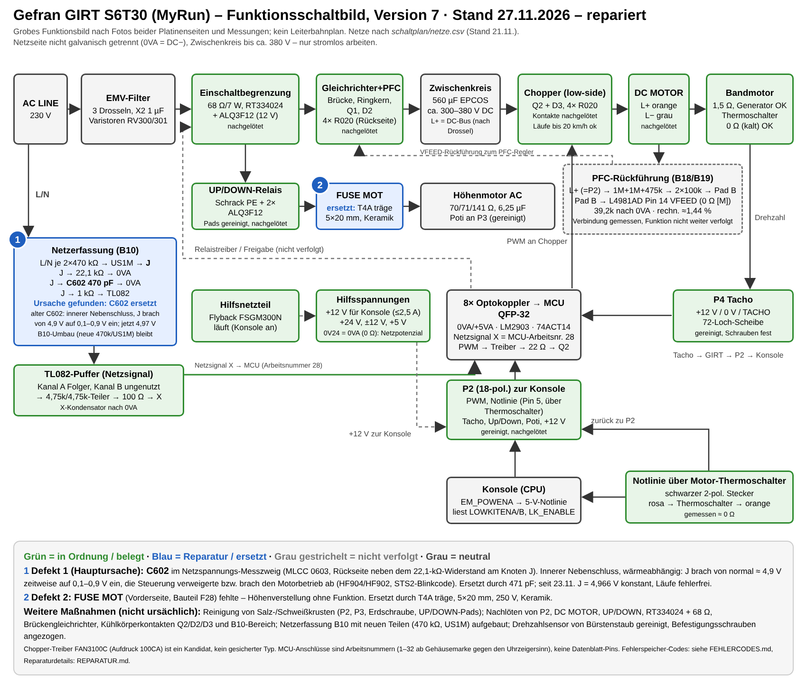
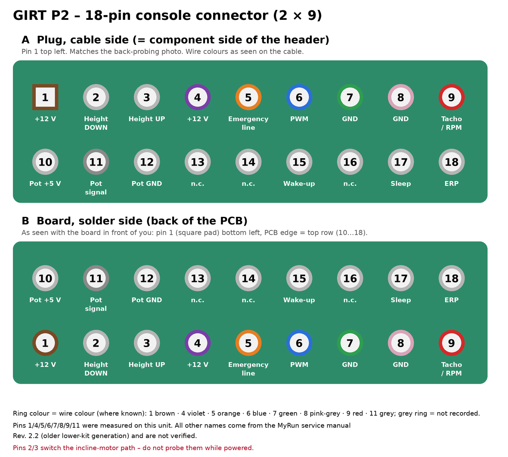
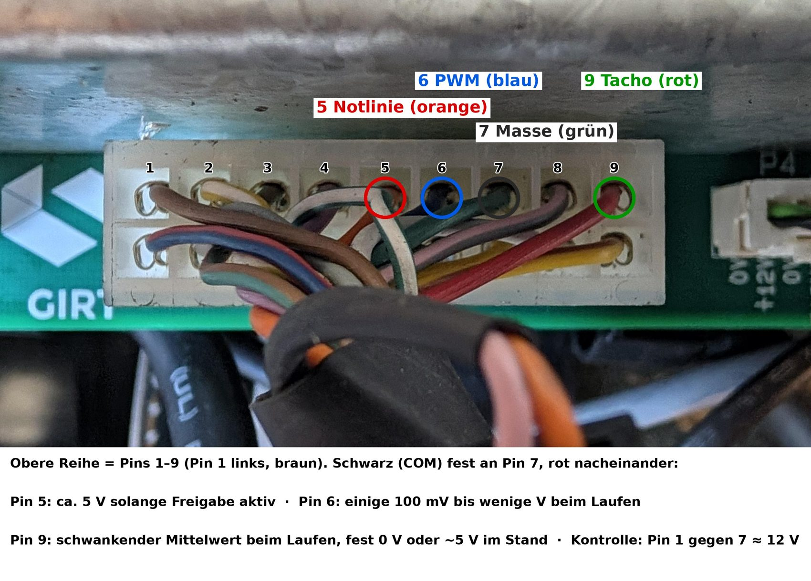
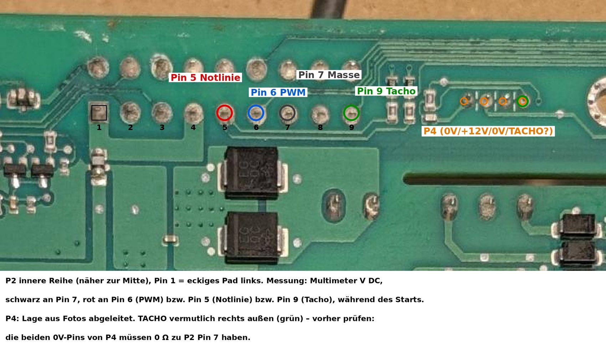
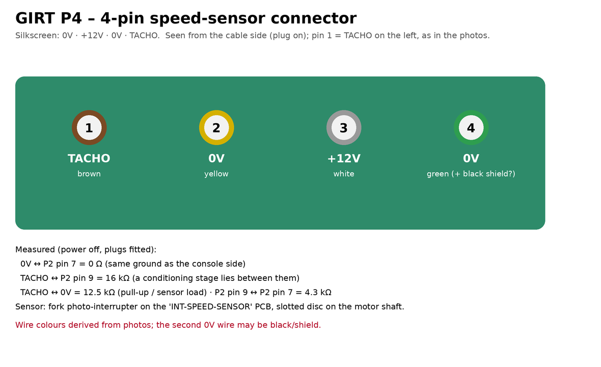
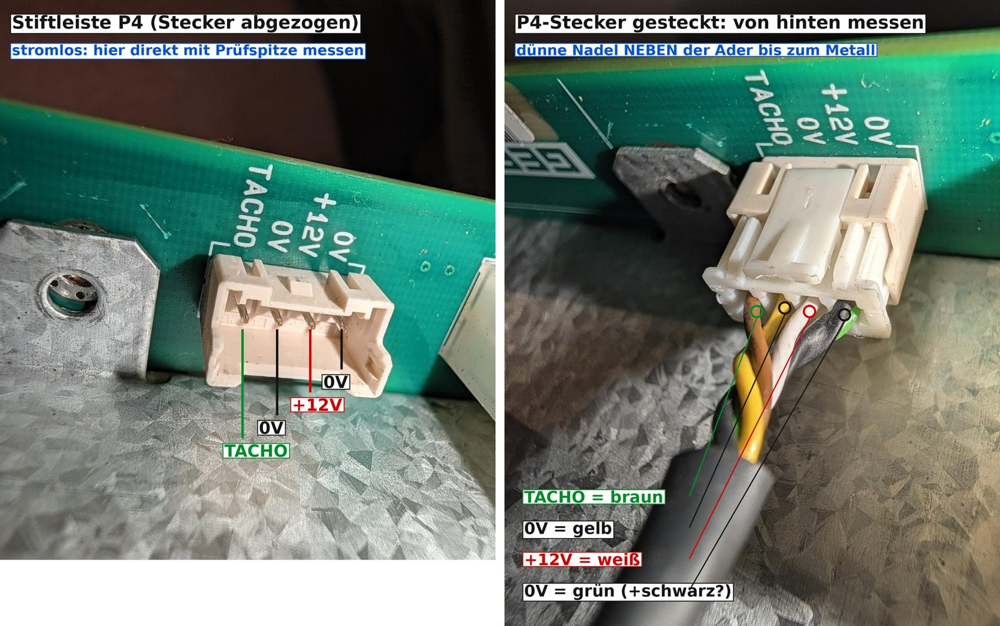
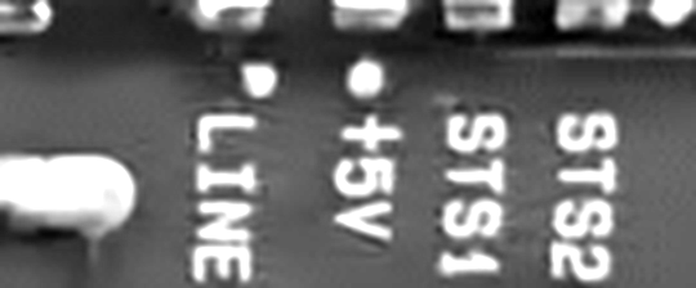
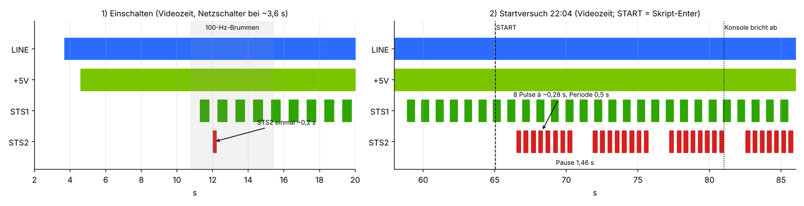
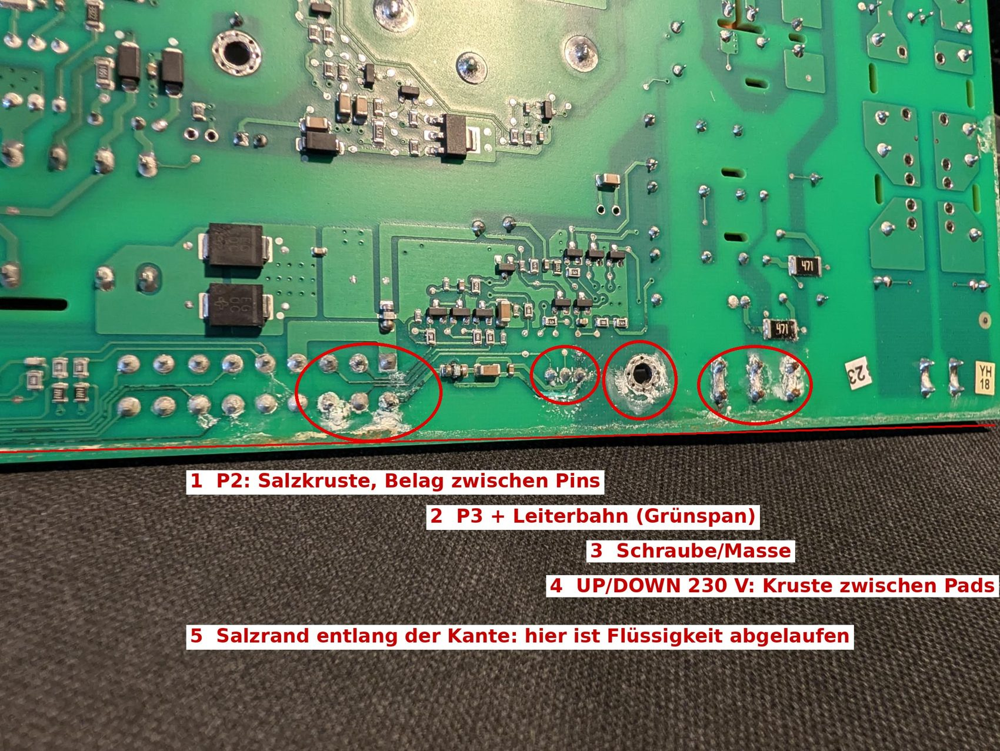
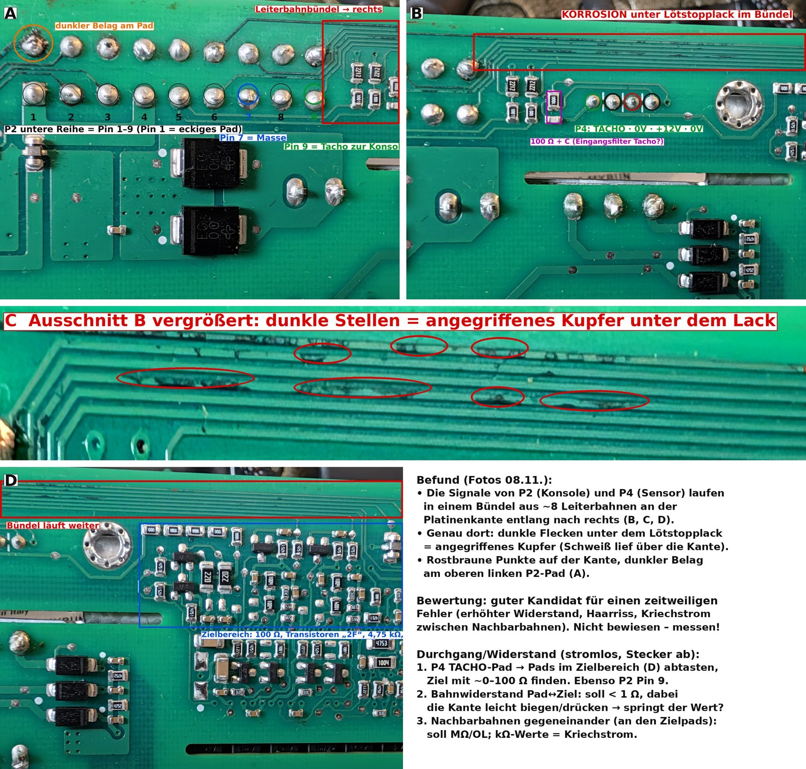

# Technogym MyRun – Hardware-Dokumentation des Unterteils (Gefran GIRT S6T30)

Hardware-Notizen zur Unterteil-Steuerung („GIRT“) eines gebrauchten Technogym MyRun, entstanden bei der Reparatur eines einzelnen Geräts. Ein Herstellerschaltplan liegt nicht vor; der [rekonstruierte Teilschaltplan](schaltplan/README.md) dokumentiert die bekannten Netze. Alles Folgende ist an diesem Gerät gemessen, beobachtet (Fotos, Videos, BLE-Logs), aus Servicehandbüchern verwandter Technogym-Antriebe übernommen oder als Ableitung gekennzeichnet. Die Reparatur selbst steht in [REPARATUR.md](REPARATUR.md) ([PDF](REPARATUR.pdf)), die Fehlermeldungen in [FEHLERCODES.md](FEHLERCODES.md). Wie sich Raster, Bereichs-IDs (F/B), Schaltplan-Referenzen und Aufdrucke zueinander verhalten, steht in [BAUTEILE.md](BAUTEILE.md).

> **Belegstufen:** **[M]** am Gerät gemessen · **[O]** beobachtet (Foto, Video, BLE-Log) · **[Man]** aus dem Handbuch dieses oder eines verwandten Antriebs, hier nicht verifiziert · **[I]** Ableitung · **[H]** Hypothese.

> **Sicherheit.** Die Netzseite der GIRT ist **nicht galvanisch getrennt**. Der Zwischenkreis-Elko (EPCOS 560 µF) hält bis ca. 380 V DC. Vor jeder Arbeit an der Platine messen und bei mehr als 5 V über einen Widerstand entladen. Nur stromlos arbeiten; Messleitungen bei abgeschaltetem Gerät anklemmen. Die Spannung an *DC MOTOR* steigt mit der Bandgeschwindigkeit steil an. An die Debug-Buchse P70 (Netzseite) nichts anschließen. Widerstände nie unter Spannung messen.

Dokumentiertes Gerät: MyRun, Seriennummer `DCKA2B021008231`, Konsolen-Firmware `WFW0699_BA30.35167`, Unterteil Gefran GIRT S6T30, Teilenummer `0WR01179AG`, Platine `ECS2458-6` / `ESE6114`, GIRT-Firmware 10.05, Hardware-Stand AG. Typenschild: *Gefran Drives and Motion S.r.l., Gerenzano (VA)* (die Antriebssparte gehört heute zu WEG Automation Europe), Leistungsausgang 0–370 V DC, 1,5 kW **[O]**.

## 1. Überblick

*Das Blockdiagramm ist eine grobe Schätzung aus Fotos beider Platinenseiten und Messungen, kein Leiterbahnplan. Grün: in Ordnung/belegt, blau: repariert/ersetzt, grau gestrichelt: nicht weiter verfolgt.*

Der Bandmotor ist ein **Gleichstrom-Bürstenmotor, der über einen Chopper aus der gleichgerichteten Netzspannung gespeist wird** (kein Wechselstrom-Umrichter). Die Konsole (CPU-Platine im Lenker) steuert die GIRT über P2 an: Freigabe-/Notlinie, PWM-Sollwert und Tacho-Rückmeldung. Der Mikrocontroller der GIRT (QFP-32, Netzseite) ist von der Konsolenseite durch 8 Vishay VO617A-8 Optokoppler in einer Spalte getrennt (weitere an anderer Stelle nicht ausgeschlossen) **[O]**. Die Netzspannung wird über einen eigenen Messzweig (Bereich B10, Knoten J) erfasst und als Messsignal zum Mikrocontroller geführt (Abschnitt 2.1).

## 2. Baugruppen und identifizierte Bauteile

| Bereich | Bauteile | Funktion | Beleg |
|---|---|---|---|
| Netzeingang | EMV-Filter mit 3 Drosseln, X2 1 µF, Varistoren RV300/RV301 | Filterung | [O] |
| Einschaltbegrenzung | Schrack RT334024 (Relais, 24-V-Spule, 16 A) + weißer 7-W-Widerstand 68 Ω | Sanftanlauf / Hauptrelais | [O] |
| Gleichrichter / PFC | Brückengleichrichter (Kühlkörper rechts), Q1, D2, 4 × R020-Shunts auf der Rückseite, PFC-Regler L4981AD | Speisung des Zwischenkreises, Eingangsstrommessung | [O]/[I] |
| Zwischenkreis | EPCOS B43630-C9567-M7, 560 µF ±20 %, **400 V**, Klimakategorie 25/085/56 (**85 °C**), Datumscode 04.21 | ca. 300–380 V DC | [O] |
| Motor-Chopper | Q2 + D3 (Kühlkörper links), 4 × R020-Shunts auf der Vorderseite nahe DC MOTOR; Gate-Treiber, Kandidat FAN3100C (Aufdruck 100CA) | PWM-Motoransteuerung, Strommessung | [O]/[I] |
| Temperatur | NTC 10 kΩ an Stecker P600, neben Q2 verschraubt: 11 kΩ bei Raumtemperatur, 10,75 kΩ erwärmt | Temperatur Q2 | [M] |
| Relaisgruppe UP/DOWN | 3 × Panasonic ALQ3F12 (12 V, 10 A), Schrack PE014012, **FUSE MOT T4A 5×20** (Vorderseite, Feld J2, Fotoatlas-ID F28) | Höhenverstellung (UP/DOWN) und weitere Freigaben; einzelne Relaiskontakte nicht durchgemessen | [O]/[I] |
| Hilfsnetzteil | FSGM300N (DIP-8), Übertrager ETI1349X4, Thermistor RT700 | +24 V, +12 V (Konsole), ±12 V, +5 V | [O] |
| Logik | MCU QFP-32, 2 × 74ACT14, LM2903 (Komparator), **TL082 (Puffer des Netzspannungs-Messsignals)**, EEPROM 24C32, 78L05, 2 × SOT-223-Regler | Steuerung, Schutz, Parameter | [O] |
| Potentialtrennung | 8 × VO617A-8 (OC01–OC08, siehe `img/optocoupler_pads.png`), CPC1017N (OptoMOS) | Trennung Konsole ↔ Netzseite | [O] |
| LEDs | LINE (blau), +5V (grün), STS1 (grün), STS2 (rot) | siehe Abschnitt 6 | [O] |

Der Widerstandsaufdruck `4753` auf den SMD-Widerständen der Messketten bedeutet **475 kΩ** (nicht 47,5 kΩ).

### 2.1 Netzerfassung (B10) und Messsignal zum Mikrocontroller

Die Netzspannung wird über zwei Zweige (L und N) erfasst; die Netze stammen aus dem [Gesamtschaltplan](schaltplan/README.md) (Stand 21.11.2026). Im aktuellen Aufbau gilt je Seite: Faston-Pad – 470 kΩ – 470 kΩ – Diode US1M – **Knoten J** (Kathoden beider Seiten). Am Knoten J liegen:

- 22,1 kΩ („2212“) nach 0VA,
- der Kondensator **C602** (ca. 470 pF) nach 0VA, parallel zum 22,1-kΩ-Widerstand,
- 1 kΩ („1001“) zum nichtinvertierenden Eingang (Pin 3) des **TL082**, Kanal A, der als Spannungsfolger arbeitet (Kanal B ungenutzt).

Vom TL082-Ausgang führt das Signal über einen 4,75-kΩ/4,75-kΩ-Teiler und einen 100-Ω-Widerstand zum Netz „X“, an dem ein Kondensator nach 0VA liegt, und weiter zum MCU-Anschluss mit der **Arbeitsnummer 28** (Zählung 1–32 ab Gehäusemarke gegen den Uhrzeigersinn, siehe [mcu_pins](mcu_pins/README.md); keine Datenblatt-Pins, MCU-Typ nicht identifiziert). Bei ca. 238 V Netzspannung liegt J bei ≈ 4,9 V DC **[M]**. C602 bildet mit der Quellimpedanz von ca. 21 kΩ einen Tiefpass (Grenzfrequenz ≈ 16 kHz) zur Entstörung des Messsignals **[I]**. Dieser Kondensator war die Hauptursache der Fehlstarts (siehe Abschnitt 7).

## 3. Steckverbinder

Alle Steckverbinder sitzen am Platinenrand auf der Lötseite. Der Rand war durch Schweiß/Salz korrodiert (Abschnitt 8) und ist gereinigt.

| Bezeichnung | Zweck | Anmerkungen | Beleg |
|---|---|---|---|
| **P2** | 18-poliger Anschluss zur Konsole | Abschnitt 3.1 | [M]/[Man] |
| **P4** | 4-poliger Drehzahlsensor (TACHO / 0V / +12V / 0V) | Abschnitt 3.2 | [M] |
| **DC MOTOR** | Flachstecker L+ (orange) / L− (grau) zum Bandmotor | 0 V bei gesperrter GIRT; 12,4 V DC bei 1,2 km/h unbelastet (guter Lauf) | [M] |
| **UP/DOWN** | 230 V AC zum Höhenmotor über Relais und FUSE MOT | Sicherung war nicht vorhanden, ersetzt durch T4A/250 V Keramik | [O] |
| **P3** | 3 Pads neben der Erdschraube | Zweck nicht bestätigt, vermutlich Höhen-Poti | [I] |
| **P600** | NTC an Q2 | 10-kΩ-NTC | [M] |
| **P70** | Debug-Buchse | **Netzseite – nicht anschließen** | [O] |
| Thermoschalter-Schleife | schwarzer 2-poliger Zwischenstecker am Motorkabel | rosa Ader (aus dem P2-Kabelbaum) → Thermoschalter des Motors → orange Ader → **P2 Pin 5**; ≈ 0 Ω kalt | [M] |
| Netzeingang | 230 V AC | Bezeichnung nicht erfasst | – |

### 3.1 P2 – Konsolenanschluss (18-polig, 2 × 9)

| Pin | Signal | Ader | Beobachtung | Beleg |
|---|---|---|---|---|
| 1 | +12 V Konsolenversorgung | braun | 1 ↔ 4 = 0 Ω | [M] |
| 2 | Höhe DOWN | – | | [Man] |
| 3 | Höhe UP | – | | [Man] |
| 4 | +12 V Konsolenversorgung | violett | 1 ↔ 4 = 0 Ω | [M] |
| 5 | Not-/Freigabelinie | orange | 4,55 V im Ruhezustand und beim Start; läuft über den Motor-Thermoschalter | [M] |
| 6 | PWM-Sollwert | blau | 0 V im Ruhezustand, ≈ 0,5 V Mittelwert beim Start (Konsole meldet 0,077–0,13 %) | [M] |
| 7 | GND | grün | 7 ↔ 8 = 0 Ω; gleiche Masse wie P4 0V | [M] |
| 8 | GND | rosa-grau | | [M] |
| 9 | Tacho / Drehzahl | rot | ≈ 0,5 V Mittelwert, ändert sich bei Bandbewegung; 4,3 kΩ gegen Pin 7 (stromlos); 16 kΩ zu P4 TACHO | [M] |
| 10 | Höhen-Poti +5 V | – | | [Man] |
| 11 | Höhen-Poti Signal | grau | ≈ 0,4 V | [M] |
| 12 | Höhen-Poti GND | – | | [Man] |
| 13, 14, 16 | nicht belegt | – | | [Man] |
| 15 | Wake-up | – | erwartet 0 → ≈ 3 V → 0 beim Einschalten des Bandes (nicht der Netzschalter) | [Man] |
| 17 | Sleep | – | | [Man] |
| 18 | ERP | – | | [Man] |

Die [Man]-Bezeichnungen stammen aus dem MyRun-Servicehandbuch Rev. 2.2, das eine ältere Unterteil-Generation beschreibt. Die Aderfarben stimmten bei jedem geprüften Pin.

**Orientierung.** Ansicht A der Abbildung zeigt den Stecker von der Kabelseite (wie im Foto unten): Pin 1 oben links, 1–9 obere Reihe, 10–18 untere Reihe. Ansicht B zeigt die Platine von der Lötseite, so gedreht, wie sie meist auf dem Tisch liegt: Pin 1 (quadratisches Pad) unten links, Pins 1–9 in der inneren Reihe, Pins 10–18 in der Reihe am Platinenrand (oben).

*P2-Stecker von der Kabelseite mit markierten Messpins.*

*Lötseite der Platine, Ausrichtung wie Ansicht B: P2 innere Reihe (Pins 1–9, Pin 1 = quadratisches Pad links) und die vier P4-Pads rechts.*

### 3.2 P4 – Drehzahlsensor

*Links: Stiftleiste ohne Stecker. Rechts: Stecker von hinten mit Aderfarben.*

Der Sensor ist eine Gabellichtschranke (Aufdruck „1041“ / „NXO“) auf einer kleinen Platine `INT-SPEED-SENSOR` mit fein geschlitzter Scheibe auf der Motorwelle **[O]**. Die von der Konsole gemeldete Encoderfrequenz (`@RENC#`) beträgt etwa 250 Hz pro km/h Bandgeschwindigkeit (300–310 Hz bei 1,2 km/h) **[M]**. Das Tachosignal durchläuft auf der GIRT eine Aufbereitungsstufe, bevor es an P2 Pin 9 anliegt **[M]**.

## 4. Konsole ↔ GIRT-Signale

`@DUMPIO#` (BLE-Textkanal, siehe README) listet die E/A-Leitungen zwischen Konsole und Unterteil:

| Signal | Richtung (Sicht der Konsole) | Ruhe / bereit | Anmerkung |
|---|---|---|---|
| EM_ENGAGE | Ausgang | 0 | |
| EM_POWENA | Ausgang | 1 | Konsole fordert Leistung an; die folgenden vier Eingänge folgen diesem Ausgang |
| EM_WATCHD | Ausgang | 1 | Watchdog |
| LK_SL_WRK | Ausgang | 1 | |
| EM_STATUS | Eingang | 1 | folgt EM_POWENA, **nicht** dem Fehlerzustand der GIRT |
| LK_PW_ENABLE | Eingang | 1 | |
| ACC_WK_SENSOR | Eingang | 1 | fiel einmal im Ruhezustand für ≈ 6 s auf 0 |
| UNFOLD_NC, DSENSOR_B | Eingang | 1 | |
| LOWKITENA / LOWKITENB | Eingang | 1 / 1 | folgen EM_POWENA |
| LK_ENABLE | Eingang | 1 | folgt EM_POWENA |
| PWM_MOTOR | PWM | 0 | ≈ 5400–5550 im guten Lauf bei 1,2 km/h, 8526 wenn die Konsole bei einem Fehlstart stärker fordert |

Weitere lesbare BLE-Werte: `@RPWM#` (PWM in %, im guten Lauf konstant 0,085 %), `@RENC#` (Encoder-Hz → km/h), `@STATUS#` (Zustandsautomat, `MeasSpeed`), `@RERRORLOG#` (Fehlerspeicher, letzte 5 Einträge), `@RSTAT#` (Nutzungszähler), `@RRUNDETMINSP#` (Schwelle der Läufererkennung, an diesem Gerät 3,0 km/h). Über BLE sind weder Temperatur noch Zwischenkreisspannung abrufbar (geratene Befehle ohne Antwort).

Das Geschwindigkeitsfeld der FTMS-Treadmill-Data (0x2ACD) ist der **Sollwert**, nicht die gemessene Geschwindigkeit; die echte Geschwindigkeit liefern `@RENC#` bzw. `MeasSpeed`.

## 5. Fehlerverhalten (Kurzfassung)

Vor der Reparatur traten Fehlstarts und Abbrüche auf: Die Konsole meldete HF904 (Start ohne Drehzahl), HF902 (Abbruch im Lauf) oder HF901 (Fehler im Wartezustand), die GIRT-LED STS2 blinkte einen Fehlercode (8× bzw. 4×) und die Relais klickten. Im Fehlstart blieb DC MOTOR bei 0 V, die Wicklung war intakt (Generatorspannung beim Drehen von Hand). Die GIRT verriegelt dann bis zum vollständigen Abschalten. Die Bedeutung der einzelnen Codes, die Blinkcodes und die Beobachtungen im Detail stehen in [FEHLERCODES.md](FEHLERCODES.md).

Weitere Werte des Geräts: Motorwicklung 1,5–1,6 Ω über mehr als 16 Rotorstellungen, Thermoschalter ≈ 0 Ω.

## 6. LEDs (Rückseite der Platine, zwischen D3 und Q2)

Siebdruck: `LINE`, `+5V`, `STS1`, `STS2`.

| Zustand | LINE | +5V | STS1 | STS2 |
|---|---|---|---|---|
| Start | an bei t0 | an bei +0,9 s | dunkel bis +7,6 s, dann 1 Hz | ein 0,2-s-Blitz bei +8,3 s |
| Bereit | an | an | 1 Hz (0,5 s an / 0,47 s aus) | aus |
| Lauf | an | an | dauerhaft an | aus |
| Fehler (verriegelt) | an | an | 1 Hz | N Impulse (≈ 0,27 s an, 0,5 s Periode), ≈ 1,4 s Pause, dann Wiederholung; N = 8 oder 4 beobachtet |

Zeitverlauf aus Handy-Videos, Bild für Bild ausgewertet **[O]**:

Zum Vergleich: Beim WEG TPD500 sind `STS1`/`STS2` Status-LEDs des Mikrocontrollers (Start = asymmetrisch, normal = symmetrisches 1-s-Blinken) ohne Fehlercode; die GIRT nutzt STS2 offenbar als eigene Fehleranzeige. Zuordnung der Blinkzahlen zu Fehlern: [FEHLERCODES.md](FEHLERCODES.md).

## 7. Reparatur

Das Gerät wurde repariert; zwei Defekte wurden gefunden, dazu kamen vorsorgliche Maßnahmen. Ausführlich in [REPARATUR.md](REPARATUR.md) ([PDF](REPARATUR.pdf)).

- **Defekt 1 – Kondensator C602 im Netzspannungs-Messzweig (Hauptursache).** SMD-Keramikkondensator (0603, ca. 470 pF) an Knoten J mit innerem Nebenschluss: J brach wärmeabhängig von ≈ 4,9 V auf 0,1–0,9 V ein; die Steuerung verweigerte vermutlich deshalb den Motorbetrieb bzw. brach ihn ab **[I]**. Nach dem Ersatz durch 471 pF ist J stabil (4,966 V, auch unter Wärme), Läufe bis 20 km/h und bei 12 % Steigung sind fehlerfrei **[M]**.
- **Defekt 2 – Sicherung FUSE MOT.** Die Feinsicherung 5 × 20 mm T4A (250 V) im 230-V-Zweig des Höhenmotors fehlte, die Höhenverstellung war ohne Funktion. Ersetzt durch eine Keramiksicherung; Steigungstest 0 → 2 → 0 % bestanden, später bis 12 %.
- **Weitere Maßnahmen (nicht als Ursache nachgewiesen):** Reinigung von Salz-/Schweißkrusten, Nachlöten mehrerer Lötstellen (P2, DC MOTOR, UP/DOWN, RT334024 + 68 Ω, Brückengleichrichter, Kühlkörperkontakte Q2/D2/D3, B10-Bereich), Neuaufbau der Netzerfassung B10 mit neuen Teilen (470 kΩ, US1M; bleibt eingebaut), Drehzahlsensor von Bürstenstaub gereinigt und lose Befestigungsschrauben am Motorgehäuse angezogen.
- Ein Ausfall am 24.11. während der Höhenverstellung hatte einen lockeren Kaltgerätestecker als Ursache (Knistern/Funken); fest gesteckt, danach fehlerfrei. Stecker und Buchse sollten geprüft und ggf. getauscht werden.

## 8. Korrosionsbefund (gereinigt)

*Salzkruste zwischen den P2-Pins, an P3, an der Erdschraube und zwischen den UP/DOWN-Pads; eine Salzlinie zieht sich über den ganzen Rand.*

Die P2/P4-Signale laufen als Bündel von etwa 8 Leiterbahnen am oberen Platinenrand zum Treiber-/Logikbereich (100-Ω-Widerstände, „2F“-Transistoren, 4,75 kΩ, 22 Ω). Unter dem Lötstopplack finden sich dunkle Stellen (korrodiertes Kupfer), Rostpunkte am Rand und ein dunkler Belag auf einem P2-Pad der oberen Reihe **[O]**. Alle P2- und P4-Pads zeigten 0,3–0,5 Ω zum nächsten Kontakt (0,2–0,4 Ω für die sich berührenden Messspitzen), jede Bahn war also bis zum ersten Bauteilpad durchgängig **[M]**. Die Krusten wurden mit Isopropanol entfernt und die Lötstellen nachgelötet. Die Korrosion war nicht die Ursache der Fehlstarts, ist aber ein Zeichen für Schweißeintrag am Platinenrand.

## 9. Alter und Nutzung des Geräts (Stand 08.11.2026)

- **Datumscodes auf der GIRT [O]:** Gefran-Aufkleber auf dem Zwischenkreis-Elko `S890A16E U12 GIRT 140421 V.10.05` = 14.04.2021; Übertrager `ETI349X4 2110 FALCO` = Woche 10/2021. Das Unterteil wurde also im Frühjahr 2021 oder später gebaut (etwa 5,5 Jahre alt). Der Aufdruck `YH 18` auf der Platinenrückseite ist ungeklärt.
- **Konsolenuhr** (`@GETDATE#`, 06.11.2026) ist auf das reale Datum gestellt und sagt nichts über das Baudatum. Die Seriennummer hat kein bekanntes Datumsformat.
- **Nutzungszähler** (`@RSTAT#`, 06.11.2026; die letzten Ziffern jeder Antwort sind eine Prüfsumme): eingeschaltet 8339 × 10 min ≈ 1390 h (Standby nur 23 × 10 min), Bandlauf 2050 × 10 min ≈ 342 h, Höhenmotor 84 min, Strecke 3719 km. Geringer Verschleiß, aber das Gerät war fast nie im Standby.

## 10. Quellen

Eingesehene Servicehandbücher: MyRun Rev. 2.2 (FR, 2016); Technogym Excite Run 500/700/900 Rev. 1.3; Run Personal + Unity Rev. 4.1; Jog Now Excite+ 700; Skillrun Unity 7000 Technical Service Guide Rev. 6.0; WEG TPD500 Instruction Manual. Deren Antriebe sind älter oder andere Hardware; nur die mit [Man] gekennzeichneten Punkte sind übernommen. Die Handbücher beschreiben weder die Codes HF901–HF904 noch die STS-LEDs dieser Platine. Die Rohprotokolle der Messungen liegen im Branch `archiv-vor-aufraeumen-2026-11-27`.

## 11. Haftungsausschluss

Private, nicht kommerzielle Reparaturdokumentation, bereitgestellt wie besehen und ohne Gewähr. Sie steht in keiner Verbindung zu Technogym, Gefran oder WEG und wird von diesen nicht unterstützt; Produkt- und Firmennamen gehören ihren Inhabern und dienen nur der Identifikation der Hardware. Es werden keine Herstellerunterlagen, Firmware oder Schaltpläne wiedergegeben; alle Inhalte stammen aus Messungen, Fotos und Logs eines rechtmäßig erworbenen Geräts sowie kurzen, sinngemäß wiedergegebenen Angaben aus den genannten Handbüchern. Arbeiten an einer netzbetriebenen, nicht getrennten Platine können lebensgefährlich sein – nur mit entsprechender Qualifikation und unter Beachtung der Sicherheitshinweise oben.
