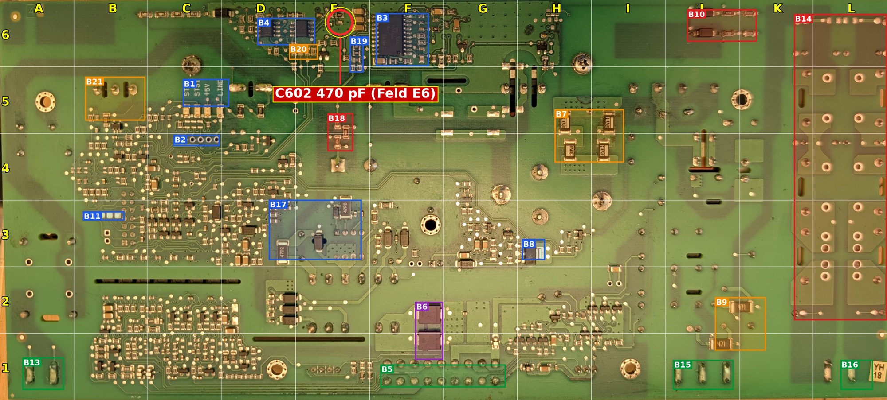
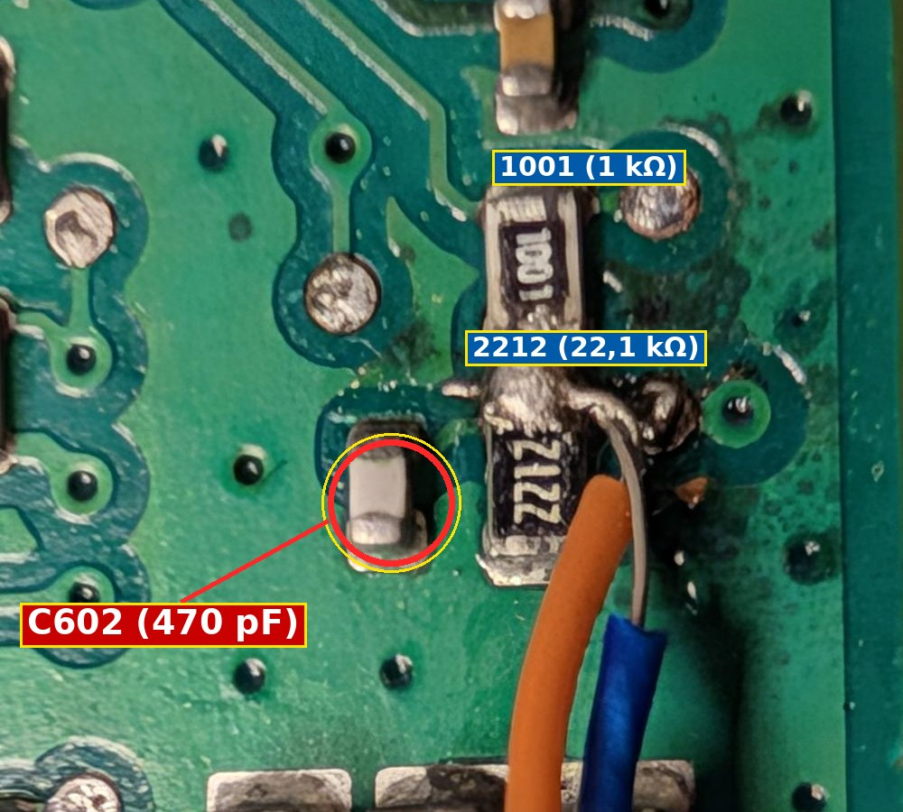
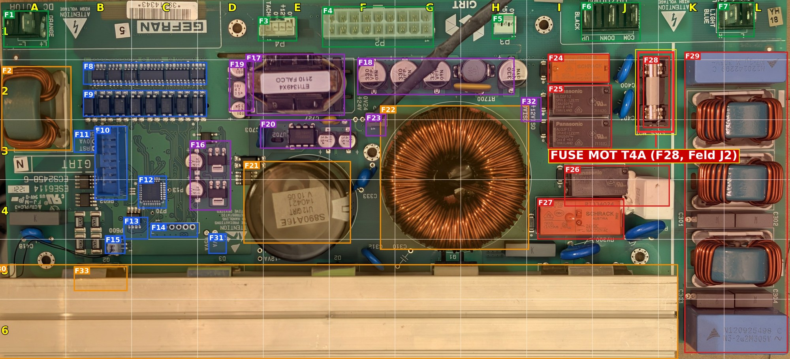
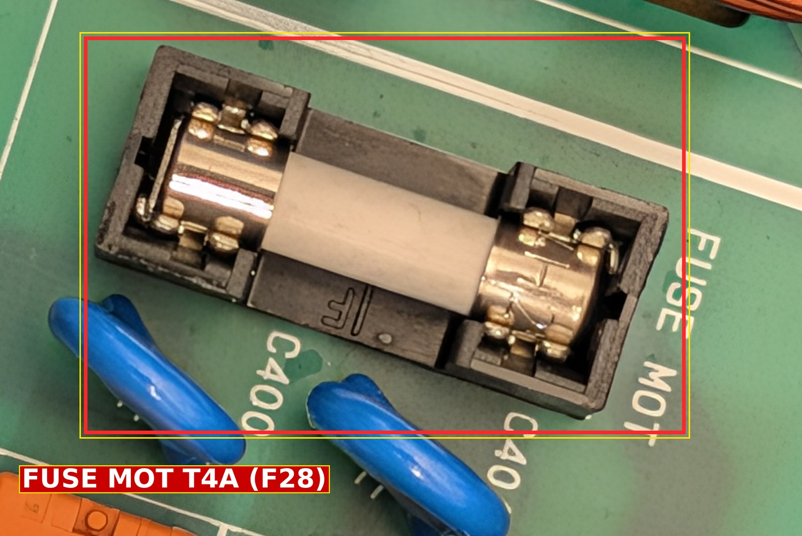

# Technogym MyRun / GIRT S6T30 – Reparatur: defekte Bauteile

Stand 27.11.2026. Gerät: Technogym MyRun, Unterteil-Steuerung Gefran GIRT S6T30 (Platine ECS2458-6).
Belegstufen: [M] gemessen, [O] beobachtet, [I] abgeleitet, [H] Hypothese.

**Symptome vorher:** Fehlstarts und Abbrüche (Konsole HF904 Start ohne Drehzahl, HF902 Abbruch im Lauf, HF901 Fehler im Wartezustand), LED STS2 der GIRT blinkt (8×, bzw. 4×), Relaisklicken; Höhenverstellung ohne Funktion.

## 1. Kondensator C602 (Hauptursache der Fehlstarts)

| | |
|---|---|
| Bauteil | SMD-Keramikkondensator (MLCC) 0603 (1,6 × 0,8 mm), ca. 470 pF (kein Aufdruck; ausgebaut kalt 0,43 nF) |
| Lage | **Rückseite** (Lötseite), Rasterfeld **E6** (Fotoatlas-Raster A–L / 1–6, Rückseite aufrecht), im oberen Randbereich neben dem Widerstand „2212“ (22,1 kΩ) und „1001“ (1 kΩ); Nachbarn: zwei SO-8 (TL082, Feld D6), SO-20 L4981 (Feld E/F6) |
| Funktion | Netzspannungs-Messzweig: Knoten J (Netz über 2 × 470 kΩ und Diode je Seite) → 22,1 kΩ nach 0VA; C602 liegt parallel dazu und bildet mit ca. 21 kΩ einen Tiefpass (≈ 16 kHz) vor dem TL082-Spannungsfolger und dem MCU-Eingang [I] |
| Fehlerbild | J normal ≈ 4,9 V DC (bei ≈ 238 V Netz). Mit dem defekten C602 brach J zeitweise auf 0,1–0,9 V ein, wärmeabhängig (Föhn: erst linear sinkend, dann Sprung) [M]. Die Steuerung wertete das vermutlich als fehlerhafte Netzversorgung und verweigerte oder brach den Motorbetrieb ab (HF904/902, STS2-Blinkcode) [I; Firmware nicht dokumentiert] |

**Nachweis [M]:** Ohne C602 kein Einbruch im Wärmetest, Läufe fehlerfrei. Ausgebauter Altteil: Kapazität schwankend 0,15–3 nF, Widerstand ca. 2 MΩ sinkend auf 150–20 kΩ (intakt: OL) – innerer Nebenschluss. Neuer Kondensator (460 pF gemessen): stabil, Widerstand OL. Nach Einbau am 23.11.: J = 4,966 V konstant, auch unter Föhn; Läufe bis 20 km/h bzw. 6,6 km/h bei 12 % Steigung; seitdem mehrere Trainings ohne Fehler (Stand 27.11.) [M/O].

**Ersatzteil:** 470 pF, 0603, ≥ 50 V, C0G/NP0 bevorzugt (X7R möglich), ±5–10 %. Eingebaut wurde 471 pF aus einem 0603-Sortiment.
**Preis (Einzelstück):** ca. 0,10–0,30 € bei Distributoren (z. B. DigiKey-Vergleichsteil 0,29 €); Großmenge ca. 0,015 € (Yageo CC0603JRNPO9BN471, ab 1000 Stück).
Quellen: [RS Components 2006499P](https://de.rs-online.com/web/p/products/2006499P) · [DigiKey CC0603FRNPO9BN471](https://www.digikey.fr/en/products/detail/yageo/CC0603FRNPO9BN471/8024989)

**Lagebegründung (E6, nicht J6):** Der Fotoatlas führt den Netz-Sense-Bereich B10 (Dioden/Widerstandsketten) auf J6; `bauteile.csv` nennt für C602 „E6 / neben 2212“. Das Makrofoto (`docs/img/j1_gegenpunkt_2212_1001.jpg`, `photos/2026-11-15/j1_gegenpunkt_uebersicht_l4981_tl082.jpg`) zeigt „2212“/„1001“ neben zwei SO-8 (TL082) und dem SO-20 mit Aufdruck L4981AP. Diese Bauteilgruppe liegt in der Übersicht oben bei D6/E6 (B4, B3); im Feld J6 gibt es keinen vergleichbaren IC. B10 ist nur über 0-Ω-Verbindung (Kathode D1 = Knoten J) mit dem Pärchen 2212/1001 verbunden. Damit ist E6 belegt; Lagegenauigkeit wie im Atlas ±1 Feld (Grenze D6/E6). Die Zuordnung „kleiner Kondensator über 2212“ = C602 stützt sich auf die Messung vom 21.11. (hängt an J, zweiter Anschluss auf 0VA) [M/F].

## 2. Sicherung FUSE MOT (Höhenverstellung)

| | |
|---|---|
| Bauteil | Feinsicherung 5 × 20 mm, T4A (träge), 250 V |
| Lage | **Vorderseite** (Bauteilseite), Rasterfeld **J2** (Bauteil-ID F28; Lage ±1 Feld), rechts oben neben dem Aufdruck „FUSE MOT“, unter den Anschlüssen UP/DOWN/COM (F6), neben den blauen Kondensatoren C400/C401 und den Relais F24/F25 |
| Funktion | Absicherung des 230-V-Zweigs zum Steigungsmotor (über Relais UP/DOWN) |
| Fehlerbild | Sicherung fehlte beim Kauf (Glaskörper weg) → Höhenverstellung ohne Funktion [O] |

**Nachweis:** Nach Ersatz durch T4A/250 V (Keramik) Steigungstest 0 → 2 → 0 % bestanden, später bis 12 % [M/O]. Mögliche Vorgeschichte: Korrosion/Kriechstrom an den UP/DOWN-Pads [H].
**Ersatzteil:** 5 × 20 mm, T4A träge, 250 V, Keramik (hohes Schaltvermögen).
**Preis (Einzelstück):** ca. 0,20–2 €; Beispiel Conrad, ESKA 522.723 (Best.-Nr. 537316), Keramik, 1,92 €: [Link](https://www.conrad.de/de/p/eska-8522723-8522723-feinsicherung-o-x-l-5-mm-x-20-mm-4-a-250-v-traege-t-inhalt-1-st-537316.html)

## Weitere Maßnahmen (keine nachgewiesene Ursache)

Am Gerät zusätzlich durchgeführt, aber nicht als Ursache belegt:
- **B10-Umbau (weiterhin eingebaut):** Netzerfassung je Seite neu aufgebaut: Faston-Pad – 470 kΩ – 470 kΩ (1206, Aufdruck 4703) – US1M – J, neue Teile auf den alten Pads, zusätzliche Litzenbrücken über dieselben Knoten. Original: 2 × 475 kΩ + Diode je Seite.
- Reinigung von Salz-/Schweißkrusten (P2, P3, Erdschraube, UP/DOWN-Pads; Isopropanol); Nachlöten von P2, DC MOTOR, UP/DOWN, RT334024 + 68 Ω, Brückengleichrichter, Kühlkörperkontakten Q2/D2/D3 und B10-Bereich.
- Drehzahlsensor (P4, Gabellichtschranke) von Bürstenstaub gereinigt, lose Schrauben am Motorgehäuse angezogen (13.11.).
- 24.11.: Ausfall während der Höhenverstellung durch lockeren Kaltgerätestecker (Knistern/Funken), danach fest gesteckt und fehlerfrei. Empfehlung: Stecker/Buchse prüfen, ggf. tauschen.

## Sicherheit

Die Netzseite der GIRT ist nicht galvanisch getrennt; der Zwischenkreis-Elko (560 µF/400 V) liegt bis ca. 380 V DC. Nur stromlos arbeiten, Elko vorher messen/entladen. Sicherungen nur durch den vorgegebenen Typ ersetzen.
