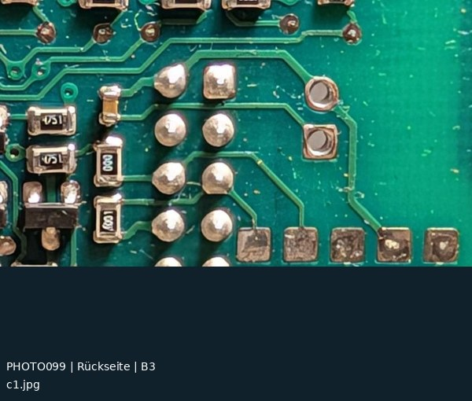
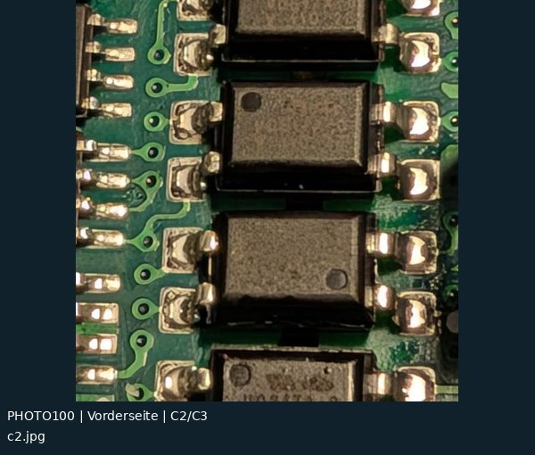
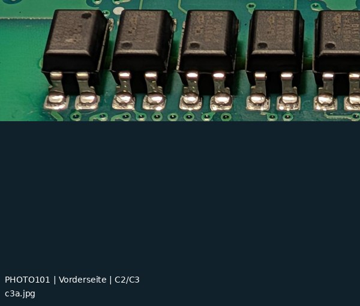
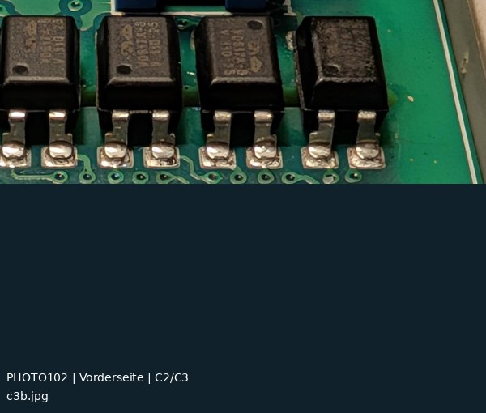
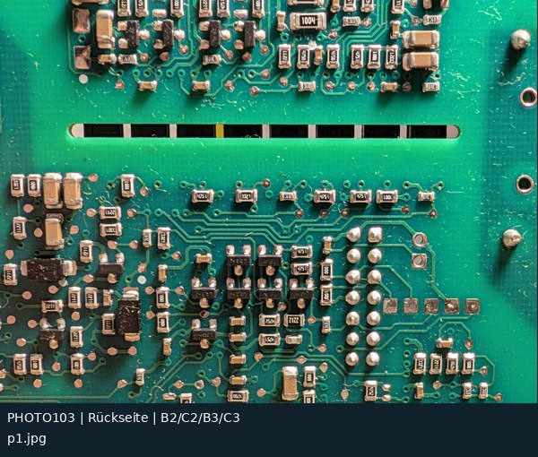
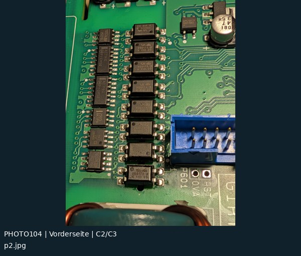
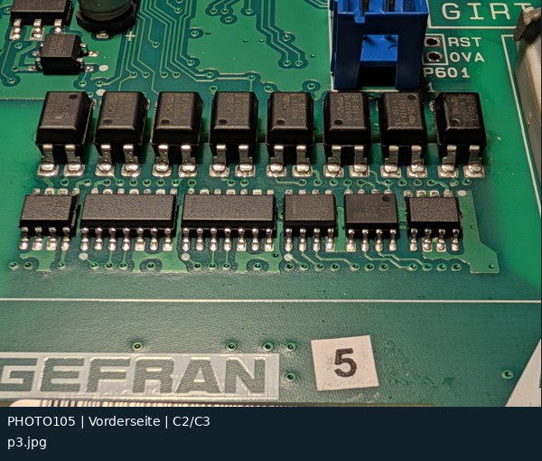

# Inspektionsmakros: 7 Originalfotos

[Zur Übersicht](README.md) · [CSV](fotoindex.csv) · [Kontaktatlas PDF](kontaktatlas.pdf)

Rasterangaben sind ungefähre Bildlagen bzw. Felder sichtbar identifizierter Bauteile. „Projizierte Bereiche“ in der CSV bedeuten nur, dass ein Feldmittelpunkt im berechneten Bildfenster liegt. Das beweist weder Sichtbarkeit noch elektrische Zugehörigkeit.

| Foto / Original | Vorschau | Raster / Inhalt | Zuordnung |
|---|---|---|---|
| **PHOTO099** [c1.jpg](../../photos/2026-11-08/inspektion_verkleinert/c1.jpg) |  | **B3** B11/P602-Rückseite; Testpad-Reihe | visuell nach Bauteilbestand zugeordnet Alt: –; Abgleich: –; Inlier: 0 |
| **PHOTO100** [c2.jpg](../../photos/2026-11-08/inspektion_verkleinert/c2.jpg) |  | **C2/C3** OC-Spalte, Pin-/Gehäusedetails | visuell nach Bauteilbestand zugeordnet Alt: –; Abgleich: –; Inlier: 4 |
| **PHOTO101** [c3a.jpg](../../photos/2026-11-08/inspektion_verkleinert/c3a.jpg) |  | **C2/C3** OC-Spalte seitlich; Lötstellen | visuell nach Bauteilbestand zugeordnet Alt: –; Abgleich: –; Inlier: 4 |
| **PHOTO102** [c3b.jpg](../../photos/2026-11-08/inspektion_verkleinert/c3b.jpg) |  | **C2/C3** OC-Spalte seitlich; Lötstellen | visuell nach Bauteilbestand zugeordnet Alt: –; Abgleich: –; Inlier: 4 |
| **PHOTO103** [p1.jpg](../../photos/2026-11-08/inspektion_verkleinert/p1.jpg) |  | **B2/C2/B3/C3** Rückseite hinter Optokopplern, Trennschlitz/P602 | visuell nach Bauteilbestand zugeordnet Alt: –; Abgleich: –; Inlier: 4 |
| **PHOTO104** [p2.jpg](../../photos/2026-11-08/inspektion_verkleinert/p2.jpg) |  | **C2/C3** Optokoppler und Logikspalte in Übersicht | visuell nach Bauteilbestand zugeordnet Alt: –; Abgleich: –; Inlier: 16 |
| **PHOTO105** [p3.jpg](../../photos/2026-11-08/inspektion_verkleinert/p3.jpg) |  | **C2/C3** Optokoppler und Logik, schräg | visuell nach Bauteilbestand zugeordnet Alt: –; Abgleich: C2; Inlier: 18 |
