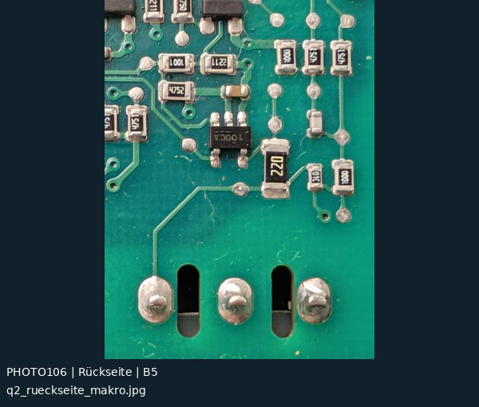
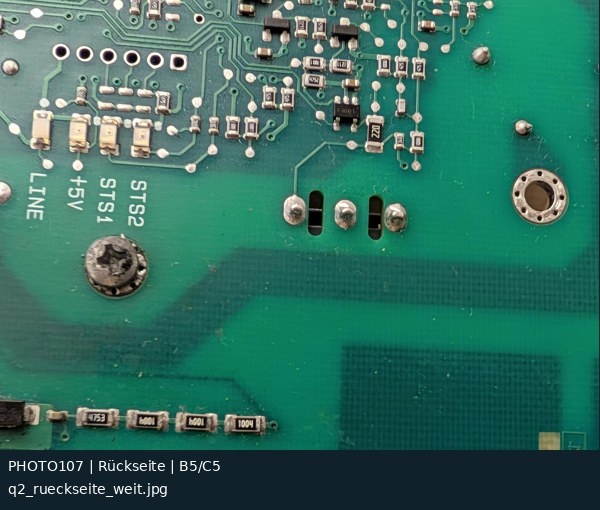
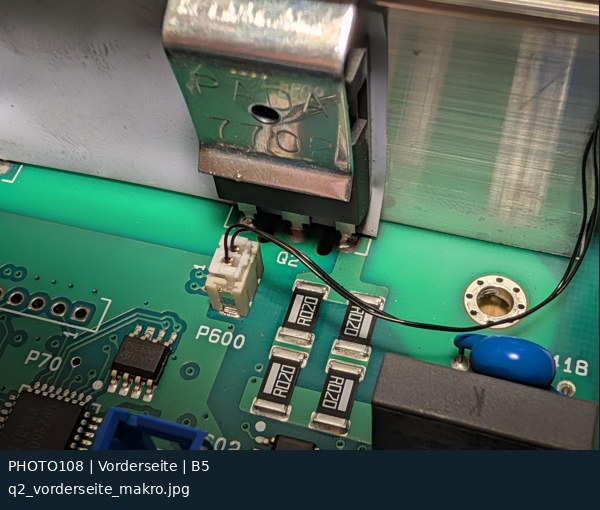

# Q2-Makros: 3 Originalfotos

[Zur Übersicht](README.md) · [CSV](fotoindex.csv) · [Kontaktatlas PDF](kontaktatlas.pdf)

Rasterangaben sind ungefähre Bildlagen bzw. Felder sichtbar identifizierter Bauteile. „Projizierte Bereiche“ in der CSV bedeuten nur, dass ein Feldmittelpunkt im berechneten Bildfenster liegt. Das beweist weder Sichtbarkeit noch elektrische Zugehörigkeit.

| Foto / Original | Vorschau | Raster / Inhalt | Zuordnung |
|---|---|---|---|
| **PHOTO106** [q2_rueckseite_makro.jpg](../../photos/2026-11-08/q2/q2_rueckseite_makro.jpg) |  | **B5** Q2 G/D/S, 22-Ω-Gate-R, fünfpoliger Treiber | visuell nach Bauteilbestand zugeordnet Alt: –; Abgleich: –; Inlier: 0 |
| **PHOTO107** [q2_rueckseite_weit.jpg](../../photos/2026-11-08/q2/q2_rueckseite_weit.jpg) |  | **B5/C5** Q2, LEDs und Treiberumfeld | visuell nach Bauteilbestand zugeordnet Alt: –; Abgleich: B5; Inlier: 19 |
| **PHOTO108** [q2_vorderseite_makro.jpg](../../photos/2026-11-08/q2/q2_vorderseite_makro.jpg) |  | **B5** Q2, P600 und vier R020-Shunts | visuell nach Bauteilbestand zugeordnet Alt: –; Abgleich: –; Inlier: 14 |
