# Rückseite: 57 Originalfotos

[Zur Übersicht](README.md) · [CSV](fotoindex.csv) · [Kontaktatlas PDF](kontaktatlas.pdf)

Rasterangaben sind ungefähre Bildlagen bzw. Felder sichtbar identifizierter Bauteile. „Projizierte Bereiche“ in der CSV bedeuten nur, dass ein Feldmittelpunkt im berechneten Bildfenster liegt. Das beweist weder Sichtbarkeit noch elektrische Zugehörigkeit.

| Foto / Original | Vorschau | Raster / Inhalt | Zuordnung |
|---|---|---|---|
| **PHOTO001** [PXL_20261108_153725460.jpg](../../photos/2026-11-08/back/PXL_20261108_153725460.jpg) | <a href="../../photos/2026-11-08/back/PXL_20261108_153725460.jpg">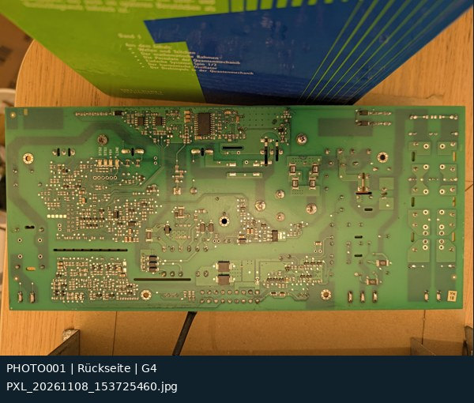</a> | **G4** Mittelfeld / Bildabgleich; Detailinhalt im Original prüfen | Originalindex übernommen; Bildabgleich ±1 Feld bestätigt Alt: G4; Abgleich: G4; Inlier: 1932 |
| **PHOTO002** [PXL_20261108_153750178.jpg](../../photos/2026-11-08/back/PXL_20261108_153750178.jpg) | <a href="../../photos/2026-11-08/back/PXL_20261108_153750178.jpg">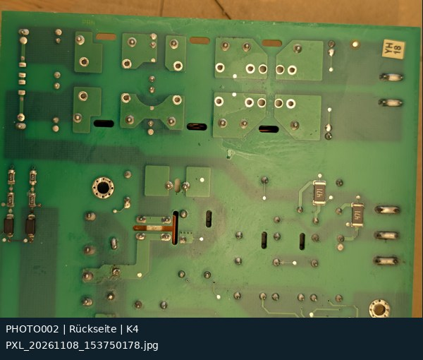</a> | **K4** Mittelfeld / Bildabgleich; Detailinhalt im Original prüfen | Originalindex übernommen; Bildabgleich ±1 Feld bestätigt Alt: K4; Abgleich: K3; Inlier: 426 |
| **PHOTO003** [PXL_20261108_153802461.jpg](../../photos/2026-11-08/back/PXL_20261108_153802461.jpg) | <a href="../../photos/2026-11-08/back/PXL_20261108_153802461.jpg">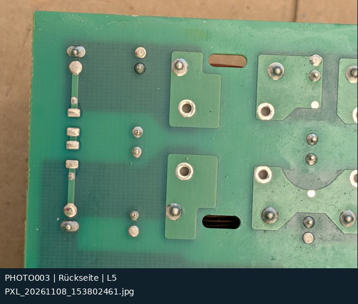</a> | **L5** Mittelfeld / Bildabgleich; Detailinhalt im Original prüfen | Originalindex abweichend: G4; Nachbarfoto-Abgleich L5; visuell bestätigt Alt: G4; Abgleich: L5; Inlier: 45 |
| **PHOTO004** [PXL_20261108_153806786.jpg](../../photos/2026-11-08/back/PXL_20261108_153806786.jpg) | <a href="../../photos/2026-11-08/back/PXL_20261108_153806786.jpg">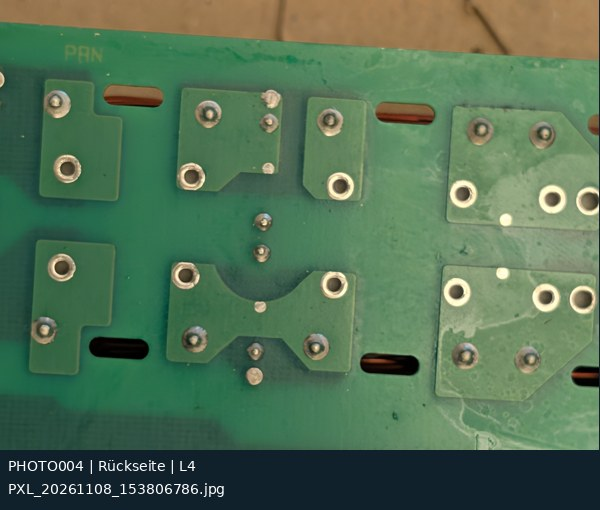</a> | **L4** Mittelfeld / Bildabgleich; Detailinhalt im Original prüfen | über Original-Nachbarfoto registriert Alt: –; Abgleich: L4; Inlier: 142 |
| **PHOTO005** [PXL_20261108_153809691.jpg](../../photos/2026-11-08/back/PXL_20261108_153809691.jpg) | <a href="../../photos/2026-11-08/back/PXL_20261108_153809691.jpg">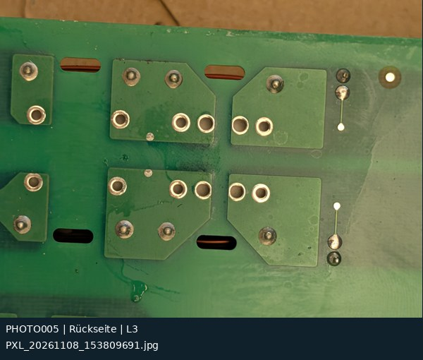</a> | **L3** Mittelfeld / Bildabgleich; Detailinhalt im Original prüfen | über Original-Nachbarfoto registriert Alt: –; Abgleich: L3; Inlier: 85 |
| **PHOTO006** [PXL_20261108_153812115.jpg](../../photos/2026-11-08/back/PXL_20261108_153812115.jpg) | <a href="../../photos/2026-11-08/back/PXL_20261108_153812115.jpg">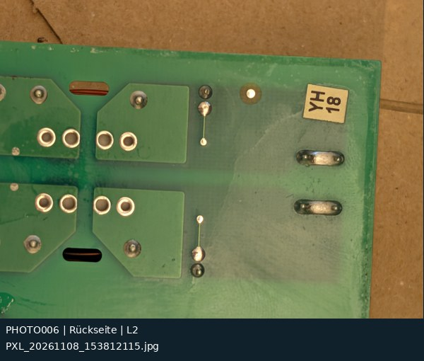</a> | **L2** Mittelfeld / Bildabgleich; Detailinhalt im Original prüfen | Originalindex übernommen; Bildabgleich ±1 Feld bestätigt Alt: L2; Abgleich: L2; Inlier: 25 |
| **PHOTO007** [PXL_20261108_153815740.jpg](../../photos/2026-11-08/back/PXL_20261108_153815740.jpg) | <a href="../../photos/2026-11-08/back/PXL_20261108_153815740.jpg">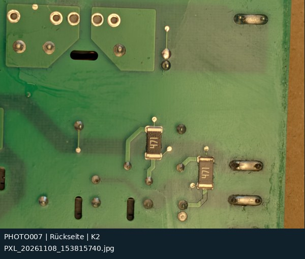</a> | **K2** Mittelfeld / Bildabgleich; Detailinhalt im Original prüfen | über Original-Nachbarfoto registriert Alt: –; Abgleich: K2; Inlier: 62 |
| **PHOTO008** [PXL_20261108_153820259.jpg](../../photos/2026-11-08/back/PXL_20261108_153820259.jpg) | <a href="../../photos/2026-11-08/back/PXL_20261108_153820259.jpg">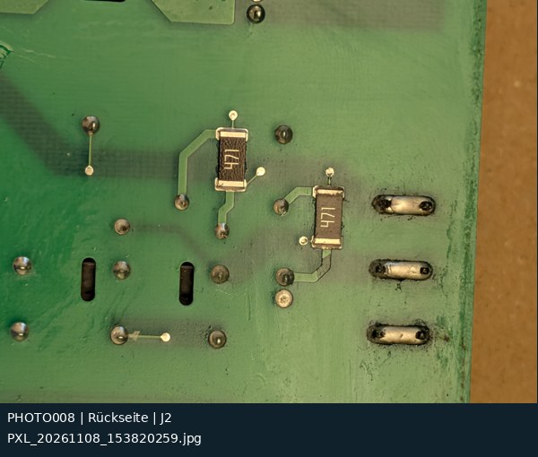</a> | **J2** Mittelfeld / Bildabgleich; Detailinhalt im Original prüfen | über Original-Nachbarfoto registriert Alt: –; Abgleich: J2; Inlier: 77 |
| **PHOTO009** [PXL_20261108_153823849.jpg](../../photos/2026-11-08/back/PXL_20261108_153823849.jpg) | <a href="../../photos/2026-11-08/back/PXL_20261108_153823849.jpg">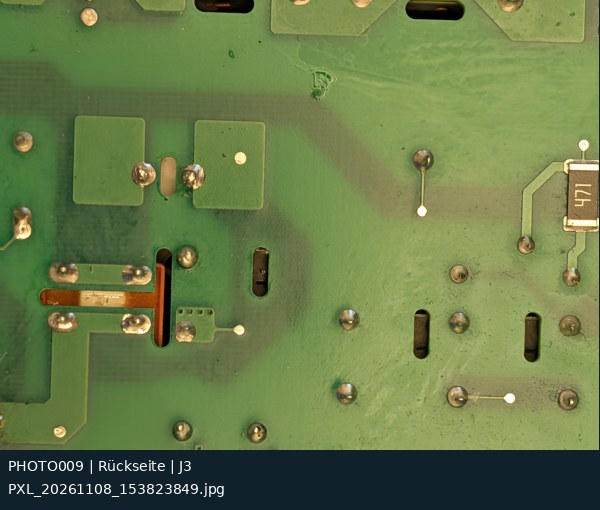</a> | **J3** Mittelfeld / Bildabgleich; Detailinhalt im Original prüfen | über Original-Nachbarfoto registriert Alt: –; Abgleich: J3; Inlier: 371 |
| **PHOTO010** [PXL_20261108_153826344.jpg](../../photos/2026-11-08/back/PXL_20261108_153826344.jpg) | <a href="../../photos/2026-11-08/back/PXL_20261108_153826344.jpg">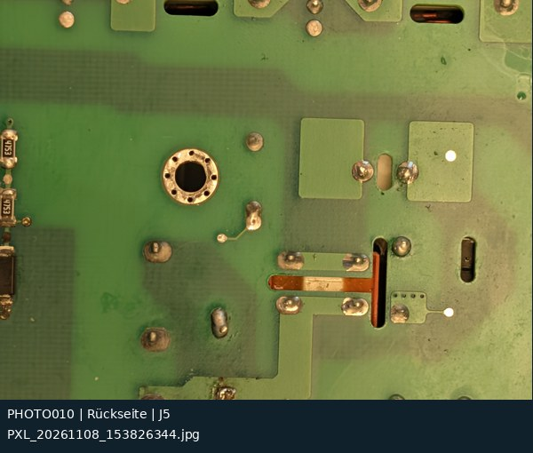</a> | **J5** Mittelfeld / Bildabgleich; Detailinhalt im Original prüfen | über Original-Nachbarfoto registriert Alt: –; Abgleich: J5; Inlier: 285 |
| **PHOTO011** [PXL_20261108_153829037.jpg](../../photos/2026-11-08/back/PXL_20261108_153829037.jpg) | <a href="../../photos/2026-11-08/back/PXL_20261108_153829037.jpg">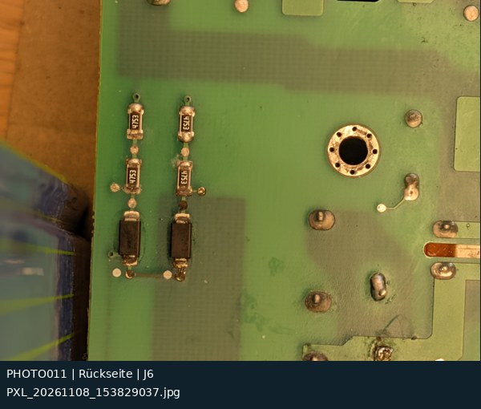</a> | **J6** B10: zwei Widerstandsketten und Dioden eindeutig sichtbar; Umfeld des Relais-Kontaktbereichs | visuell nach Bauteilbestand zugeordnet Alt: –; Abgleich: J6; Inlier: 122 |
| **PHOTO012** [PXL_20261108_153832358.jpg](../../photos/2026-11-08/back/PXL_20261108_153832358.jpg) | <a href="../../photos/2026-11-08/back/PXL_20261108_153832358.jpg">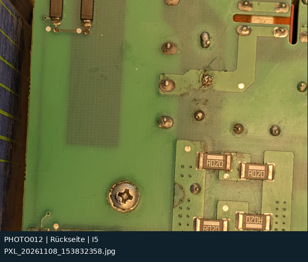</a> | **I5** Mittelfeld / Bildabgleich; Detailinhalt im Original prüfen | Originalindex abweichend: G4; Nachbarfoto-Abgleich I5; visuell bestätigt Alt: G4; Abgleich: I5; Inlier: 100 |
| **PHOTO013** [PXL_20261108_153834626.jpg](../../photos/2026-11-08/back/PXL_20261108_153834626.jpg) | <a href="../../photos/2026-11-08/back/PXL_20261108_153834626.jpg">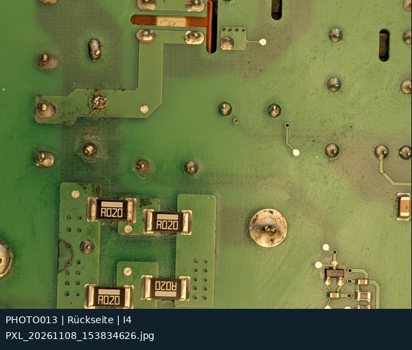</a> | **I4** Mittelfeld / Bildabgleich; Detailinhalt im Original prüfen | Originalindex übernommen; Bildabgleich ±1 Feld bestätigt Alt: I4; Abgleich: I4; Inlier: 38 |
| **PHOTO014** [PXL_20261108_153836782.jpg](../../photos/2026-11-08/back/PXL_20261108_153836782.jpg) | <a href="../../photos/2026-11-08/back/PXL_20261108_153836782.jpg">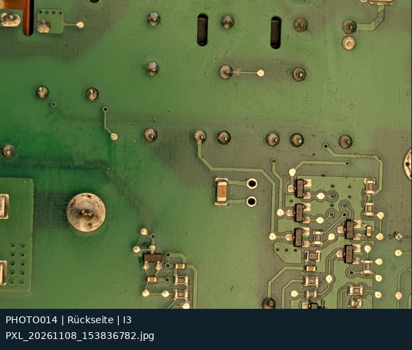</a> | **I3** Mittelfeld / Bildabgleich; Detailinhalt im Original prüfen | Originalindex übernommen; Bildabgleich ±1 Feld bestätigt Alt: I3; Abgleich: I3; Inlier: 245 |
| **PHOTO015** [PXL_20261108_153839659.jpg](../../photos/2026-11-08/back/PXL_20261108_153839659.jpg) | <a href="../../photos/2026-11-08/back/PXL_20261108_153839659.jpg">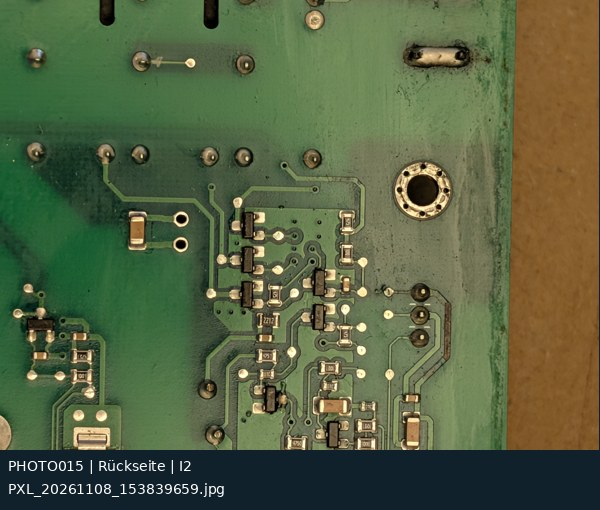</a> | **I2** Mittelfeld / Bildabgleich; Detailinhalt im Original prüfen | Originalindex übernommen; Bildabgleich ±1 Feld bestätigt Alt: I2; Abgleich: I2; Inlier: 75 |
| **PHOTO016** [PXL_20261108_153842361.jpg](../../photos/2026-11-08/back/PXL_20261108_153842361.jpg) | <a href="../../photos/2026-11-08/back/PXL_20261108_153842361.jpg">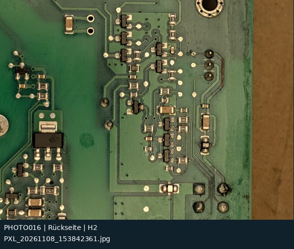</a> | **H2** Mittelfeld / Bildabgleich; Detailinhalt im Original prüfen | Originalindex übernommen; Bildabgleich ±1 Feld bestätigt Alt: H2; Abgleich: H2; Inlier: 57 |
| **PHOTO017** [PXL_20261108_153845377.jpg](../../photos/2026-11-08/back/PXL_20261108_153845377.jpg) | <a href="../../photos/2026-11-08/back/PXL_20261108_153845377.jpg">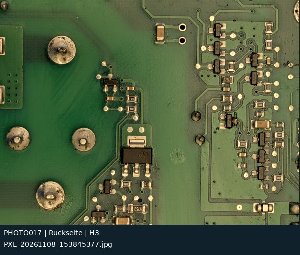</a> | **H3** Mittelfeld / Bildabgleich; Detailinhalt im Original prüfen | Originalindex übernommen; Bildabgleich ±1 Feld bestätigt Alt: H3; Abgleich: H3; Inlier: 45 |
| **PHOTO018** [PXL_20261108_153847630.jpg](../../photos/2026-11-08/back/PXL_20261108_153847630.jpg) | <a href="../../photos/2026-11-08/back/PXL_20261108_153847630.jpg">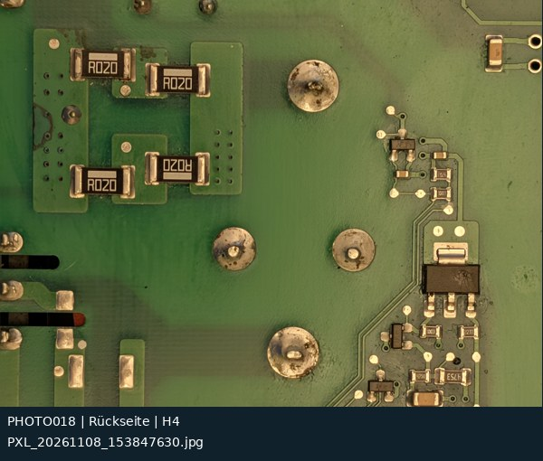</a> | **H4** Mittelfeld / Bildabgleich; Detailinhalt im Original prüfen | Originalindex übernommen; Bildabgleich ±1 Feld bestätigt Alt: H4; Abgleich: H4; Inlier: 109 |
| **PHOTO019** [PXL_20261108_153851483.jpg](../../photos/2026-11-08/back/PXL_20261108_153851483.jpg) | <a href="../../photos/2026-11-08/back/PXL_20261108_153851483.jpg">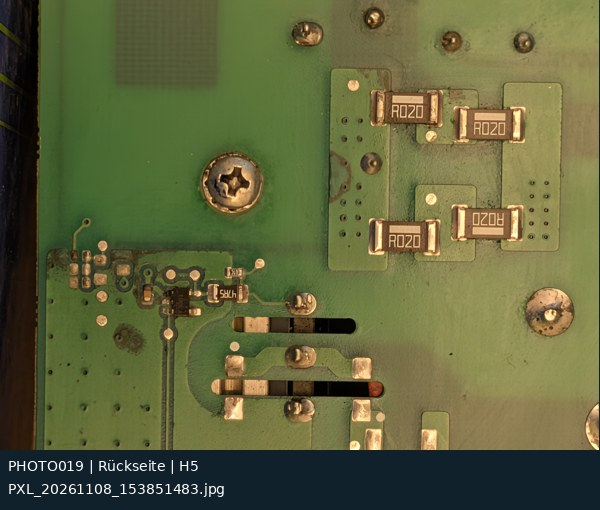</a> | **H5** Mittelfeld / Bildabgleich; Detailinhalt im Original prüfen | Originalindex übernommen; Bildabgleich ±1 Feld bestätigt Alt: H5; Abgleich: H5; Inlier: 58 |
| **PHOTO020** [PXL_20261108_153855456.jpg](../../photos/2026-11-08/back/PXL_20261108_153855456.jpg) | <a href="../../photos/2026-11-08/back/PXL_20261108_153855456.jpg">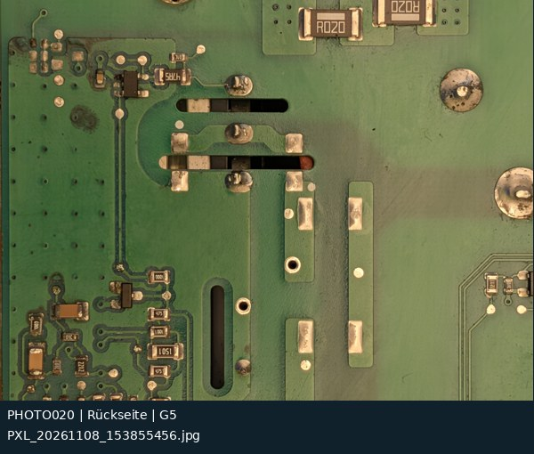</a> | **G5** Mittelfeld / Bildabgleich; Detailinhalt im Original prüfen | Originalindex übernommen; Bildabgleich ±1 Feld bestätigt Alt: G5; Abgleich: G5; Inlier: 54 |
| **PHOTO021** [PXL_20261108_153857829.jpg](../../photos/2026-11-08/back/PXL_20261108_153857829.jpg) | <a href="../../photos/2026-11-08/back/PXL_20261108_153857829.jpg">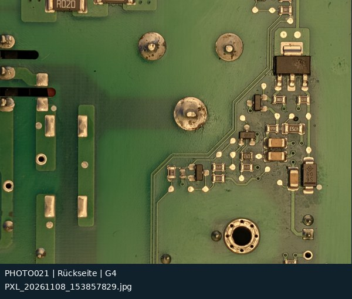</a> | **G4** Mittelfeld / Bildabgleich; Detailinhalt im Original prüfen | Originalindex übernommen; Bildabgleich ±1 Feld bestätigt Alt: G4; Abgleich: G4; Inlier: 154 |
| **PHOTO022** [PXL_20261108_153900296.jpg](../../photos/2026-11-08/back/PXL_20261108_153900296.jpg) | <a href="../../photos/2026-11-08/back/PXL_20261108_153900296.jpg">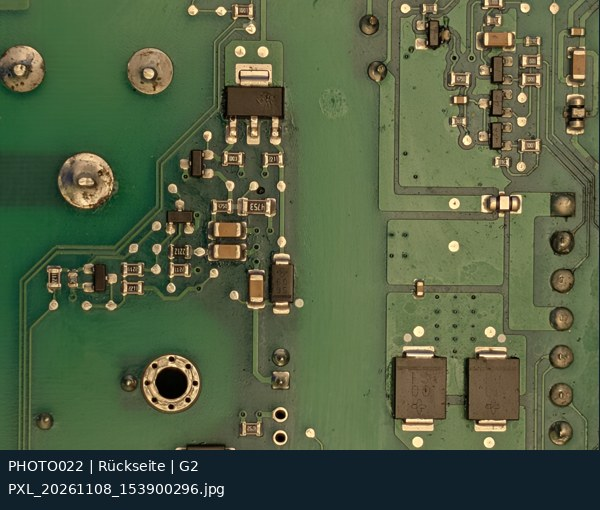</a> | **G2** Mittelfeld / Bildabgleich; Detailinhalt im Original prüfen | Originalindex übernommen; Bildabgleich ±1 Feld bestätigt Alt: G2; Abgleich: G2; Inlier: 52 |
| **PHOTO023** [PXL_20261108_153903047.jpg](../../photos/2026-11-08/back/PXL_20261108_153903047.jpg) | <a href="../../photos/2026-11-08/back/PXL_20261108_153903047.jpg">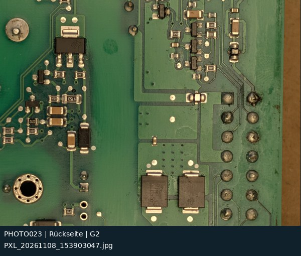</a> | **G2** Mittelfeld / Bildabgleich; Detailinhalt im Original prüfen | Originalindex übernommen; Bildabgleich ±1 Feld bestätigt Alt: G2; Abgleich: G2; Inlier: 53 |
| **PHOTO024** [PXL_20261108_153904998.jpg](../../photos/2026-11-08/back/PXL_20261108_153904998.jpg) | <a href="../../photos/2026-11-08/back/PXL_20261108_153904998.jpg">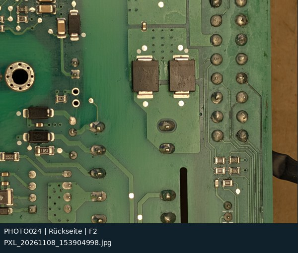</a> | **F2** Mittelfeld / Bildabgleich; Detailinhalt im Original prüfen | Originalindex übernommen; Bildabgleich ±1 Feld bestätigt Alt: F2; Abgleich: F2; Inlier: 28 |
| **PHOTO025** [PXL_20261108_153907263.jpg](../../photos/2026-11-08/back/PXL_20261108_153907263.jpg) | <a href="../../photos/2026-11-08/back/PXL_20261108_153907263.jpg">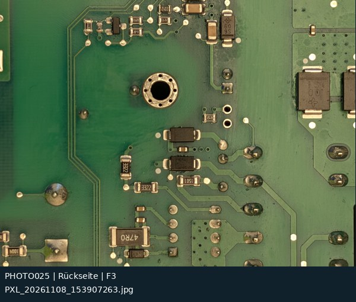</a> | **F3** Mittelfeld / Bildabgleich; Detailinhalt im Original prüfen | Originalindex übernommen; Bildabgleich ±1 Feld bestätigt Alt: F3; Abgleich: F3; Inlier: 47 |
| **PHOTO026** [PXL_20261108_153909351.jpg](../../photos/2026-11-08/back/PXL_20261108_153909351.jpg) | <a href="../../photos/2026-11-08/back/PXL_20261108_153909351.jpg">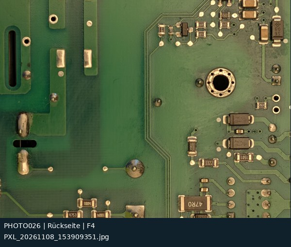</a> | **F4** Mittelfeld / Bildabgleich; Detailinhalt im Original prüfen | Originalindex übernommen; Bildabgleich ±1 Feld bestätigt Alt: F4; Abgleich: F4; Inlier: 114 |
| **PHOTO027** [PXL_20261108_153911731.jpg](../../photos/2026-11-08/back/PXL_20261108_153911731.jpg) | <a href="../../photos/2026-11-08/back/PXL_20261108_153911731.jpg">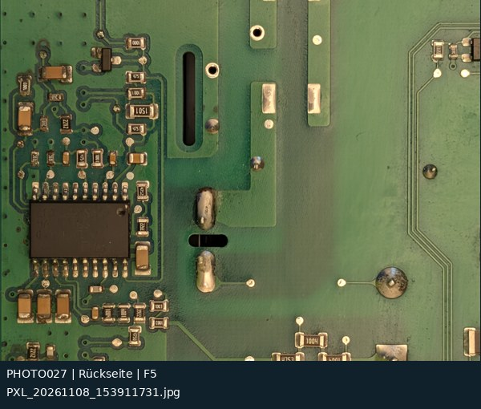</a> | **F5** Mittelfeld / Bildabgleich; Detailinhalt im Original prüfen | Originalindex übernommen; Bildabgleich ±1 Feld bestätigt Alt: F5; Abgleich: F5; Inlier: 77 |
| **PHOTO028** [PXL_20261108_153913723.jpg](../../photos/2026-11-08/back/PXL_20261108_153913723.jpg) | <a href="../../photos/2026-11-08/back/PXL_20261108_153913723.jpg">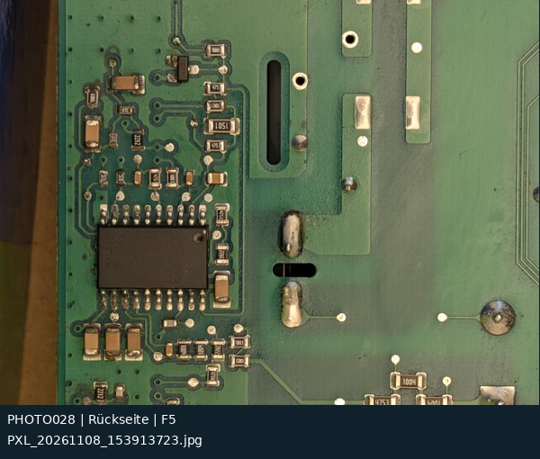</a> | **F5** Mittelfeld / Bildabgleich; Detailinhalt im Original prüfen | Originalindex übernommen; Bildabgleich ±1 Feld bestätigt Alt: F5; Abgleich: F5; Inlier: 50 |
| **PHOTO029** [PXL_20261108_153921371.jpg](../../photos/2026-11-08/back/PXL_20261108_153921371.jpg) | <a href="../../photos/2026-11-08/back/PXL_20261108_153921371.jpg">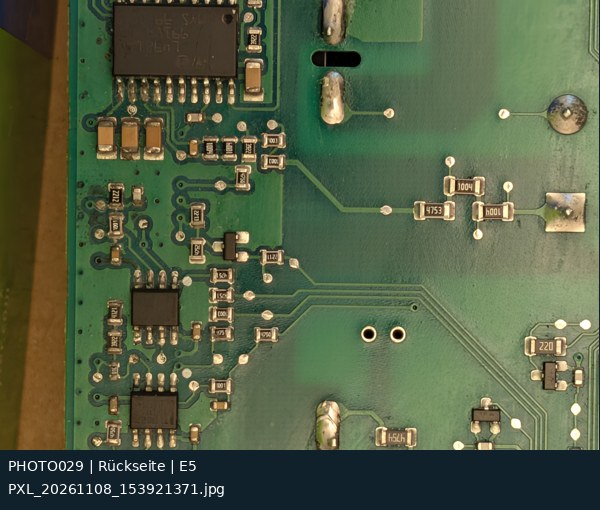</a> | **E5** Mittelfeld / Bildabgleich; Detailinhalt im Original prüfen | Originalindex übernommen; Bildabgleich ±1 Feld bestätigt Alt: E5; Abgleich: E5; Inlier: 35 |
| **PHOTO030** [PXL_20261108_153924115.jpg](../../photos/2026-11-08/back/PXL_20261108_153924115.jpg) | <a href="../../photos/2026-11-08/back/PXL_20261108_153924115.jpg">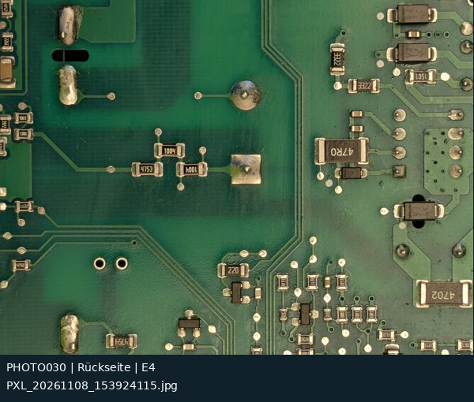</a> | **E4** Mittelfeld / Bildabgleich; Detailinhalt im Original prüfen | Originalindex übernommen; Bildabgleich ±1 Feld bestätigt Alt: E4; Abgleich: E4; Inlier: 44 |
| **PHOTO031** [PXL_20261108_153927181.jpg](../../photos/2026-11-08/back/PXL_20261108_153927181.jpg) | <a href="../../photos/2026-11-08/back/PXL_20261108_153927181.jpg">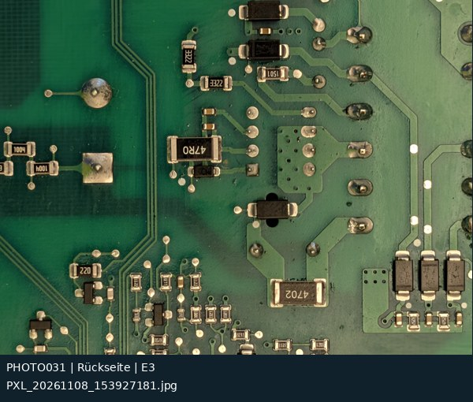</a> | **E3** Mittelfeld / Bildabgleich; Detailinhalt im Original prüfen | Originalindex übernommen; Bildabgleich ±1 Feld bestätigt Alt: E3; Abgleich: E3; Inlier: 41 |
| **PHOTO032** [PXL_20261108_153929309.jpg](../../photos/2026-11-08/back/PXL_20261108_153929309.jpg) | <a href="../../photos/2026-11-08/back/PXL_20261108_153929309.jpg">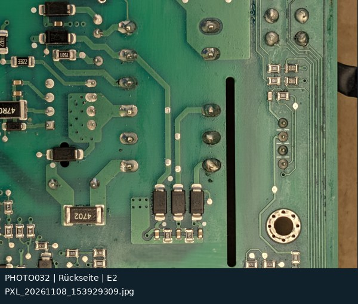</a> | **E2** Mittelfeld / Bildabgleich; Detailinhalt im Original prüfen | Originalindex übernommen; Bildabgleich ±1 Feld bestätigt Alt: E2; Abgleich: E2; Inlier: 23 |
| **PHOTO033** [PXL_20261108_153931527.jpg](../../photos/2026-11-08/back/PXL_20261108_153931527.jpg) | <a href="../../photos/2026-11-08/back/PXL_20261108_153931527.jpg">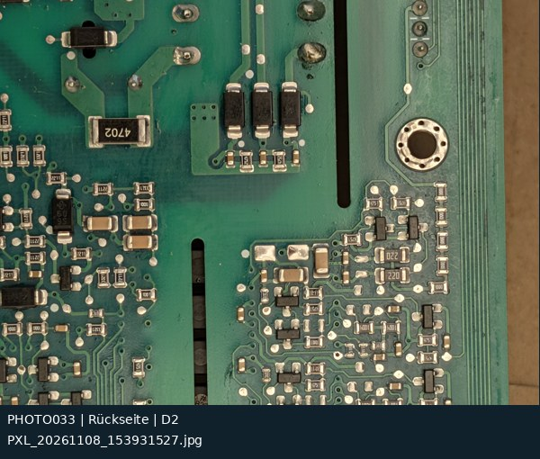</a> | **D2** Mittelfeld / Bildabgleich; Detailinhalt im Original prüfen | Originalindex übernommen; Bildabgleich ±1 Feld bestätigt Alt: D2; Abgleich: D2; Inlier: 25 |
| **PHOTO034** [PXL_20261108_153933907.jpg](../../photos/2026-11-08/back/PXL_20261108_153933907.jpg) | <a href="../../photos/2026-11-08/back/PXL_20261108_153933907.jpg">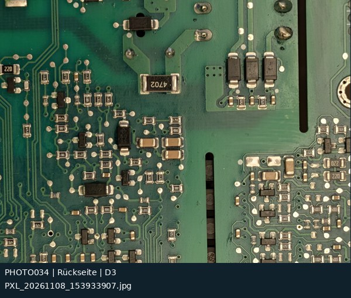</a> | **D3** Mittelfeld / Bildabgleich; Detailinhalt im Original prüfen | Originalindex übernommen; Bildabgleich ±1 Feld bestätigt Alt: D3; Abgleich: D3; Inlier: 43 |
| **PHOTO035** [PXL_20261108_153936293.jpg](../../photos/2026-11-08/back/PXL_20261108_153936293.jpg) | <a href="../../photos/2026-11-08/back/PXL_20261108_153936293.jpg">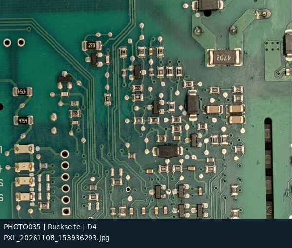</a> | **D4** Mittelfeld / Bildabgleich; Detailinhalt im Original prüfen | Originalindex übernommen; Bildabgleich ±1 Feld bestätigt Alt: D4; Abgleich: D4; Inlier: 78 |
| **PHOTO036** [PXL_20261108_153939094.jpg](../../photos/2026-11-08/back/PXL_20261108_153939094.jpg) | <a href="../../photos/2026-11-08/back/PXL_20261108_153939094.jpg">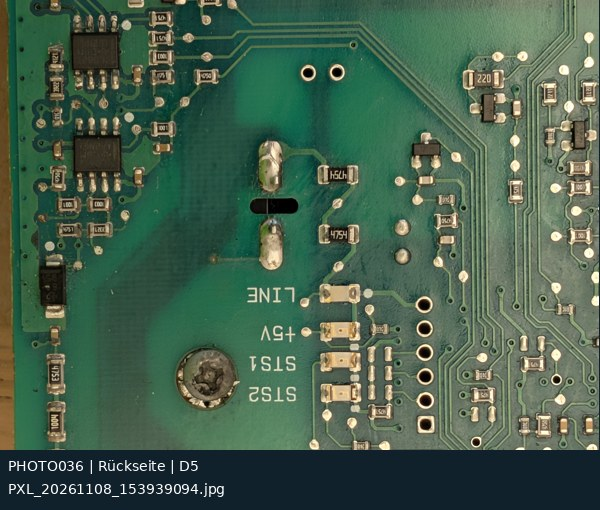</a> | **D5** Mittelfeld / Bildabgleich; Detailinhalt im Original prüfen | Originalindex übernommen; Bildabgleich ±1 Feld bestätigt Alt: D5; Abgleich: D5; Inlier: 68 |
| **PHOTO037** [PXL_20261108_153942267.jpg](../../photos/2026-11-08/back/PXL_20261108_153942267.jpg) | <a href="../../photos/2026-11-08/back/PXL_20261108_153942267.jpg">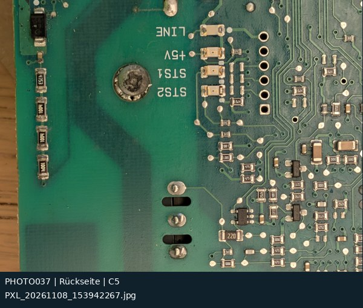</a> | **C5** Mittelfeld / Bildabgleich; Detailinhalt im Original prüfen | Originalindex übernommen; Bildabgleich ±1 Feld bestätigt Alt: C5; Abgleich: C5; Inlier: 41 |
| **PHOTO038** [PXL_20261108_153944155.jpg](../../photos/2026-11-08/back/PXL_20261108_153944155.jpg) | <a href="../../photos/2026-11-08/back/PXL_20261108_153944155.jpg">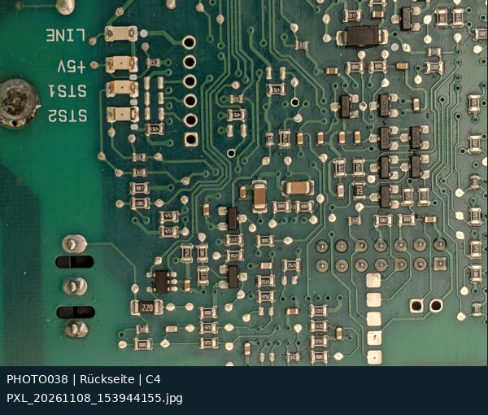</a> | **C4** Mittelfeld / Bildabgleich; Detailinhalt im Original prüfen | Originalindex übernommen; Bildabgleich ±1 Feld bestätigt Alt: C4; Abgleich: C4; Inlier: 63 |
| **PHOTO039** [PXL_20261108_153950316.jpg](../../photos/2026-11-08/back/PXL_20261108_153950316.jpg) | <a href="../../photos/2026-11-08/back/PXL_20261108_153950316.jpg">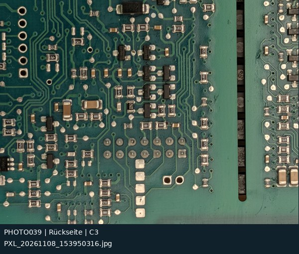</a> | **C3** Mittelfeld / Bildabgleich; Detailinhalt im Original prüfen | Originalindex übernommen; Bildabgleich ±1 Feld bestätigt Alt: C3; Abgleich: C3; Inlier: 32 |
| **PHOTO040** [PXL_20261108_153953773.jpg](../../photos/2026-11-08/back/PXL_20261108_153953773.jpg) | <a href="../../photos/2026-11-08/back/PXL_20261108_153953773.jpg">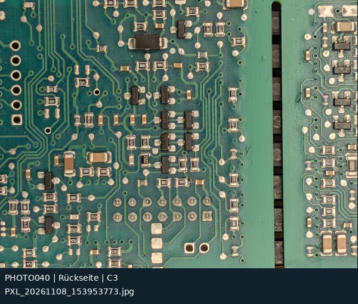</a> | **C3** Mittelfeld / Bildabgleich; Detailinhalt im Original prüfen | Originalindex übernommen; Bildabgleich ±1 Feld bestätigt Alt: C3; Abgleich: C3; Inlier: 38 |
| **PHOTO041** [PXL_20261108_153958521.jpg](../../photos/2026-11-08/back/PXL_20261108_153958521.jpg) | <a href="../../photos/2026-11-08/back/PXL_20261108_153958521.jpg">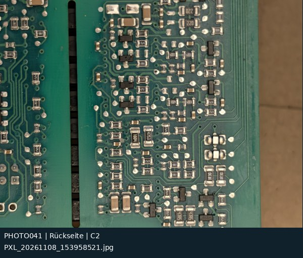</a> | **C2** Mittelfeld / Bildabgleich; Detailinhalt im Original prüfen | Originalindex übernommen; Bildabgleich ±1 Feld bestätigt Alt: C2; Abgleich: C2; Inlier: 25 |
| **PHOTO042** [PXL_20261108_154004074.jpg](../../photos/2026-11-08/back/PXL_20261108_154004074.jpg) | <a href="../../photos/2026-11-08/back/PXL_20261108_154004074.jpg">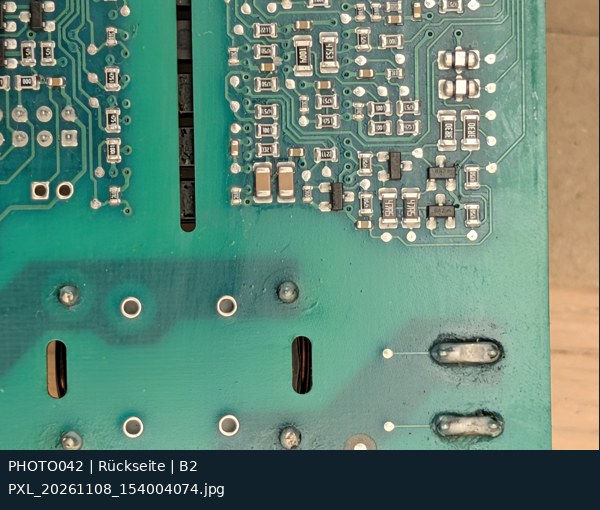</a> | **B2** Mittelfeld / Bildabgleich; Detailinhalt im Original prüfen | Originalindex übernommen Alt: B2; Abgleich: –; Inlier: 3 |
| **PHOTO043** [PXL_20261108_154012668.jpg](../../photos/2026-11-08/back/PXL_20261108_154012668.jpg) | <a href="../../photos/2026-11-08/back/PXL_20261108_154012668.jpg">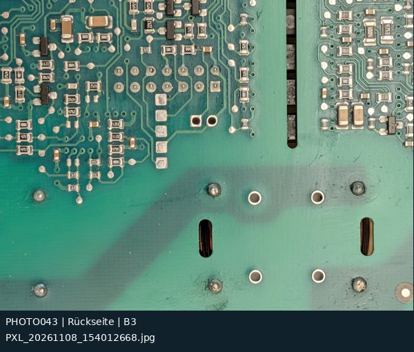</a> | **B3** Mittelfeld / Bildabgleich; Detailinhalt im Original prüfen | Originalindex übernommen Alt: B3; Abgleich: –; Inlier: 6 |
| **PHOTO044** [PXL_20261108_154016619.jpg](../../photos/2026-11-08/back/PXL_20261108_154016619.jpg) | <a href="../../photos/2026-11-08/back/PXL_20261108_154016619.jpg">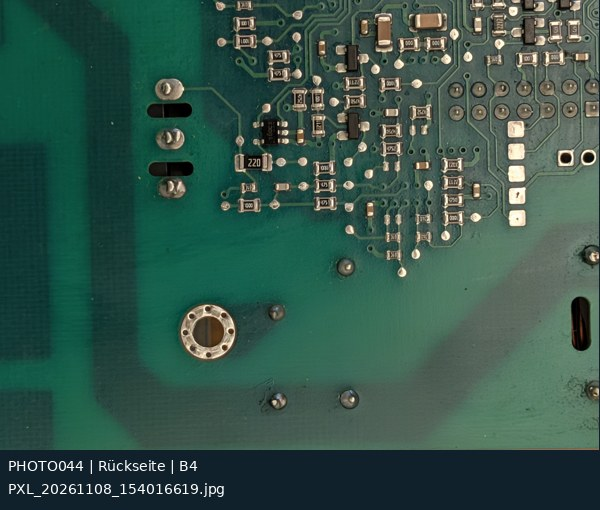</a> | **B4** Mittelfeld / Bildabgleich; Detailinhalt im Original prüfen | Originalindex übernommen; Bildabgleich ±1 Feld bestätigt Alt: B4; Abgleich: B4; Inlier: 26 |
| **PHOTO045** [PXL_20261108_154021818.jpg](../../photos/2026-11-08/back/PXL_20261108_154021818.jpg) | <a href="../../photos/2026-11-08/back/PXL_20261108_154021818.jpg">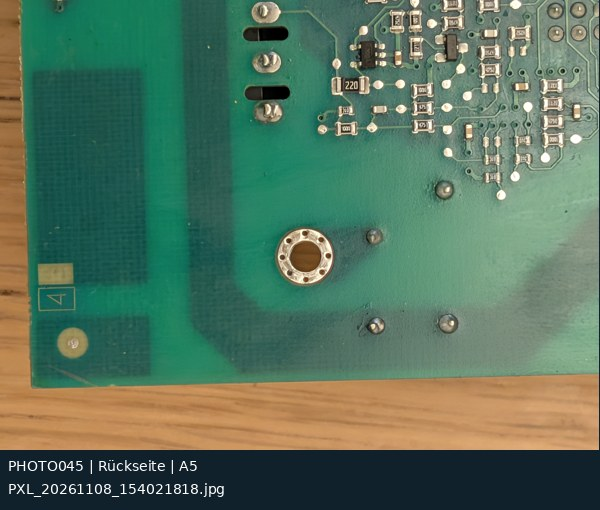</a> | **A5** Mittelfeld / Bildabgleich; Detailinhalt im Original prüfen | Originalindex übernommen Alt: A5; Abgleich: –; Inlier: 6 |
| **PHOTO046** [PXL_20261108_154024924.jpg](../../photos/2026-11-08/back/PXL_20261108_154024924.jpg) | <a href="../../photos/2026-11-08/back/PXL_20261108_154024924.jpg">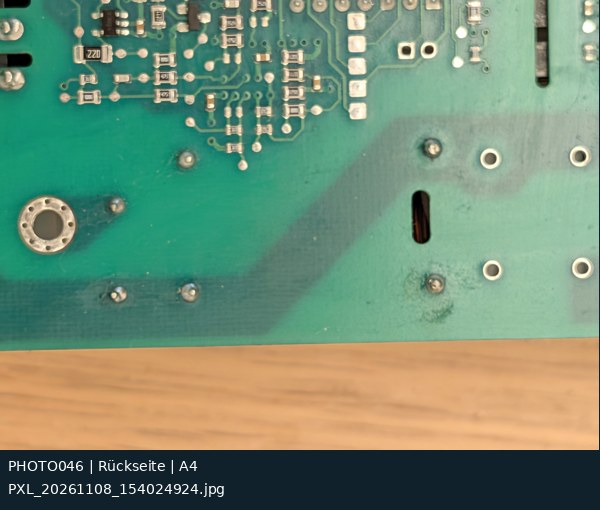</a> | **A4** Mittelfeld / Bildabgleich; Detailinhalt im Original prüfen | über Original-Nachbarfoto registriert Alt: –; Abgleich: A4; Inlier: 36 |
| **PHOTO047** [PXL_20261108_154029418.jpg](../../photos/2026-11-08/back/PXL_20261108_154029418.jpg) | <a href="../../photos/2026-11-08/back/PXL_20261108_154029418.jpg">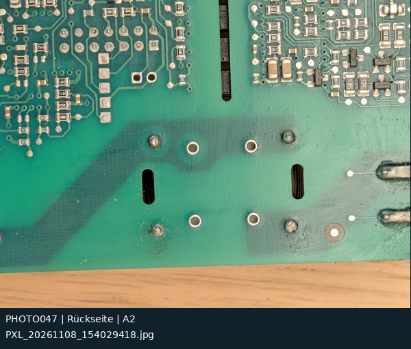</a> | **A2** Mittelfeld / Bildabgleich; Detailinhalt im Original prüfen | Originalindex abweichend: H3; Nachbarfoto-Abgleich A2; visuell bestätigt Alt: H3; Abgleich: A2; Inlier: 114 |
| **PHOTO048** [PXL_20261108_154033156.jpg](../../photos/2026-11-08/back/PXL_20261108_154033156.jpg) | <a href="../../photos/2026-11-08/back/PXL_20261108_154033156.jpg">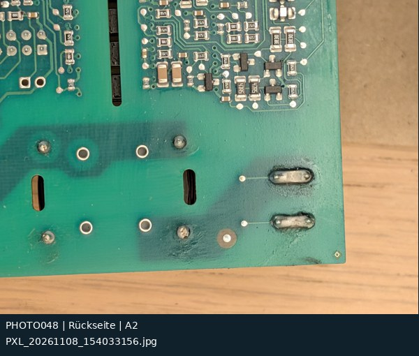</a> | **A2** Mittelfeld / Bildabgleich; Detailinhalt im Original prüfen | Originalindex übernommen; Bildabgleich ±1 Feld bestätigt Alt: A2; Abgleich: A2; Inlier: 68 |
| **PHOTO049** [PXL_20261108_154050560.jpg](../../photos/2026-11-08/back/PXL_20261108_154050560.jpg) | <a href="../../photos/2026-11-08/back/PXL_20261108_154050560.jpg">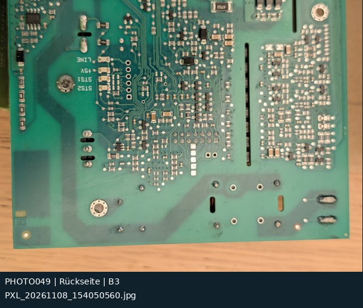</a> | **B3** Mittelfeld / Bildabgleich; Detailinhalt im Original prüfen | Originalindex übernommen; Bildabgleich ±1 Feld bestätigt Alt: B3; Abgleich: B3; Inlier: 103 |
| **PHOTO050** [PXL_20261108_154053061.jpg](../../photos/2026-11-08/back/PXL_20261108_154053061.jpg) | <a href="../../photos/2026-11-08/back/PXL_20261108_154053061.jpg">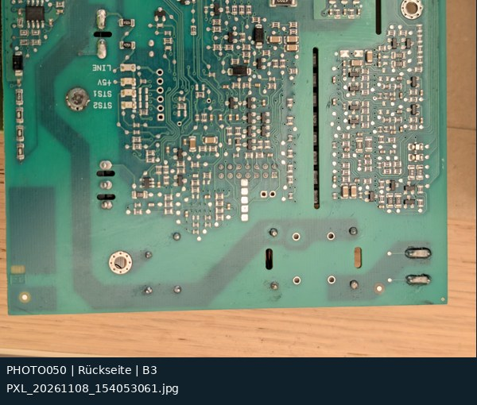</a> | **B3** Mittelfeld / Bildabgleich; Detailinhalt im Original prüfen | Originalindex übernommen; Bildabgleich ±1 Feld bestätigt Alt: B3; Abgleich: B3; Inlier: 162 |
| **PHOTO051** [PXL_20261108_154058519.jpg](../../photos/2026-11-08/back/PXL_20261108_154058519.jpg) |  | **D4** Mittelfeld / Bildabgleich; Detailinhalt im Original prüfen | Originalindex übernommen; Bildabgleich ±1 Feld bestätigt Alt: D4; Abgleich: D4; Inlier: 261 |
| **PHOTO052** [PXL_20261108_154101512.jpg](../../photos/2026-11-08/back/PXL_20261108_154101512.jpg) |  | **D4** Mittelfeld / Bildabgleich; Detailinhalt im Original prüfen | Originalindex übernommen; Bildabgleich ±1 Feld bestätigt Alt: D4; Abgleich: D4; Inlier: 284 |
| **PHOTO053** [PXL_20261108_154106644.jpg](../../photos/2026-11-08/back/PXL_20261108_154106644.jpg) |  | **G3** Mittelfeld / Bildabgleich; Detailinhalt im Original prüfen | Originalindex übernommen; Bildabgleich ±1 Feld bestätigt Alt: G3; Abgleich: G4; Inlier: 319 |
| **PHOTO054** [PXL_20261108_154110134.jpg](../../photos/2026-11-08/back/PXL_20261108_154110134.jpg) |  | **G3** Mittelfeld / Bildabgleich; Detailinhalt im Original prüfen | Originalindex übernommen; Bildabgleich ±1 Feld bestätigt Alt: G3; Abgleich: G3; Inlier: 331 |
| **PHOTO055** [PXL_20261108_154116875.jpg](../../photos/2026-11-08/back/PXL_20261108_154116875.jpg) |  | **J4** Mittelfeld / Bildabgleich; Detailinhalt im Original prüfen | Originalindex übernommen; Bildabgleich ±1 Feld bestätigt Alt: J4; Abgleich: J4; Inlier: 42 |
| **PHOTO056** [PXL_20261108_154119736.jpg](../../photos/2026-11-08/back/PXL_20261108_154119736.jpg) |  | **J3** Mittelfeld / Bildabgleich; Detailinhalt im Original prüfen | Originalindex übernommen; Bildabgleich ±1 Feld bestätigt Alt: J3; Abgleich: J3; Inlier: 27 |
| **PHOTO057** [PXL_20261108_154504043-EDIT.jpg](../../photos/2026-11-08/back/PXL_20261108_154504043-EDIT.jpg) |  | **G4** Mittelfeld / Bildabgleich; Detailinhalt im Original prüfen | Originalindex übernommen; Bildabgleich ±1 Feld bestätigt Alt: G4; Abgleich: G3; Inlier: 114 |
