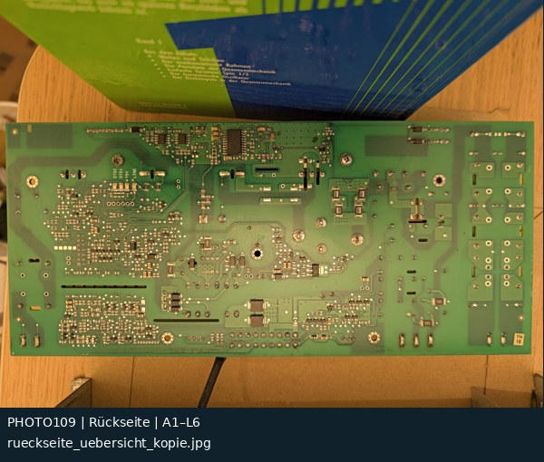
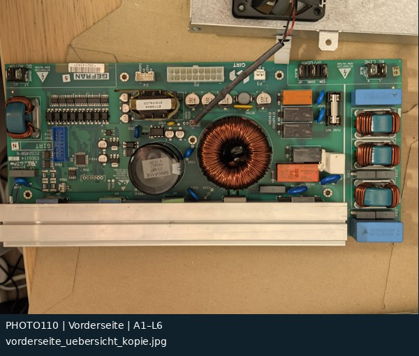

# Übersichtskopien: 2 Originalfotos

[Zur Übersicht](README.md) · [CSV](fotoindex.csv) · [Kontaktatlas PDF](kontaktatlas.pdf)

Rasterangaben sind ungefähre Bildlagen bzw. Felder sichtbar identifizierter Bauteile. „Projizierte Bereiche“ in der CSV bedeuten nur, dass ein Feldmittelpunkt im berechneten Bildfenster liegt. Das beweist weder Sichtbarkeit noch elektrische Zugehörigkeit.

| Foto / Original | Vorschau | Raster / Inhalt | Zuordnung |
|---|---|---|---|
| **PHOTO109** [rueckseite_uebersicht_kopie.jpg](../../photos/2026-11-08/uebersicht_kopien/rueckseite_uebersicht_kopie.jpg) |  | **A1–L6** Gesamte Rückseite, Übersichtskopie | visuell nach Bauteilbestand zugeordnet Alt: –; Abgleich: G4; Inlier: 1946 |
| **PHOTO110** [vorderseite_uebersicht_kopie.jpg](../../photos/2026-11-08/uebersicht_kopien/vorderseite_uebersicht_kopie.jpg) |  | **A1–L6** Gesamte Vorderseite, Übersichtskopie | visuell nach Bauteilbestand zugeordnet Alt: –; Abgleich: G4; Inlier: 888 |
