# Vorderseite: 41 Originalfotos

[Zur Übersicht](README.md) · [CSV](fotoindex.csv) · [Kontaktatlas PDF](kontaktatlas.pdf)

Rasterangaben sind ungefähre Bildlagen bzw. Felder sichtbar identifizierter Bauteile. „Projizierte Bereiche“ in der CSV bedeuten nur, dass ein Feldmittelpunkt im berechneten Bildfenster liegt. Das beweist weder Sichtbarkeit noch elektrische Zugehörigkeit.

| Foto / Original | Vorschau | Raster / Inhalt | Zuordnung |
|---|---|---|---|
| **PHOTO058** [PXL_20261108_154927065.jpg](../../photos/2026-11-08/front/PXL_20261108_154927065.jpg) | <a href="../../photos/2026-11-08/front/PXL_20261108_154927065.jpg">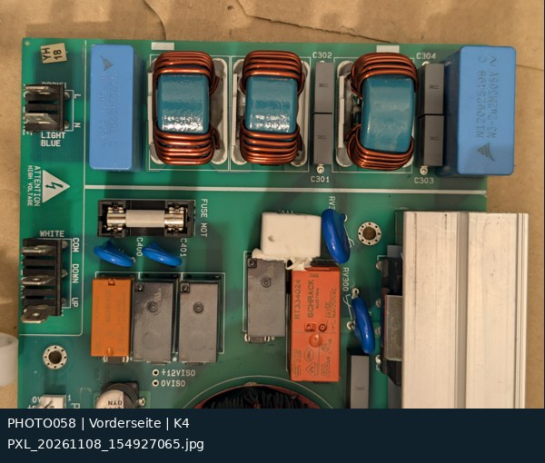</a> | **K4** Mittelfeld / Bildabgleich; Detailinhalt im Original prüfen | gut registriert Alt: –; Abgleich: K4; Inlier: 117 |
| **PHOTO059** [PXL_20261108_154933842.jpg](../../photos/2026-11-08/front/PXL_20261108_154933842.jpg) | <a href="../../photos/2026-11-08/front/PXL_20261108_154933842.jpg">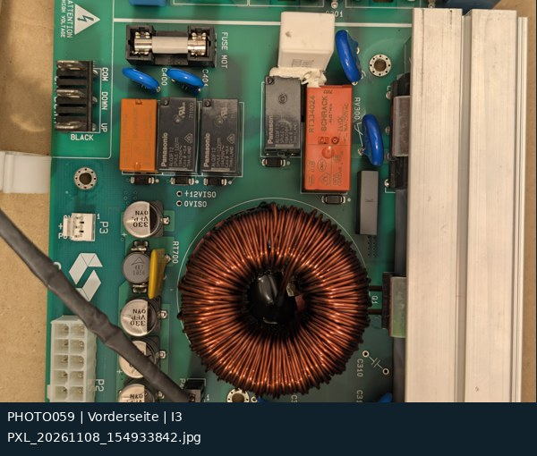</a> | **I3** Mittelfeld / Bildabgleich; Detailinhalt im Original prüfen | gut registriert Alt: –; Abgleich: I3; Inlier: 133 |
| **PHOTO060** [PXL_20261108_154939161.jpg](../../photos/2026-11-08/front/PXL_20261108_154939161.jpg) | <a href="../../photos/2026-11-08/front/PXL_20261108_154939161.jpg">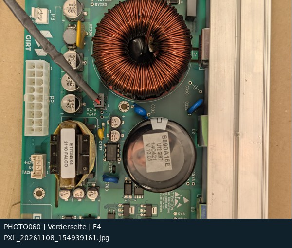</a> | **F4** Mittelfeld / Bildabgleich; Detailinhalt im Original prüfen | gut registriert Alt: –; Abgleich: F4; Inlier: 93 |
| **PHOTO061** [PXL_20261108_154944758.jpg](../../photos/2026-11-08/front/PXL_20261108_154944758.jpg) | <a href="../../photos/2026-11-08/front/PXL_20261108_154944758.jpg">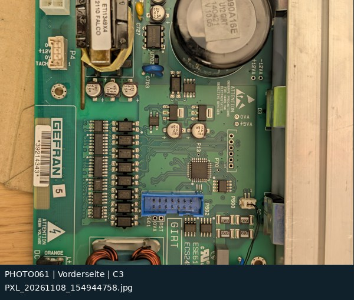</a> | **C3** Mittelfeld / Bildabgleich; Detailinhalt im Original prüfen | gut registriert Alt: –; Abgleich: C3; Inlier: 192 |
| **PHOTO062** [PXL_20261108_154952632.jpg](../../photos/2026-11-08/front/PXL_20261108_154952632.jpg) | <a href="../../photos/2026-11-08/front/PXL_20261108_154952632.jpg">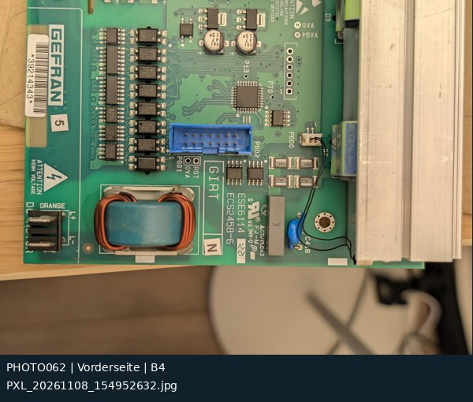</a> | **B4** Mittelfeld / Bildabgleich; Detailinhalt im Original prüfen | gut registriert Alt: –; Abgleich: B4; Inlier: 155 |
| **PHOTO063** [PXL_20261108_155008238.jpg](../../photos/2026-11-08/front/PXL_20261108_155008238.jpg) | <a href="../../photos/2026-11-08/front/PXL_20261108_155008238.jpg">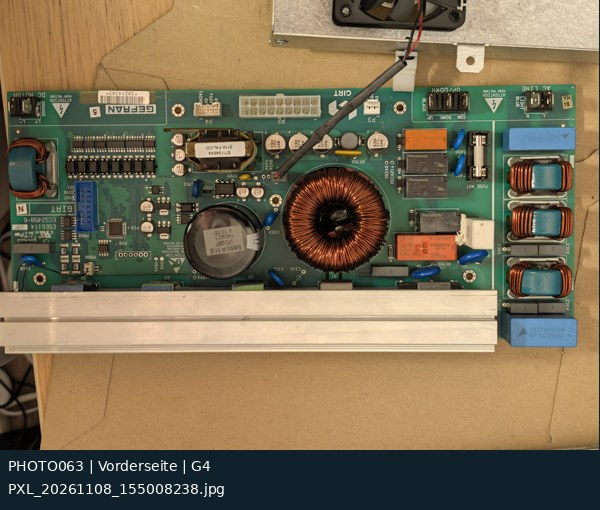</a> | **G4** Mittelfeld / Bildabgleich; Detailinhalt im Original prüfen | gut registriert Alt: –; Abgleich: G4; Inlier: 906 |
| **PHOTO064** [PXL_20261108_155016705.jpg](../../photos/2026-11-08/front/PXL_20261108_155016705.jpg) | <a href="../../photos/2026-11-08/front/PXL_20261108_155016705.jpg">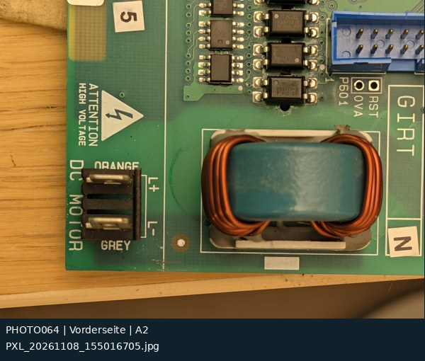</a> | **A2** Mittelfeld / Bildabgleich; Detailinhalt im Original prüfen | vorsichtig registriert Alt: –; Abgleich: A2; Inlier: 40 |
| **PHOTO065** [PXL_20261108_155021310.jpg](../../photos/2026-11-08/front/PXL_20261108_155021310.jpg) | <a href="../../photos/2026-11-08/front/PXL_20261108_155021310.jpg">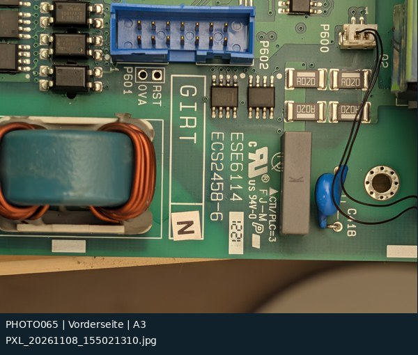</a> | **A3** Mittelfeld / Bildabgleich; Detailinhalt im Original prüfen | vorsichtig registriert Alt: –; Abgleich: A3; Inlier: 48 |
| **PHOTO066** [PXL_20261108_155026077.jpg](../../photos/2026-11-08/front/PXL_20261108_155026077.jpg) | <a href="../../photos/2026-11-08/front/PXL_20261108_155026077.jpg">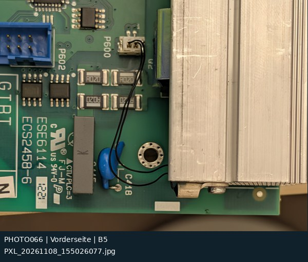</a> | **B5** Mittelfeld / Bildabgleich; Detailinhalt im Original prüfen | gut registriert Alt: –; Abgleich: B5; Inlier: 57 |
| **PHOTO067** [PXL_20261108_155029827.jpg](../../photos/2026-11-08/front/PXL_20261108_155029827.jpg) | <a href="../../photos/2026-11-08/front/PXL_20261108_155029827.jpg">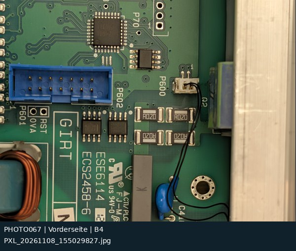</a> | **B4** Mittelfeld / Bildabgleich; Detailinhalt im Original prüfen | gut registriert Alt: –; Abgleich: B4; Inlier: 55 |
| **PHOTO068** [PXL_20261108_155037495.jpg](../../photos/2026-11-08/front/PXL_20261108_155037495.jpg) | <a href="../../photos/2026-11-08/front/PXL_20261108_155037495.jpg">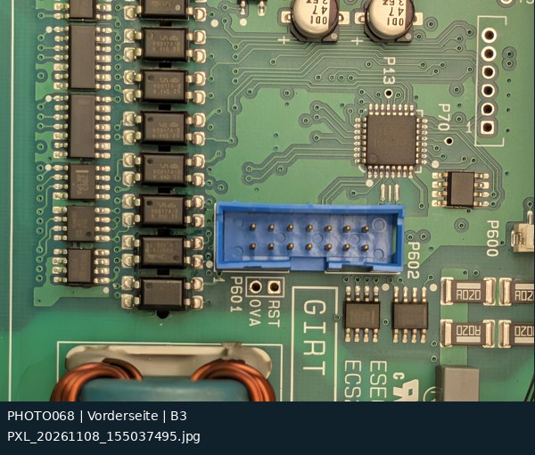</a> | **B3** Mittelfeld / Bildabgleich; Detailinhalt im Original prüfen | vorsichtig registriert Alt: –; Abgleich: B3; Inlier: 31 |
| **PHOTO069** [PXL_20261108_155042648.jpg](../../photos/2026-11-08/front/PXL_20261108_155042648.jpg) | <a href="../../photos/2026-11-08/front/PXL_20261108_155042648.jpg">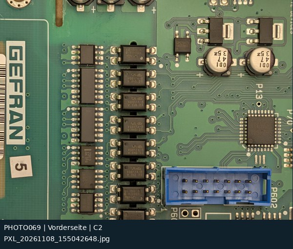</a> | **C2** Mittelfeld / Bildabgleich; Detailinhalt im Original prüfen | gut registriert Alt: –; Abgleich: C2; Inlier: 74 |
| **PHOTO070** [PXL_20261108_155047174.jpg](../../photos/2026-11-08/front/PXL_20261108_155047174.jpg) | <a href="../../photos/2026-11-08/front/PXL_20261108_155047174.jpg">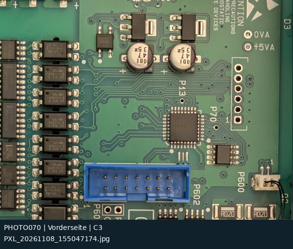</a> | **C3** Mittelfeld / Bildabgleich; Detailinhalt im Original prüfen | vorsichtig registriert Alt: –; Abgleich: C3; Inlier: 16 |
| **PHOTO071** [PXL_20261108_155051210.jpg](../../photos/2026-11-08/front/PXL_20261108_155051210.jpg) | <a href="../../photos/2026-11-08/front/PXL_20261108_155051210.jpg">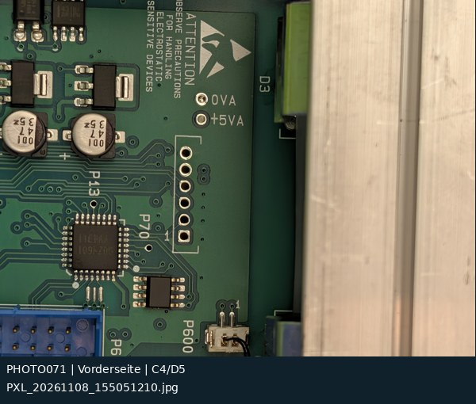</a> | **C4/D5** MCU/P70 und beschriftete Testpunkte 0VA/+5VA | visuell nach Bauteilbestand zugeordnet Alt: –; Abgleich: –; Inlier: 12 |
| **PHOTO072** [PXL_20261108_155055876.jpg](../../photos/2026-11-08/front/PXL_20261108_155055876.jpg) | <a href="../../photos/2026-11-08/front/PXL_20261108_155055876.jpg">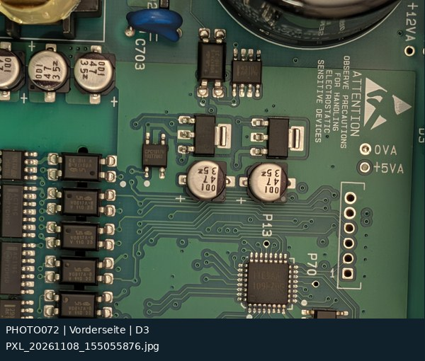</a> | **D3** Mittelfeld / Bildabgleich; Detailinhalt im Original prüfen | vorsichtig registriert Alt: –; Abgleich: D3; Inlier: 23 |
| **PHOTO073** [PXL_20261108_155059777.jpg](../../photos/2026-11-08/front/PXL_20261108_155059777.jpg) | <a href="../../photos/2026-11-08/front/PXL_20261108_155059777.jpg">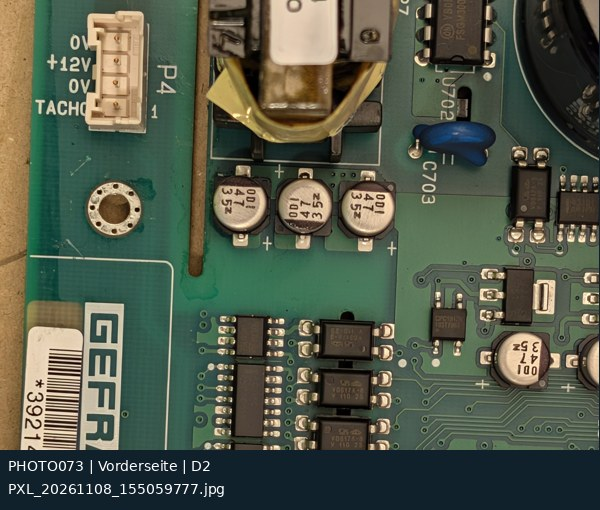</a> | **D2** Mittelfeld / Bildabgleich; Detailinhalt im Original prüfen | gut registriert Alt: –; Abgleich: D2; Inlier: 66 |
| **PHOTO074** [PXL_20261108_155104011.jpg](../../photos/2026-11-08/front/PXL_20261108_155104011.jpg) | <a href="../../photos/2026-11-08/front/PXL_20261108_155104011.jpg">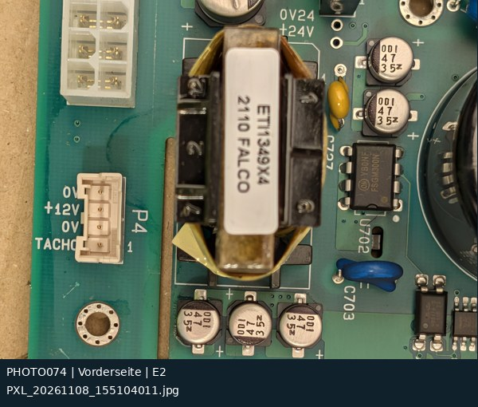</a> | **E2** Mittelfeld / Bildabgleich; Detailinhalt im Original prüfen | vorsichtig registriert Alt: –; Abgleich: E2; Inlier: 23 |
| **PHOTO075** [PXL_20261108_155109443.jpg](../../photos/2026-11-08/front/PXL_20261108_155109443.jpg) | <a href="../../photos/2026-11-08/front/PXL_20261108_155109443.jpg">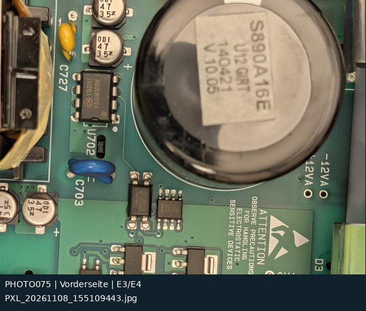</a> | **E3/E4** U702, C727/C703 und Zwischenkreis-Elko | visuell nach Bauteilbestand zugeordnet Alt: –; Abgleich: –; Inlier: 8 |
| **PHOTO076** [PXL_20261108_155115274.jpg](../../photos/2026-11-08/front/PXL_20261108_155115274.jpg) | <a href="../../photos/2026-11-08/front/PXL_20261108_155115274.jpg">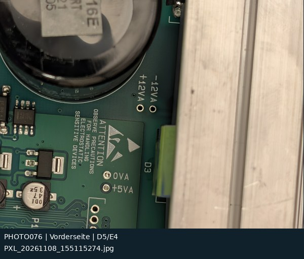</a> | **D5/E4** 0VA/+5VA, SOT-223 und Elko-Umfeld | visuell nach Bauteilbestand zugeordnet Alt: –; Abgleich: –; Inlier: 9 |
| **PHOTO077** [PXL_20261108_155125967.jpg](../../photos/2026-11-08/front/PXL_20261108_155125967.jpg) | <a href="../../photos/2026-11-08/front/PXL_20261108_155125967.jpg">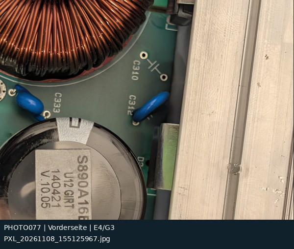</a> | **E4/G3** DC-Link-Elko, großer Ringkern und Kühlkörperrand | visuell nach Bauteilbestand zugeordnet Alt: –; Abgleich: –; Inlier: 10 |
| **PHOTO078** [PXL_20261108_155130312.jpg](../../photos/2026-11-08/front/PXL_20261108_155130312.jpg) | <a href="../../photos/2026-11-08/front/PXL_20261108_155130312.jpg">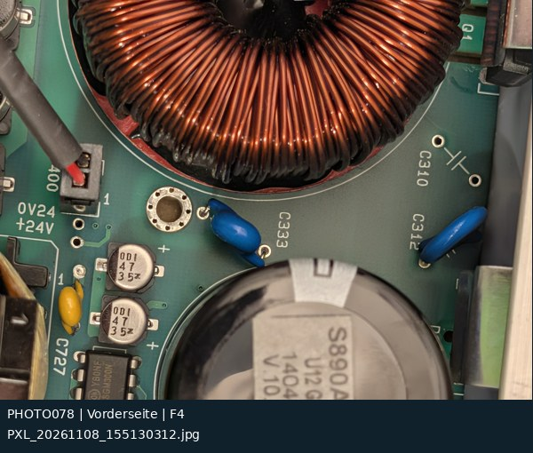</a> | **F4** Mittelfeld / Bildabgleich; Detailinhalt im Original prüfen | vorsichtig registriert Alt: –; Abgleich: F4; Inlier: 18 |
| **PHOTO079** [PXL_20261108_155137120.jpg](../../photos/2026-11-08/front/PXL_20261108_155137120.jpg) | <a href="../../photos/2026-11-08/front/PXL_20261108_155137120.jpg">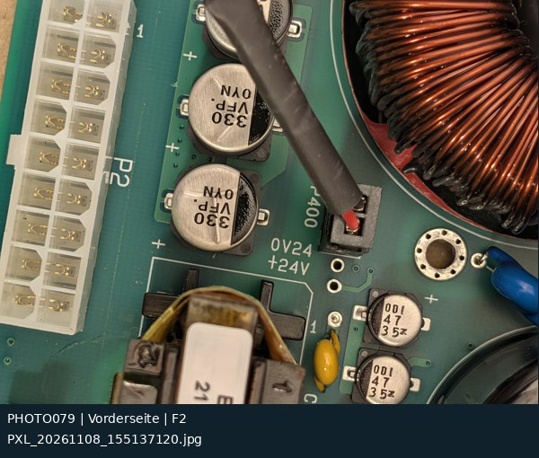</a> | **F2** Mittelfeld / Bildabgleich; Detailinhalt im Original prüfen | vorsichtig registriert Alt: –; Abgleich: F2; Inlier: 12 |
| **PHOTO080** [PXL_20261108_155150890.jpg](../../photos/2026-11-08/front/PXL_20261108_155150890.jpg) | <a href="../../photos/2026-11-08/front/PXL_20261108_155150890.jpg">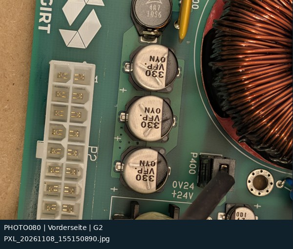</a> | **G2** Mittelfeld / Bildabgleich; Detailinhalt im Original prüfen | vorsichtig registriert Alt: –; Abgleich: G2; Inlier: 28 |
| **PHOTO081** [PXL_20261108_155152683.jpg](../../photos/2026-11-08/front/PXL_20261108_155152683.jpg) | <a href="../../photos/2026-11-08/front/PXL_20261108_155152683.jpg">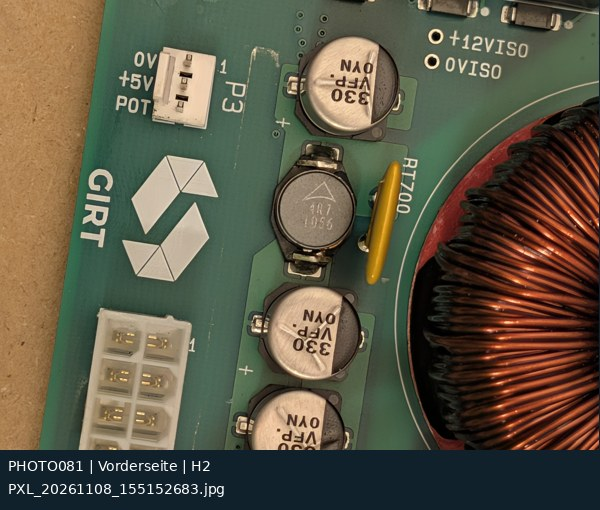</a> | **H2** Mittelfeld / Bildabgleich; Detailinhalt im Original prüfen | gut registriert Alt: –; Abgleich: H2; Inlier: 40 |
| **PHOTO082** [PXL_20261108_155154914.jpg](../../photos/2026-11-08/front/PXL_20261108_155154914.jpg) | <a href="../../photos/2026-11-08/front/PXL_20261108_155154914.jpg">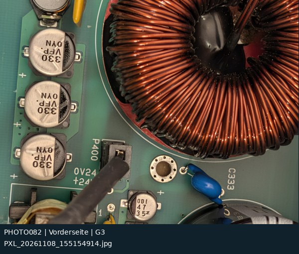</a> | **G3** Mittelfeld / Bildabgleich; Detailinhalt im Original prüfen | vorsichtig registriert Alt: –; Abgleich: G3; Inlier: 25 |
| **PHOTO083** [PXL_20261108_155159325.jpg](../../photos/2026-11-08/front/PXL_20261108_155159325.jpg) | <a href="../../photos/2026-11-08/front/PXL_20261108_155159325.jpg">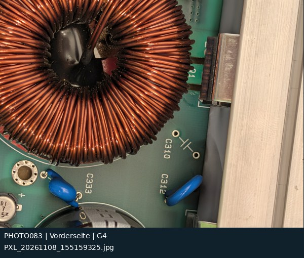</a> | **G4** Mittelfeld / Bildabgleich; Detailinhalt im Original prüfen | vorsichtig registriert Alt: –; Abgleich: G4; Inlier: 21 |
| **PHOTO084** [PXL_20261108_155206065.jpg](../../photos/2026-11-08/front/PXL_20261108_155206065.jpg) | <a href="../../photos/2026-11-08/front/PXL_20261108_155206065.jpg">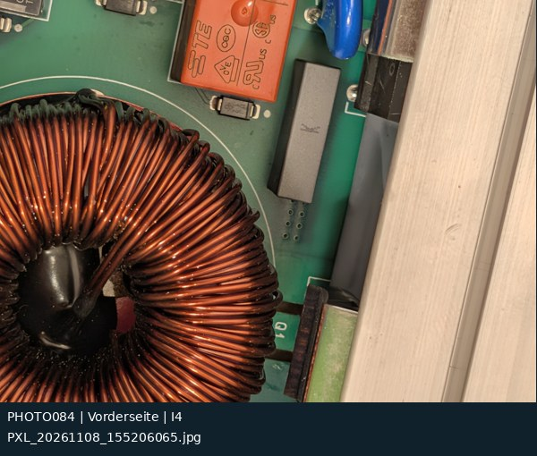</a> | **I4** RT334024, Diodenumfeld und Kühlkörperrand | visuell nach Bauteilbestand zugeordnet Alt: –; Abgleich: –; Inlier: 0 |
| **PHOTO085** [PXL_20261108_155209219.jpg](../../photos/2026-11-08/front/PXL_20261108_155209219.jpg) | <a href="../../photos/2026-11-08/front/PXL_20261108_155209219.jpg">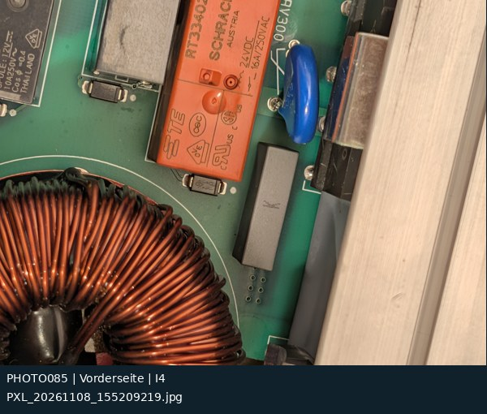</a> | **I4** RT334024-Aufdruck, Spulen-Diodenumfeld | visuell nach Bauteilbestand zugeordnet Alt: –; Abgleich: –; Inlier: 9 |
| **PHOTO086** [PXL_20261108_155217084.jpg](../../photos/2026-11-08/front/PXL_20261108_155217084.jpg) | <a href="../../photos/2026-11-08/front/PXL_20261108_155217084.jpg">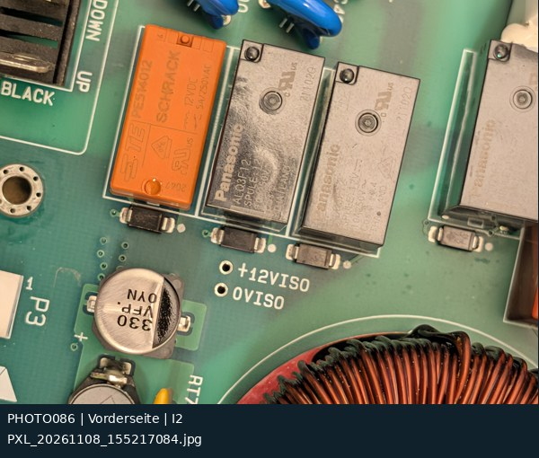</a> | **I2** Mittelfeld / Bildabgleich; Detailinhalt im Original prüfen | gut registriert Alt: –; Abgleich: I2; Inlier: 52 |
| **PHOTO087** [PXL_20261108_155223801.jpg](../../photos/2026-11-08/front/PXL_20261108_155223801.jpg) | <a href="../../photos/2026-11-08/front/PXL_20261108_155223801.jpg">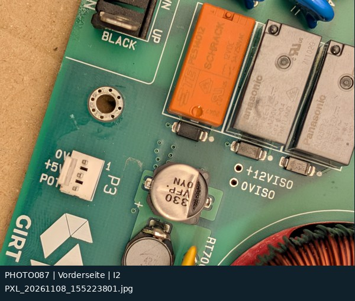</a> | **I2** Mittelfeld / Bildabgleich; Detailinhalt im Original prüfen | gut registriert Alt: –; Abgleich: I2; Inlier: 68 |
| **PHOTO088** [PXL_20261108_155227844.jpg](../../photos/2026-11-08/front/PXL_20261108_155227844.jpg) | <a href="../../photos/2026-11-08/front/PXL_20261108_155227844.jpg">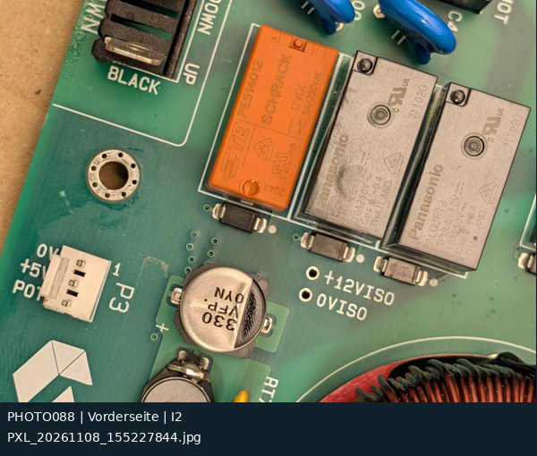</a> | **I2** Mittelfeld / Bildabgleich; Detailinhalt im Original prüfen | gut registriert Alt: –; Abgleich: I2; Inlier: 78 |
| **PHOTO089** [PXL_20261108_155230704.jpg](../../photos/2026-11-08/front/PXL_20261108_155230704.jpg) | <a href="../../photos/2026-11-08/front/PXL_20261108_155230704.jpg">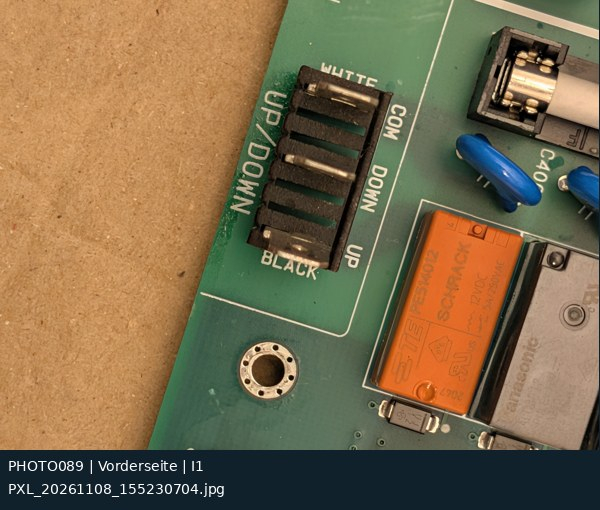</a> | **I1** Mittelfeld / Bildabgleich; Detailinhalt im Original prüfen | vorsichtig registriert Alt: –; Abgleich: I1; Inlier: 33 |
| **PHOTO090** [PXL_20261108_155233092.jpg](../../photos/2026-11-08/front/PXL_20261108_155233092.jpg) | <a href="../../photos/2026-11-08/front/PXL_20261108_155233092.jpg">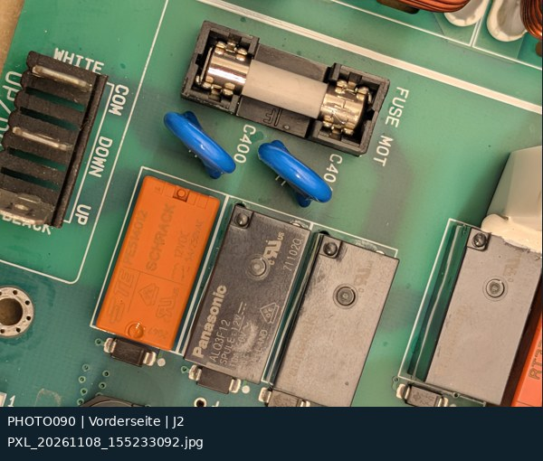</a> | **J2** Mittelfeld / Bildabgleich; Detailinhalt im Original prüfen | gut registriert Alt: –; Abgleich: J2; Inlier: 65 |
| **PHOTO091** [PXL_20261108_155235509.jpg](../../photos/2026-11-08/front/PXL_20261108_155235509.jpg) | <a href="../../photos/2026-11-08/front/PXL_20261108_155235509.jpg">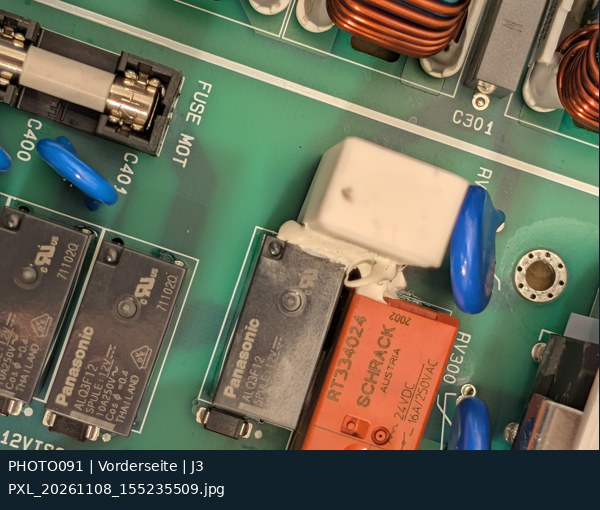</a> | **J3** Mittelfeld / Bildabgleich; Detailinhalt im Original prüfen | gut registriert Alt: –; Abgleich: J3; Inlier: 44 |
| **PHOTO092** [PXL_20261108_155241755.jpg](../../photos/2026-11-08/front/PXL_20261108_155241755.jpg) | <a href="../../photos/2026-11-08/front/PXL_20261108_155241755.jpg">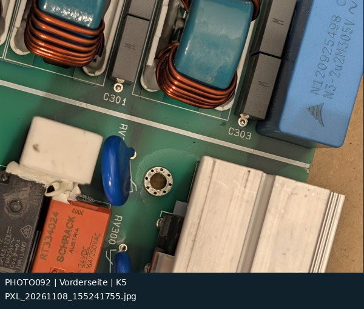</a> | **K5** Mittelfeld / Bildabgleich; Detailinhalt im Original prüfen | vorsichtig registriert Alt: –; Abgleich: K5; Inlier: 20 |
| **PHOTO093** [PXL_20261108_155245932.jpg](../../photos/2026-11-08/front/PXL_20261108_155245932.jpg) | <a href="../../photos/2026-11-08/front/PXL_20261108_155245932.jpg">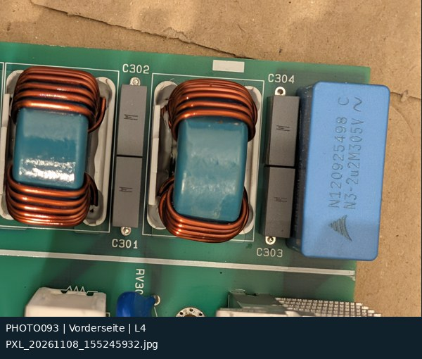</a> | **L4** Netzfilter C301–C304, Drosseln/X-Kondensatoren | visuell nach Bauteilbestand zugeordnet Alt: –; Abgleich: –; Inlier: 12 |
| **PHOTO094** [PXL_20261108_155249678.jpg](../../photos/2026-11-08/front/PXL_20261108_155249678.jpg) | <a href="../../photos/2026-11-08/front/PXL_20261108_155249678.jpg">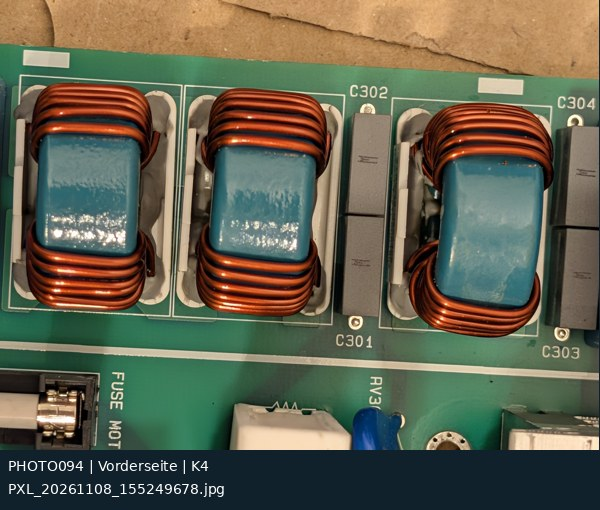</a> | **K4** Mittelfeld / Bildabgleich; Detailinhalt im Original prüfen | gut registriert Alt: –; Abgleich: K4; Inlier: 36 |
| **PHOTO095** [PXL_20261108_155253342.jpg](../../photos/2026-11-08/front/PXL_20261108_155253342.jpg) | <a href="../../photos/2026-11-08/front/PXL_20261108_155253342.jpg">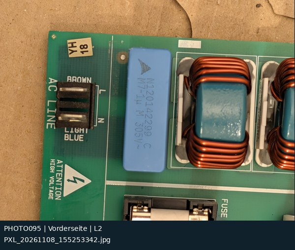</a> | **L2** Mittelfeld / Bildabgleich; Detailinhalt im Original prüfen | gut registriert Alt: –; Abgleich: L2; Inlier: 71 |
| **PHOTO096** [PXL_20261108_155332127.jpg](../../photos/2026-11-08/front/PXL_20261108_155332127.jpg) | <a href="../../photos/2026-11-08/front/PXL_20261108_155332127.jpg">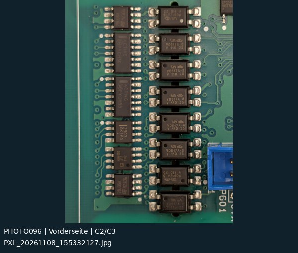</a> | **C2/C3** acht Optokoppler und Logikspalte, Gesamtmakro | visuell nach Bauteilbestand zugeordnet Alt: –; Abgleich: –; Inlier: 7 |
| **PHOTO097** [PXL_20261108_155349372.jpg](../../photos/2026-11-08/front/PXL_20261108_155349372.jpg) | <a href="../../photos/2026-11-08/front/PXL_20261108_155349372.jpg">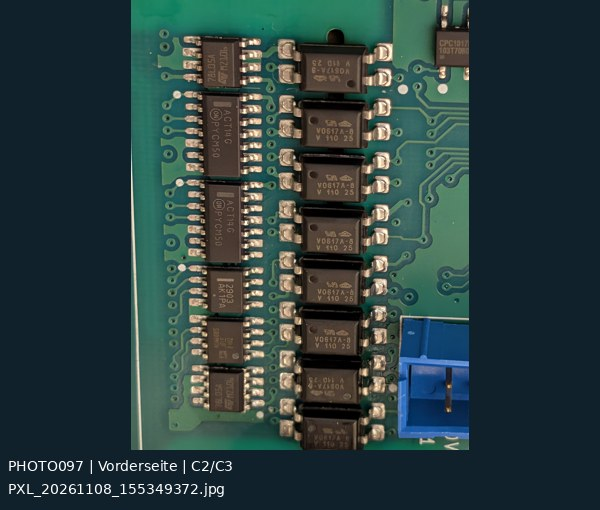</a> | **C2/C3** Optokoppler, Logikspalte und P602 | visuell nach Bauteilbestand zugeordnet Alt: –; Abgleich: –; Inlier: 8 |
| **PHOTO098** [PXL_20261108_155403914.jpg](../../photos/2026-11-08/front/PXL_20261108_155403914.jpg) | <a href="../../photos/2026-11-08/front/PXL_20261108_155403914.jpg">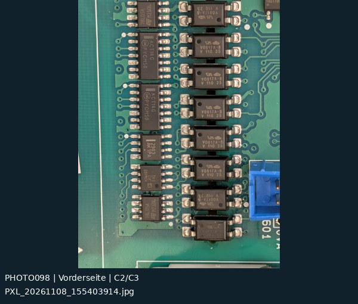</a> | **C2/C3** Optokoppler-/Logikspalte, P601/P602 | visuell nach Bauteilbestand zugeordnet Alt: –; Abgleich: –; Inlier: 4 |
