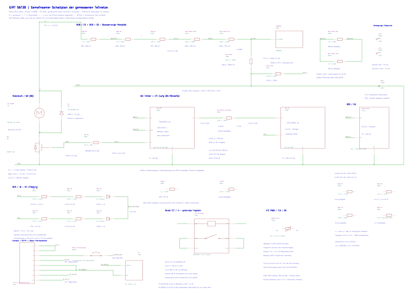

# Gemeinsamer Schaltplan der gemessenen GIRT-S6T30-Teilnetze

**[Schaltplan mit Ausschnitten und Messregister öffnen (PDF)](gesamtschaltplan.pdf)** · [Nur das gemeinsame A1-Blatt](uebersicht_A1.pdf) · [Vektorgrafik zum Zoomen](gesamtschaltplan.svg) · [Bearbeitbare KiCad-Datei](GIRT_Gesamtschaltplan.kicad_sch)

Stand **09.11.2026**, Branch **110926**, Quellenstand `4e8a91f0a84bc1fafa61f6027e0ec2bc0bf99199`. Die bisher einzeln gezeichneten und gemessenen Teilnetze stehen hier auf **einem elektrisch verbundenen KiCad-Blatt**. Gemeinsame Leiterzüge sind native CAD-Netze. 38 Bauteile und Anschlussblöcke mit 88 Anschlüssen sind erfasst. Das Messregister übernimmt alle **87 Ergebniszeilen vom 09.11.**, zusätzlich 50 historische CSV-Messzeilen und neun Beobachtungen aus `HARDWARE.md`.

## Was miteinander verbunden ist

| Bereich | Gemeinsame Verbindung / Darstellung | CAD-Referenzen |
|---|---|---|
| Motorstufe und B18/B19 | L+ führt zum Motoranschluss, D3 und B18-P2; B18/B19 führt über beide 1003 zu VFEED / L4981AD Pin 14 und über 3922 zu 0VA | M1, Q2, D3, R101–R107, U301 |
| B19, zusätzliche 1004 | Beide linken Kappen gemeinsam; beide rechten Kappen gemeinsam. Die zwei 1-MΩ-Bauteile liegen parallel. Weitere Netzeinbindung offen | R108, R109 |
| Q2-Gate und Treiber | G = RG-G; über 22 Ω nach RG-U = Treiber E; Treiber B liegt an 0VA | Q2, R201, U201 |
| Treiber C und 1P | C = R2211-b; über den echten 2,21-kΩ-Widerstand zu R2211-a = 1P.O; 1P.R liegt an 0VA. 1P.L bleibt offen | U201, R202, U202 |
| B20 | Tb liegt ebenfalls an 0VA. Ta/Tc und die vier gemessenen Widerstände bleiben mit ihren noch unbekannten Anschlusswegen erhalten | U401, R301–R304 |
| Hilfsversorgung | +5VA und +24V als gemessene Referenzpunkte; 0V24 = 0VA im geprüften Steckzustand | TP501–TP503 |
| B10 | Zwei AC-Sense-Ketten mit gemeinsamem Dioden-Kathodenknoten; Auswertung dahinter offen | R401–R404, D401, D402 |
| Relais und NTC | Doppelpadgruppen 11a/b und 14a/b verbunden; Spule, Kontakt und NTC als eigene Fragmente, ohne erfundene Versorgungspfade | K501, TH501 |
| P2/P4 und Thermoschalter | P2.1 = P2.4; P2.7 = P2.8 = P4.0V; P2.5 zum Motor-Thermokontakt mit unbekanntem Zielpin des rosa Rückwegs | J201, J204, SW501 |
| Weitere gemessene Widerstände bei Q2 | R1001 und R4752 sind enthalten; ihre Endkappen wurden noch keinem bestimmten Signal-/Versorgungsnetz zugeordnet | R203, R204 |

Die **0VA-Leitung verbindet** B19-Fusspunkte, Q2-Source gemäß Altstand, Treiber B, 1P.R und B20.Tb. **0V_KONSOLE bleibt ein separates Netz**: Für eine Verbindung von P2/P4-Rückleiter zu 0VA gibt es keinen Durchgangsnachweis. Gleichnamig wirkende Versorgungspunkte werden nicht allein aufgrund ihrer Bezeichnung verbunden; beispielsweise ist P4.+12V nicht als Verbindung zu P2.1 ergänzt.

## Messwerte und offene Zuordnungen lesen

- **M:** vom Nutzer berichtete Messung. **F:** sichtbarer Verlauf im Originalfoto. **I:** Schluss aus Aufdruck, Pinout oder bisherigem Stand. [Jeder Verbindungsbeleg mit Quelle und Einstufung](verbindungsbelege.csv).
- Die CAD-Referenzen R101, U201 usw. dienen diesem Dokument. [Bauteiltabelle](bauteile.csv), sichtbare Original-IDs und KiCad-Eigenschaften erhalten die bisherigen Bezeichnungen. **Claudes A–L × 1–6-Raster bleibt unverändert.** Schematische Platzierung ist keine neue Platinenkoordinate.
- A/B/C/D5/E am Treiber sowie O/L/R am 1P sind die **Labels der Originalmakros**, keine Hersteller-Pinnummern. Am R2211 bezeichnet **a die linke**, **b die rechte** Endkappe in der Orientierung von Foto 50386. Deshalb liegt in dieser Zeichnung b auf der linken Symbolseite und a auf der rechten. Bei B20 bleibt a = unten und b = oben im ursprünglichen Messplan.
- Tatsächliche Widerstände sind mit Aufdruck-Nennwert und gemessenem In-Circuit-Wert getrennt beschriftet. Beispiel: **4750 = 475 Ω**, gemessen 478 Ω; **2211 = 2,21 kΩ**, gemessen 2,09 kΩ; **1001 = 1 kΩ**, gemessen 979/977 Ω. Die letzte Code-Ziffer von B20-R4 bleibt ungesichert.
- Die **68,4 Ω zwischen Relais-Kontaktgruppen**, 9,14 kΩ G–S, Treiber-Matrizen und kΩ-Anzeigen zu +24V sind Messungen am Netzwerk. Daraus entstehen keine zusätzlichen Einzelwiderstände oder Dioden im Schaltplan. Der dokumentierte 68-Ω-Vorladewiderstand wurde noch nicht durch eine separate Anschlussverfolgung als Ursache des Relais-Messpfads bestätigt.
- Q2-D = L− und Q2-S = 0VA folgen dem bisherigen Stand mit Pinout/Diodentest (**I+M**); ein neues separates Pad-zu-Klemmen-Protokoll liegt nicht vor. Bei D3 war Schwarz = L+ im Altprotokoll angenommen. Die Q2-Body-Diode gehört zum MOSFET und ist kein zusätzliches diskretes Bauteil.
- **0V24 = 0VA gilt für den gemessenen Steckzustand.** Ob der Weg vollständig über die Platine oder angeschlossene Teile führt, wurde nicht getrennt geprüft. P400 war gesteckt; seine einzelnen Steckerpins sind nicht als vermessene Leitungen zu den Testpunkten ergänzt.
- Anschlusswege, die über unbekannte IC-Innenschaltungen, verdeckte Leiterbahnen oder unbestimmte Motor-/Steckerpins führen, bleiben offen. Insbesondere sind die B20-Widerstände nicht aufgrund ähnlicher Messwerte an Ta/Tc oder TL082-Pins angeschlossen.

**Typkandidaten bleiben bedingt:** [FAN3100C-Dokumentation](../netlist/q2_treiber_fan3100c_kandidat.md) legt unter dieser Annahme A = Pin 3 / IN+, B = Pin 2 / GND, C = Pin 1 / VDD, D5 = Pin 4 / IN− und E = Pin 5 / OUT nahe. Die Zeichnung verwendet deshalb einen Fünfanschluss-Block statt eines als sicher behaupteten FAN3100C. Für 1P kommt die 2222A-NPN-Familie infrage; O = Kollektor, L = Basis, R = Emitter gilt nur unter dieser Typannahme. Die [Diodentests am 1P](../messplan_stromlos_2026-11-08/Q2_1P_DIODENTEST_AUSSTEHEND.csv) sind **weiter ausstehend**. Positive Treiberversorgung und tatsächliche Zweigfunktion bleiben offen.

## Dateien und Prüfung

- [PDF, 23 Seiten](gesamtschaltplan.pdf): ein gemeinsames A1-Blatt, sieben vergrößerte Ansichten desselben Blatts, anschließend das Messregister. Die Ausschnitte ergänzen keine neuen Verbindungen.
- [Native KiCad-9-Datei](GIRT_Gesamtschaltplan.kicad_sch): alle benötigten Symbole sind eingebettet. Die Datei lässt sich ohne zusätzliche Symbolbibliothek öffnen und bearbeiten. Sie rekonstruiert den gemessenen Teilstand und ist keine Fertigungs- oder Simulationsfreigabe.
- [KiCad-XML-Netzliste](gesamtschaltplan.xml), [Netze und Original-Aliase](netze.csv), [Bauteile](bauteile.csv), [maschinenlesbares Modell](connected_model.json).
- [Messregister CSV](messwerte.csv) und [vollständige Quellfelder JSON](messwerte_vollstaendig.json): Anzeigen, Gegenrichtungen, zeitliche Trends, Steckzustände und Korrekturhinweise. Nicht berichtete Richtungen bleiben nicht berichtet. Historische Werte sind als solche getrennt; B10-M16 ist ausdrücklich durch B10-M29 überholt.
- [Prüfnachweis](pruefnachweis.json): KiCad hat PDF, SVG und Netzliste erfolgreich exportiert. Die unabhängig aus den Verbindungsbelegen gebildeten Netzgruppen wurden mit der tatsächlichen CAD-Netzliste verglichen: **alle 88 Pins, 7.744 Paarvergleiche stimmen überein**. Damit sind insbesondere keine Serienwiderstände oder getrennten Masse-/Versorgungsnetze versehentlich überbrückt. Das ist eine Dateikonsistenzprüfung, kein elektrischer Funktionstest der Platine.
- [Originalmedien-Prüfung](originalmedien_pruefung.json): Alle 148 bereits im Quellenstand vorhandenen Dateien unter `photos/` und `docs/img/`, einschließlich Rasterindex und früherer Uploads, sind bytegleich erhalten.
- [Reproduzierbarer Generator](erzeugen.py): `python docs/gesamtschaltplan_110926/erzeugen.py` im Repository; benötigt KiCad CLI 9, Python, PyMuPDF und ReportLab. Eigene XDG-Verzeichnisse liegen unter `/workspace/work/kicad_runtime`. Quellprüfsummen stehen im Prüfnachweis. Verbindungsänderungen sollen erst in den Belegen und dann im Generator erfolgen; der Netzabgleich erkennt abweichende CAD-Verbindungen.

Es wurden **keine neuen Messungen ausgeführt, keine Reinigungs-/Löterfolge angenommen und keine Fotos verändert oder neu erzeugt**. Der bisherige [Teilschaltplan](../schaltplan_110926/README.md), [Fotoatlas](../atlas_110926/README.md), die Originalmakros und alle Rohprotokolle bleiben erhalten. Das gemeinsame Blatt macht die noch offenen Signal- und Versorgungspfade sichtbar; eine Fehlerursache ist damit nicht bewiesen.
