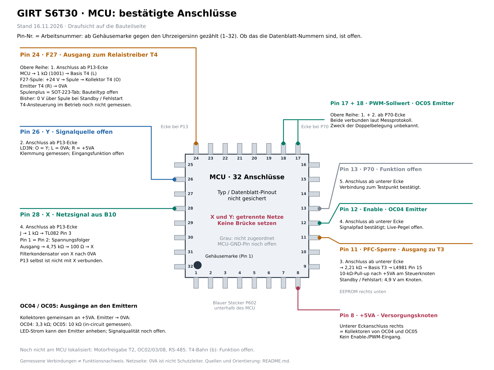

# MCU-Anschlüsse – Stand 16.11.2026

Stand: Messungen bis 16.11. 02:32, Pin-Arbeitsnummern ergänzt 16.11. 02:50. [Skizze PNG](mcu_anschluesse.png) · [SVG](mcu_anschluesse.svg) · [PDF](mcu_anschluesse.pdf).

Die Zeichnung ist eine technische Gehäuseskizze, kein erzeugtes Platinenfoto. Keine Originalfotos wurden geändert. Orientierung wie im Original [OC05-Messfoto](../../photos/2026-11-16/oc05_emitter_mcu_pins.jpg): Gehäusemarke unten links, blauer P602-Stecker unten, P70 rechts, EEPROM rechts unten. Andere Fotos sind gegenüber dieser Ansicht gedreht. Claudes Platinenraster und bestehende IDs bleiben unverändert.

**Pin-Nummern (1–32) sind Arbeitsnummern für die gemeinsame Verständigung:** gezählt ab der Gehäusemarke (Pin 1, in der Skizze unten links) gegen den Uhrzeigersinn – unten 1–8, rechts 9–16, oben 17–24, links 25–32. Das entspricht der üblichen QFP-Konvention; **ob es die Datenblatt-Nummern sind, ist offen**, da der MCU-Typ nicht identifiziert ist. Die lokalen Zählangaben („n. Anschluss ab Ecke …“) bleiben zusätzlich stehen. Zuordnung: Pin 8 +5VA · Pin 11 PFC-Sperre (T3) · Pin 12 Enable (OC04) · Pin 13 P70 · Pin 17/18 PWM (OC05) · Pin 24 F27 (T4) · Pin 26 Y · Pin 28 X (Netzsignal). Gleiche Nummern wie `../img/mcu_pinbelegung.jpg`. Der MCU-Typ und seine offiziellen Portfunktionen sind nicht identifiziert. Ein gemessener Anschluss an +5VA bestätigt das Netz, nicht die genaue interne Funktion dieses Versorgungspins (VDD/VDDA/Referenz).

| Netz | Lage in der Skizze | Gesicherter Anschluss / Stand | Quelle |
|---|---|---|---|
| X, Netzsignal | linke Seite, 4. von oben, ab P13-Ecke | B10 → TL082-Spannungsfolger → 4,75 kΩ → 100 Ω → X; Kondensator nach 0VA; Via oberhalb LD3N-L = X | Tagesprotokoll 16.11. 01:19/01:24; [X/Y-Bild](../img/mcu_pin_netzsignal.jpg) |
| Y, Quelle offen | linke Seite, 2. von oben, ab P13-Ecke | LD3N O → Y; L → 0VA; R → +5VA. Funktion als geschützter Eingang plausibel, Portfunktion nicht bekannt. | 16.11. 00:48/00:51, korrigiert 01:19/01:24 |
| PWM-Sollwert | obere Seite, 1. und 2. von rechts, ab P70-Ecke | OC05 Emitter zu beiden Anschlüssen gemeldet. Gemeinsames Signal; Timer-/Interrupt-Funktion nicht belegt. | 16.11. 02:00; [Original](../../photos/2026-11-16/oc05_emitter_mcu_pins.jpg) |
| F27-Ansteuerung, Ausgang | obere Seite, linker Eckanschluss, 1. ab P13-Ecke | MCU → 1 kΩ (1001) → Basis T4 (L); Kollektor O → Spulen-Minus; Emitter R → 0VA. Dieser Eckanschluss ist nicht direkt mit +5VA verbunden. | 16.11. 02:15–02:31; [MCU-Messfoto](../../photos/2026-11-16/t4_bahn_a_mcu_eckpin.jpg), [1001-Messfoto](../../photos/2026-11-16/t4_1001_bahn_a.jpg) |
| Enable | rechte Seite, 4. von unten, ab EEPROM/P602-Ecke | OC04 Emitter; Zählecke 01:59 bestätigt. Das OC04-Bild ist gegenüber der Skizze um 90° gedreht. | 16.11. 01:55/01:59; [Original](../../photos/2026-11-16/oc04_emitter_mcu_pin.jpg) |
| PFC-Sperre, Ausgang | rechte Seite, 3. von unten | Steuerknoten → 2,21 kΩ → T3-Basis; Pull-up 10 kΩ nach +5VA; T3-Kollektor an L4981 Pin 15. Steuerknoten 4,9 V in Standby und Fehlstart. | 14.11. 17:30–17:44; lokale Zählung am MCU |
| P70, Rolle offen | rechte Seite, 5. von unten | Testpunkt P70 direkt verbunden; nicht mit T3-Steuerleitung gleichsetzen. Keine Ein-/Ausgangsrichtung behauptet. | 14.11. 17:38; gleiches Zählbild |
| +5VA, Versorgung | untere Seite, rechter Eckanschluss | Gemeinsame Kollektoren OC04/OC05 → +5VA → dieser MCU-Anschluss. Kein Signalanschluss der beiden Koppler. | 16.11. 01:46–01:53; [Original](../../photos/2026-11-16/oc04_kollektor_mcu_pin.jpg) |

Quellen sind die Messprotokolle vom 14.–16.11.2026 (Archiv-Branch `archiv-vor-aufraeumen-2026-11-27`). Für die Zuordnungen gelten die jeweils letzten bestätigten Einträge, nicht zurückgenommene Zwischenstände.

## Elektrische Einordnung

- OC04 und OC05 sind auf der Ausgangsseite mit gemeinsamem Kollektor an +5VA beschaltet. Die Emitter sind die Signalabgriffe; gemessen wurden 3,3 kΩ bzw. 10 kΩ von dort nach 0VA. Diese In-circuit-Werte werden nicht als unabhängig identifizierte Einzelwiderstände ausgegeben.
- X und Y sind getrennte Netze. 6,4–6,5 kΩ zwischen ihnen rechtfertigen keine Drahtbrücke. Die geprüfte LD3N-Klemmung an Y darf nicht automatisch X zugerechnet werden.
- Die Durchgangszuordnung der Koppler zum MCU beweist noch keine korrekten Enable-Pegel oder PWM-Flanken im Betrieb. Für OC05 ist die gemeldete Doppelbelegung dokumentiert, aber keine interne Funktion der beiden MCU-Pins abgeleitet.
- T3 ist als **Ausgangspfad** separat eingezeichnet. Der Grund der ausbleibenden PFC-Freigabe bleibt offen.
- T2-Ansteuerung sowie weitere Optokoppler und der MCU-Masseanschluss sind noch nicht lokalisiert und erhalten keine erfundene Position.

## Ergänzung F27 / T4

Das neue [MCU-Messfoto](../../photos/2026-11-16/t4_bahn_a_mcu_eckpin.jpg) zeigt die Gehäusemarke oben links, P602 links und P70 unten. Es ist gegenüber der Skizze um 90° im Uhrzeigersinn gedreht. Sein rechter oberer Anschluss entspricht deshalb dem **linken Anschluss der oberen Reihe** in der Skizze. Er ist weder der +5VA-Anschluss rechts unten noch Y (linke Reihe, zweiter Anschluss von oben).

Bestätigte Netze laut Messprotokoll 16.11. 02:31: Basis T4 (L) → Nicht-MCU-Ende des 1001 ≈ 0 Ω; Emitter (R) → 0VA ≈ 0 Ω; Kollektor (O, Einzelanschluss) → F27-Spulenminus. L/R/O sind die lokalen Anschlussnamen des Messprotokolls, keine Richtungsangaben für alle gedrehten Fotos. „1001“ entspricht 1 kΩ. Die Diodenwerte 0,67/0,68 V ab L passen zusammen mit der Beschaltung zu einem NPN; der genaue Transistortyp und seine Funktion unter Last bleiben offen.

Spulenplus liegt laut 02:32 auf dem +24-V-Netz und ist mit dem Tab des benachbarten SOT-223 verbunden. Der Typ und die Funktion dieses SOT-223 bleiben offen; keine unbelegte Regler- oder Transistorbezeichnung ergänzen. Bereits gemessen: Spulenplus 24 V gegen 0VA, Spannung über der Spule 0 V in Standby und Fehlstart. Eine Freilaufbeschaltung ist bislang nicht zugeordnet und wird nicht erfunden. Die zweite Bahn (b) der T4-Gruppe bleibt offen; insbesondere ist eine Relais-Rückmeldung zum MCU nicht nachgewiesen.

## Hinweise

Die neueren Emitter-Zuordnungen ersetzen die früheren Aussagen, die gemeinsamen Kollektoren seien Enable-/PWM-Eingänge. Das alte Bild `mcu_pin_oc04_enable.jpg` zeigt nach aktueller Messung den +5VA-Anschluss; seine historische Bildbeschriftung ist keine aktuelle Funktionszuordnung.

Reproduktion: `python docs/mcu_pins/render.py` (Matplotlib). Die Skizze wertet dokumentierte Messungen aus; neue elektrische Messungen wurden nicht durchgeführt.
