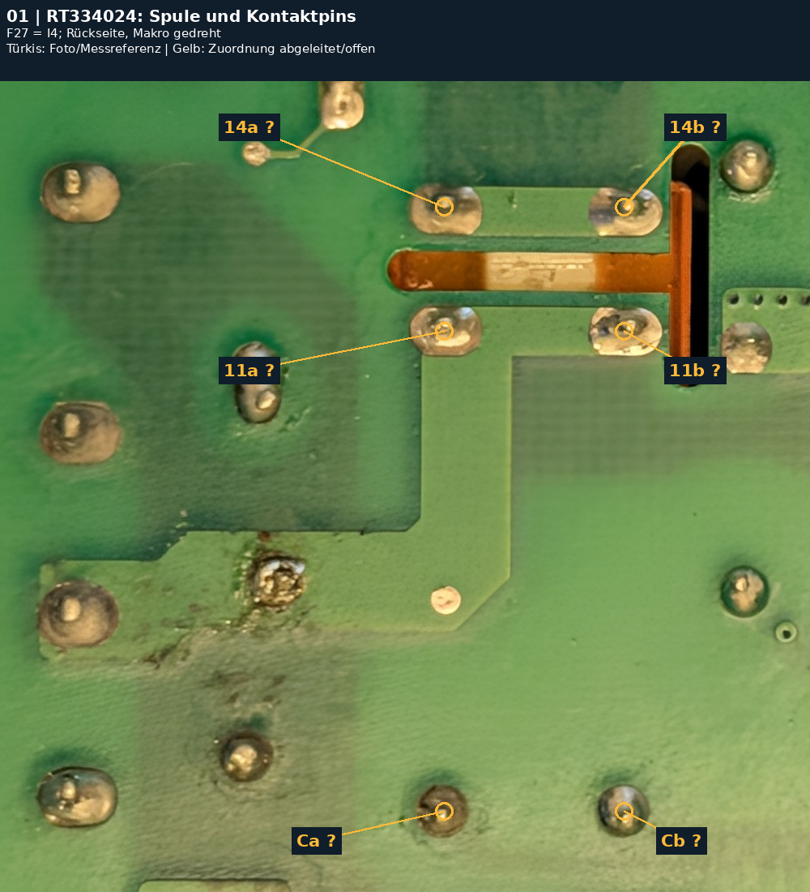
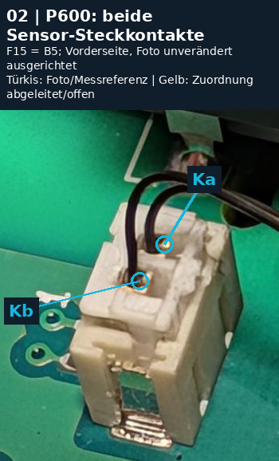
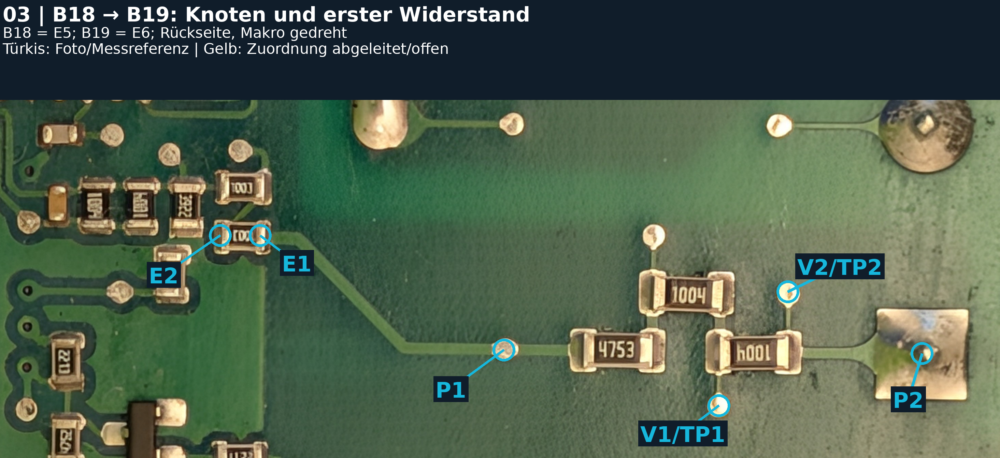
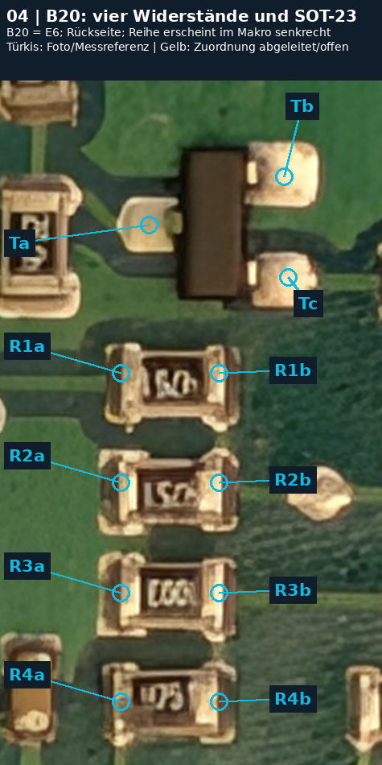
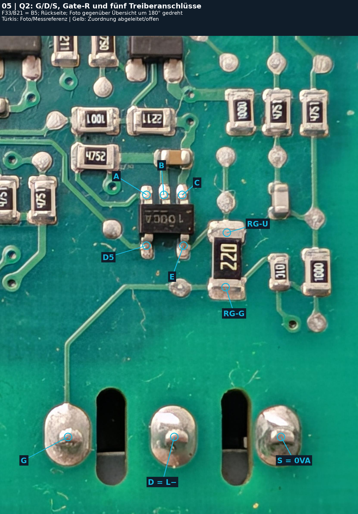
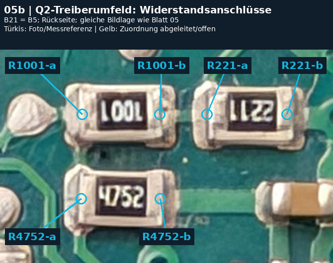
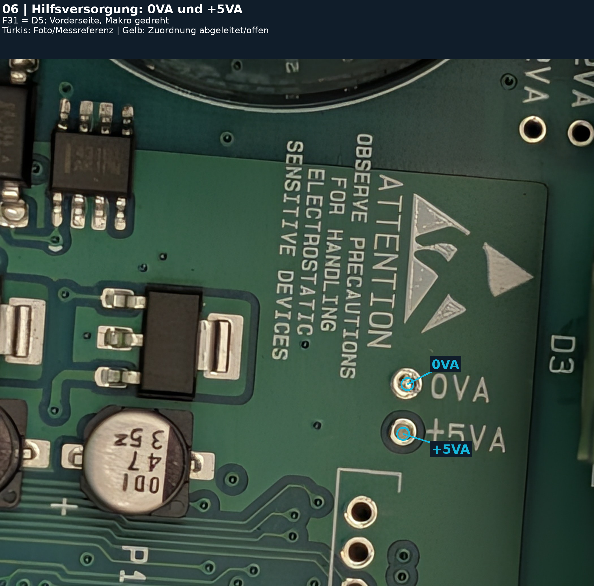
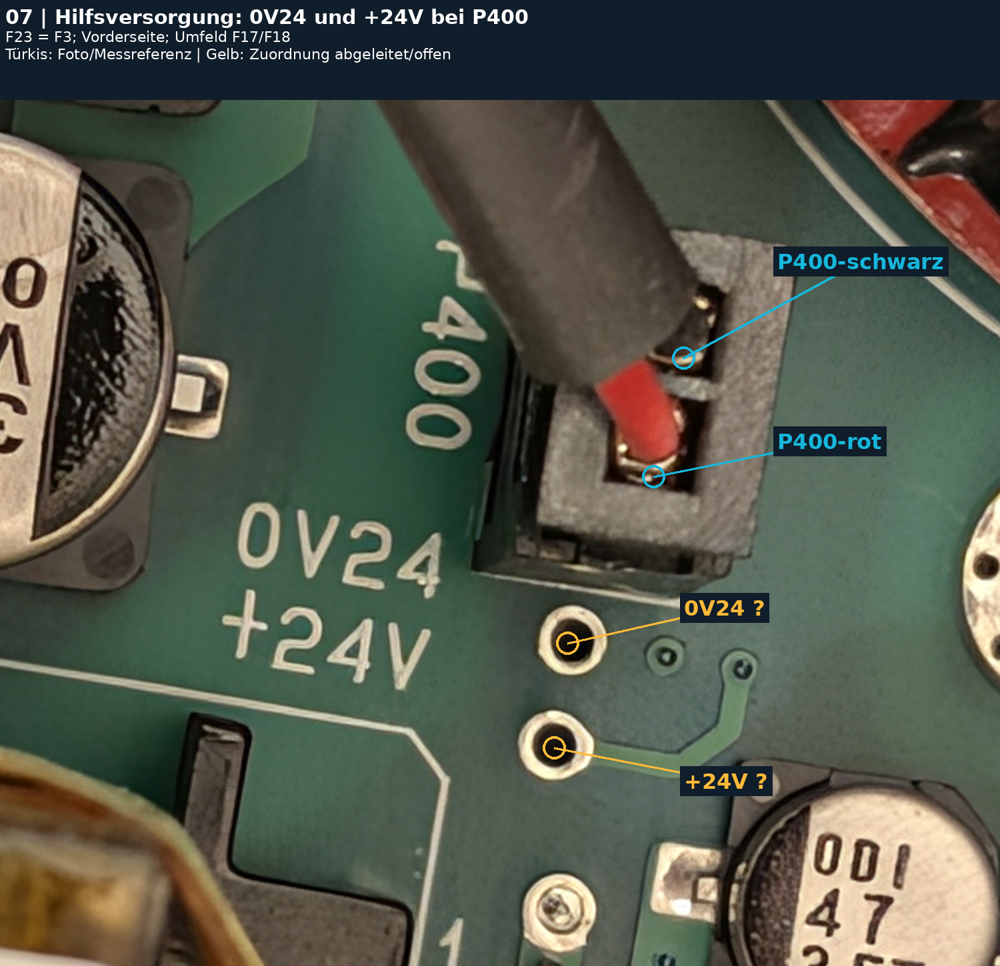

# GIRT S6T30 – stromloser Messplan mit Originalmakros

Basis: `9d1f74617b602f57db36a1993998581de360b832` · Plan 08.11.2026 · Ergebnisse/Nachtrag 09.11.2026

**Nachtrag 09.11.2026:** Blätter 01–05/05b sind im jeweils dokumentierten stromlosen Umfang abgearbeitet. [Blatt 01](ERGEBNISSE_2026-11-09.md) · [Blatt 02](P600_ERGEBNISSE_2026-11-09.md) · [Blatt 03: B18/B19, Korrekturen und offene Punkte](B19_ERGEBNISSE_2026-11-09.md) · [Blatt 04: B20](B20_ERGEBNISSE_2026-11-09.md) · [Blätter 05/05b: Q2 und Treiber](Q2_TREIBER_ERGEBNISSE_2026-11-09.md) · [ausgefüllte Ergebnis-CSV](messprotokoll_2026-11-09.csv). Blätter 03–05b, Quellenabgleich und PDF sind nachgeführt; andere Planabschnitte enthalten den ursprünglichen Ausgangsstand. **Als Nächstes Blatt 06 (Hilfsversorgung).**

**Arbeitsgrundlage.** Repository-Stand 9d1f74617b602f57db36a1993998581de360b832. Zuerst gelesen: docs/STAND_2026-11-08.md, docs/netlist/* und photos/2026-11-08/back_raster_index.csv; danach Übersichts-PDF, HARDWARE.md und Foto-Inventar. Diese Arbeitsgrundlage beschreibt den Planstand vom 08.11.; die Nutzer-Messungen vom 09.11. stehen in den verlinkten Nachträgen.

**Koordinaten unverändert.** Claudes Raster bleibt A–L × 1–6, dasselbe Feld auf beiden Platinenseiten. Variante A: Vorderseite wie fotografiert, Rückseite vertikal gespiegelt. Variante B: Rückseite wie fotografiert, Vorderseite vertikal gespiegelt; Zeilen 6 oben bis 1 unten. Makros werden hier weder gedreht noch gespiegelt. Die Zusatz-IDs identifizieren nur Anschlüsse im jeweiligen Originalmakro. Rasterangaben bleiben grob (laut Quelle etwa ±1 Feld).

**Vor jeder Messung.** Netzstecker ziehen und alle externen Versorgungen trennen. Restspannung direkt am Zwischenkreis-Elko in V DC prüfen; erst nach bestätigtem Wert unter 5 V zu den hier geplanten Ω-/Diodentests wechseln. Nur spannungsfrei messen; vorhandene Anschlüsse nicht brücken. DC MOTOR für vergleichbare Leistungsteilwerte abgezogen lassen (B10-M22). Sensor für NTC-01/02 abziehen. Steckzustände protokollieren. 0VA = Netzseite/DC−, kein Schutzleiter.

**Messwerte richtig lesen.** Prüfspitzen kurzschließen und Eigenwiderstand notieren (bisher 0,2–0,4 Ω). Ω-Werte samt Zeitverlauf und Polung erfassen; 10/60 s sind nur Ablesezeiten, kein Beweis für Einschwingen. Bei weiterem Trend bis zum erkennbaren Endwert beobachten oder ausdrücklich „nicht eingeschwungen“ eintragen. Bei hoher Impedanz kein Kontakt mit Fingern. Diodenmessung: Rot ist positive Prüfspitze. Keine pauschalen Gut-/Schlechtgrenzen für unbekannte In-Circuit-Netze.

**Reihenfolge aus dem Stand.** 1 Relais F27; 2 NTC F15; 3 B19/B20 fotografieren und sichtbaren B18-Pfad prüfen; 4 Q2-Treiber reinigen/lesen und Pins zu Referenzen kartieren; 5 Hilfsversorgung, Elkos und Lötstellen. B10 und Q2 nicht wegen alter Zwischenhypothesen erneut als defekt behandeln. Klickvergleich beim Gut-/Fehlstart und andere Betriebsmessungen gehören nicht zu diesem stromlosen Plan.

**Status.** Türkis F/M: Kontakt sichtbar bzw. vorhandene Messreferenz; der Marker ist keine neue elektrische Bestätigung. Gelb I/?: aus Pinraster/Aufdruck abgeleitete Zuordnung, zuerst durchmessen. H: Funktion oder Sollwertmodell offen. Neue Ergebnisfelder bleiben leer. Die Originalfotos wurden nur gelesen; PNGs enthalten Ausschnitte mit Overlays und Kopfzeile, ohne erzeugte Platineninhalte.

## Blatt 01 – RT334024: Spule und Kontaktpins

F27 = I4; Rückseite, Makro gedreht

Original: [photos/2026-11-08/back/PXL_20261108_154119736.jpg](https://github.com/kmoellenhoff/myrun_diagnostics/blob/9d1f74617b602f57db36a1993998581de360b832/photos/2026-11-08/back/PXL_20261108_154119736.jpg) · Ausschnitt im Original (x0,y0,x1,y1): `(900, 1150, 1900, 2150)`. Pixelursprung links oben, x nach rechts, y nach unten; keine Änderung des Platinenrasters.

**Messmodus.** RLY-01: Ω Ca–Cb, beide Richtungen. RLY-02/03: Ω 11a–11b / 14a–14b. RLY-04: Ω 11a–14a, beide Richtungen; nichts bestromen.

**Bisher.** Keine Spulen- oder Kontaktmesswerte dokumentiert. Laut HARDWARE.md wurden Relais-/Umfeldlötstellen bereits nachgelötet; Fehler kam zurück.

**Erwartung.** Spule allein 1,44 kΩ bei 23 °C, ±10 % (1,296–1,584 kΩ); in-circuit können Diode/Ansteuerung den Wert senken oder polungsabhängig machen. 11a–11b und 14a–14b etwa Spitzenwiderstand (bisher 0,2–0,4 Ω).

**Grenze / Zuordnung.** I = aus Gehäuselage, Sechspin-Geometrie und Hersteller-Bottom-View abgeleitet, noch nicht elektrisch bestätigt. Spulenpaar und Kontakt-Doppelpaare zuerst prüfen. Schließer allein unbestromt OL; eingelötet können Parallelpfade endliche Werte ergeben. Kein sicherer 68-Ω-Pfad belegt. Statisch lässt sich das Schließen unter Last nicht beurteilen.

| Foto-ID | Originalpixel (x,y) | Status | Kontakt / Zuordnung |
|---|---|---|---|
| Ca | 1448, 2050 | I | Spulenanschluss; A1/A2-Reihenfolge offen |
| Cb | 1670, 2050 | I | zweiter Spulenanschluss |
| 11a | 1448, 1458 | I | Kontaktseite nahe Spule, Pin 11 nach RT1-Pinraster |
| 11b | 1670, 1458 | I | zweiter Pin derselben Kontaktseite |
| 14a | 1448, 1305 | I | Kontaktseite fern der Spule, Pin 14 nach RT1-Pinraster |
| 14b | 1670, 1305 | I | zweiter Pin derselben Kontaktseite |

## Blatt 02 – P600: beide Sensor-Steckkontakte

F15 = B5; Vorderseite, Foto unverändert ausgerichtet

Original: [photos/2026-11-08/q2/q2_vorderseite_makro.jpg](https://github.com/kmoellenhoff/myrun_diagnostics/blob/9d1f74617b602f57db36a1993998581de360b832/photos/2026-11-08/q2/q2_vorderseite_makro.jpg) · Ausschnitt im Original (x0,y0,x1,y1): `(670, 750, 1020, 1190)`. Pixelursprung links oben, x nach rechts, y nach unten; keine Änderung des Platinenrasters.

**Messmodus.** NTC-01/02: Sensorstecker von P600 abziehen; Ω direkt zwischen den zwei markierten kabelseitigen Crimpkontakten. Kalt, dann mit Handwärme, danach bei gleichbleibender Temperatur Leitung/Stecker vorsichtig bewegen. NTC-03: wieder gesteckt, Ω zwischen denselben Kontakten; Vergleich nur mit eigenem gesteckten Ausgangswert.

**Bisher.** HARDWARE.md §2: NTC 10 kΩ; gemessen ca. 11 kΩ bei Raumtemperatur, 10,75 kΩ erwärmt. Temperaturen und damaliger Steckzustand fehlen.

**Erwartung.** Abgezogen bei ähnlicher Temperatur grob 10–11 kΩ, kein harter Toleranztest. Bei Erwärmung gleichmäßig fallend. Bei konstantem Temperaturzustand keine Sprünge/OL durch Kabelbewegung. Gesteckt können Parallelpfade den Absolutwert ändern.

**Grenze / Zuordnung.** Ka/Kb sind lokale Fotobezeichnungen, keine behaupteten P600-Pinnummern; NTC ist unpolar. Foto zeigt den Stecker gesteckt. Markiert ist das sichtbare Kontaktmetall, nicht Kunststoff. Die abgezogene Steckansicht ist nicht im Repository vorhanden. Eine schlechte Buchsen-Lötstelle kann beim Messen nur auf der Kabelseite unentdeckt bleiben; deshalb zusätzlich Lötstellen ansehen, nicht durch einen stabilen Sensortest freigeben.

| Foto-ID | Originalpixel (x,y) | Status | Kontakt / Zuordnung |
|---|---|---|---|
| Ka | 876, 918 | F | sichtbarer Crimpkontakt, weiter vom P600-Schriftzug |
| Kb | 845, 964 | F | sichtbarer Crimpkontakt, näher am P600-Schriftzug |

## Blatt 03 – B18 → B19: Knoten und erster Widerstand

B18 = E5; B19 = E6; Rückseite, Makro gedreht

Original: [photos/2026-11-08/back/PXL_20261108_153921371.jpg](https://github.com/kmoellenhoff/myrun_diagnostics/blob/9d1f74617b602f57db36a1993998581de360b832/photos/2026-11-08/back/PXL_20261108_153921371.jpg) · Ausschnitt im Original (x0,y0,x1,y1): `(1150, 700, 4080, 1750)`. Pixelursprung links oben, x nach rechts, y nach unten; keine Änderung des Platinenrasters.

**Messmodus / Stand.** Ω, stromlos, in-circuit. Nachtrag 09.11.2026: Blatt 03 im geprüften Umfang abgeschlossen; nächste Messungen auf Blatt 04 (B20). Alle Einzelwerte, Polungen und Grenzen: B19_ERGEBNISSE_2026-11-09.md und ausgefüllte Ergebnis-CSV.

**Ergebnisse.** P1–E1 0,4 Ω. E1–E2 zuerst 97,6 kΩ, erneut 102,6/90,4 kΩ; benachbarter 1003 gleich. 3922: 38,43/38,91 kΩ. Beide B19-1004 parallel bestätigt: 498/496 kΩ. 4750: 478 Ω beidseitig (korrigierte Einheit). P2–0VA bis 6 MΩ steigend, dann fallend; Endwert offen.

**Korrektur / Zuordnung.** E1–E2 trägt 1003 = 100 kΩ; der frühere 1-kΩ-Planwert war ein Lesefehler. E2 = Pad A; A zum oberen linken 1003, dessen unteres Ende = Pad B: je 0 Ω. B–L4981AD Pin 14 (VFEED): 0 Ω. Rechte Kappe 3922 und linke Kappe 4750: je 0 Ω zu 0VA. C–0VA: 478 Ω.

**Erwartung / Grenzen.** Nominalmodell: L+ über 1 MΩ + 1 MΩ + 475 kΩ + 100 kΩ + 100 kΩ zu B; 39,2 kΩ von B nach 0VA. Widerstands-Codes sind keine isolierten Einzelmessungen. B19-1004-Einbindung und C-Weiterweg offen. Verschmutzungsleck möglich, nicht nachgewiesen. Kein verursachender Bauteildefekt belegt.

| Foto-ID | Originalpixel (x,y) | Status | Kontakt / Zuordnung |
|---|---|---|---|
| P1 | 2626, 1433 | M | B18-P1; rundes Pad auf Bahn, nicht beliebiges Via |
| P2 | 3851, 1443 | M | B18-P2 = DC MOTOR L+; quadratisches Pad |
| V1/TP1 | 3256, 1596 | F | R2/R3-Abgriff; Testpad, kein Via |
| V2/TP2 | 3458, 1262 | F | Netz R3/P2; Testpad, kein Via |
| E1 | 1912, 1097 | F | B19: rechtes Pad des unteren horizontalen 1003-Widerstands; sichtbare Bahn ab P1 |
| E2 | 1795, 1097 | F | anderes Ende desselben Widerstands; Aufdruck 1003 = 100 kΩ [I] |

## Blatt 04 – B20: vier Widerstände und SOT-23

B20 = E6; Rückseite; Reihe erscheint im Makro senkrecht

Original: [photos/2026-11-08/back/PXL_20261108_153921371.jpg](https://github.com/kmoellenhoff/myrun_diagnostics/blob/9d1f74617b602f57db36a1993998581de360b832/photos/2026-11-08/back/PXL_20261108_153921371.jpg) · Ausschnitt im Original (x0,y0,x1,y1): `(1300, 1500, 1775, 2350)`. Pixelursprung links oben, x nach rechts, y nach unten; keine Änderung des Platinenrasters.

**Messmodus / Stand.** Nachtrag 09.11.2026: Blatt 04 im geprüften stromlosen Umfang abgeschlossen. Nächstes Blatt 05 (Q2-Treiber). Alle Einzelwerte und Grenzen: B20_ERGEBNISSE_2026-11-09.md; neue Aufnahme: photos/2026-11-09/b20/50370.jpg.

**Widerstände.** R1 4751 / 4,75 kΩ: 4,6 kΩ beidseitig. R2 4751 / 4,75 kΩ: a→b 2,7 kΩ, b→a 3,3 kΩ. R3 1003 / 100 kΩ: 72,3 kΩ beidseitig. R4: 4,77 kΩ beidseitig; Code unvollständig lesbar. In-circuit keine isolierte Toleranzprüfung.

**SOT-23.** Diodenmodus Ta→Tb 1,13 V, zurück 0,70 V; Ta→Tc 2,38/0,68 V; Tb→Tc 1,94/0,69 V. Ω gegen 0VA: Ta 20,5 kΩ, Tb 0 Ω, Tc 14,8 kΩ, jeweils beide Richtungen. Gegen +5VA: Ta 23,1 kΩ, Tc 12,2 kΩ, beidseitig. Tb = 0VA bestätigt; Typ und Funktion offen.

**Zuordnung / Grenzen.** Ursprüngliche a/b-Bezeichnungen bleiben erhalten. Neues Foto: R1–R4 links nach rechts; a unten, b oben; Ta unten einzeln, Tb oben links, Tc oben rechts. Die frühere umgekehrte Chatbeschreibung war falsch. Achtpolige ICs als TL082I lesbar. Keine direkte +5VA-Verbindung und kein eindeutiger Defektbefund.

[Neue Originalaufnahme ohne EXIF](../../photos/2026-11-09/b20/50370.jpg) · [Ergebnisbericht](B20_ERGEBNISSE_2026-11-09.md)

| Foto-ID | Originalpixel (x,y) | Status | Kontakt / Zuordnung |
|---|---|---|---|
| Ta | 1485, 1679 | F | einzelner SOT-23-Anschluss links im Foto |
| Tb | 1653, 1619 | F | SOT-23 oben rechts im Foto |
| Tc | 1658, 1744 | F | SOT-23 unten rechts im Foto |
| R1a | 1450, 1863 | F | lokaler Anschluss links im Foto |
| R1b | 1572, 1863 | F | lokaler Anschluss rechts im Foto |
| R2a | 1450, 1999 | F | lokaler Anschluss links im Foto |
| R2b | 1572, 1999 | F | lokaler Anschluss rechts im Foto |
| R3a | 1450, 2136 | F | lokaler Anschluss links im Foto |
| R3b | 1572, 2136 | F | lokaler Anschluss rechts im Foto |
| R4a | 1450, 2271 | F | lokaler Anschluss links im Foto |
| R4b | 1572, 2271 | F | lokaler Anschluss rechts im Foto |

## Blatt 05 – Q2: G/D/S, Gate-R und fünf Treiberanschlüsse

F33/B21 = B5; Rückseite; Foto gegenüber Übersicht um 180° gedreht

Original: [photos/2026-11-08/q2/q2_rueckseite_makro.jpg](https://github.com/kmoellenhoff/myrun_diagnostics/blob/9d1f74617b602f57db36a1993998581de360b832/photos/2026-11-08/q2/q2_rueckseite_makro.jpg) · Ausschnitt im Original (x0,y0,x1,y1): `(0, 0, 1661, 2212)`. Pixelursprung links oben, x nach rechts, y nach unten; keine Änderung des Platinenrasters.

**Stand / Gatepfad.** 09.11.2026: im vorgesehenen stromlosen Umfang abgearbeitet. G–RG-G 0 Ω; Gatewiderstandspfad 22,2 Ω. G–S 9,14 kΩ beidseitig. G–D 2,2 MΩ, rückwärts 1,86 MΩ langsam steigend, kein Endwert. S→D: Referenz 0,444 V / OL unverändert bestätigt.

**Bestätigte Knoten.** B–0VA 0 Ω beidseitig; Diodentest korrigiert 0,0 V. E–RG-U ≈0 Ω ausdrücklich bestätigt: Gate-Ansteuerpfad elektrisch belegt. E–0VA 9,16 kΩ passt zu G–S plus 22,2 Ω. Keine direkte +5VA-Verbindung des Treibers belegt.

**Matrix / Grenzen.** A/B/C/D5/E gegen 0VA und +5VA in Ω und Diode erfasst; komplette Matrix und Rohkorrekturen: Q2_TREIBER_ERGEBNISSE_2026-11-09.md. Nutzer liest Aufdruck 1000CA; Typ, Herstellerpinout, Versorgung und Freigabe bleiben offen. Statische Werte beweisen keine Betriebsschaltung.

[Ergebnisbericht](Q2_TREIBER_ERGEBNISSE_2026-11-09.md) · [neue Originalaufnahme](../../photos/2026-11-09/q2/50386.jpg)

| Foto-ID | Originalpixel (x,y) | Status | Kontakt / Zuordnung |
|---|---|---|---|
| G | 315, 1855 | M | Gate, links im Originalmakro; in aufrechter Rückseitenübersicht rechts |
| D = L− | 808, 1855 | M | Drain, Mitte |
| S = 0VA | 1303, 1855 | M | Source, rechts |
| RG-G | 1046, 1162 | M | unteres Ende des 22-Ω-Widerstands, Gate-Seite |
| RG-U | 1052, 910 | M | oberes Ende des 22-Ω-Widerstands, Treiber-Seite |
| A | 679, 735 | F | Treiber: oben links im Originalmakro, Funktion offen |
| B | 760, 735 | F | Treiber: oben Mitte; 0 Ω zu 0VA gemessen |
| C | 845, 735 | F | Treiber: oben rechts, Funktion offen |
| D5 | 679, 970 | F | Treiber: unten links, Funktion offen; D5 ist kein MOSFET-Drain |
| E | 851, 970 | F | Treiber: unten rechts; E–RG-U ≈0 Ω bestätigt |

## Blatt 05b – Q2-Treiberumfeld: Widerstandsanschlüsse

B21 = B5; Rückseite; gleiche Bildlage wie Blatt 05

Original: [photos/2026-11-08/q2/q2_rueckseite_makro.jpg](https://github.com/kmoellenhoff/myrun_diagnostics/blob/9d1f74617b602f57db36a1993998581de360b832/photos/2026-11-08/q2/q2_rueckseite_makro.jpg) · Ausschnitt im Original (x0,y0,x1,y1): `(200, 260, 870, 690)`. Pixelursprung links oben, x nach rechts, y nach unten; keine Änderung des Platinenrasters.

**Stand / Messmodus.** 09.11.2026: Ω zwischen den bestehenden a/b-Endkappen, beide Richtungen, stromlos in-circuit. Blätter 05/05b gemeinsam abgearbeitet; nächste Prüfungen Blatt 06 Hilfsversorgung. Vollständiger Ergebnisbericht: Q2_TREIBER_ERGEBNISSE_2026-11-09.md.

**Ergebnisse / Korrektur.** R1001: 979/977 Ω; anfängliche kΩ-Einheit ausdrücklich korrigiert. Bisherige Foto-ID R221: tatsächlicher Code 2211 = 2,21 kΩ, gemessen 2,09 kΩ beidseitig. Früherer 220-Ω-Sollwert war ein Lesefehler. R4752: 4,16 kΩ beidseitig bei Code 4752 = 47,5 kΩ.

**Zuordnung / Grenzen.** Alias R2211 ergänzt die alte Foto-ID R221; a/b-Pixel unverändert. Eingelötete Werte können durch Parallelpfade niedriger sein. Kein eindeutiger Einzelwiderstandsdefekt nachgewiesen. Neues Originalmakro 50386.jpg ohne EXIF gesichert; keine generierten Platineninhalte.

[Ergebnisbericht](Q2_TREIBER_ERGEBNISSE_2026-11-09.md) · [neue Originalaufnahme](../../photos/2026-11-09/q2/50386.jpg)

| Foto-ID | Originalpixel (x,y) | Status | Kontakt / Zuordnung |
|---|---|---|---|
| R1001-a | 365, 390 | F | linkes Ende im Originalfoto, Code 1001 |
| R1001-b | 521, 390 | F | rechtes Ende im Originalfoto |
| R221-a | 616, 390 | F | linkes Ende im Originalfoto, Code 2211 (Alias R2211) |
| R221-b | 777, 390 | F | rechtes Ende im Originalfoto |
| R4752-a | 363, 560 | F | linkes Ende im Originalfoto, Code 4752 |
| R4752-b | 522, 560 | F | rechtes Ende im Originalfoto |

## Blatt 06 – Hilfsversorgung: 0VA und +5VA

F31 = D5; Vorderseite, Makro gedreht

Original: [photos/2026-11-08/front/PXL_20261108_155115274.jpg](https://github.com/kmoellenhoff/myrun_diagnostics/blob/9d1f74617b602f57db36a1993998581de360b832/photos/2026-11-08/front/PXL_20261108_155115274.jpg) · Ausschnitt im Original (x0,y0,x1,y1): `(0, 1200, 2100, 3064)`. Pixelursprung links oben, x nach rechts, y nach unten; keine Änderung des Platinenrasters.

**Messmodus.** SUP-01: Ω rot 0VA, schwarz +5VA, danach umpolen; Startwert/Endwert/Trend festhalten. Sichtkontrolle der abgebildeten Regler-/47-µF-Elko-Lötstellen, des Umfelds und der Rückseite.

**Bisher.** B10-M28: 0VA→+5VA 2,16 kΩ, umgekehrt 2,55 kΩ, stromlos in-circuit. Diese Referenz bestätigt keinen sicheren Zustand der Hilfsversorgung unter Last.

**Erwartung.** Bei gleichem Aufbau ähnliche Größenordnung; Ladung/Halbleiter können den Verlauf ändern. Dauerhaft nahe Spitzenwiderstand wäre ein neuer Kurzschlussverdacht. Ω-Messung bestimmt weder Kapazität noch ESR und beweist keine stabilen +5 V.

**Grenze / Zuordnung.** Testpunkte sind am Aufdruck identifiziert. Keine Gleichsetzung mit 0VISO oder 0V24. Bestehende Fotos zeigen keine sichere Freigabe schwerer Lötstellen; Risse benötigen ggf. neues Streiflicht-Makro. Live-Messungen bleiben zurückgestellt.

| Foto-ID | Originalpixel (x,y) | Status | Kontakt / Zuordnung |
|---|---|---|---|
| 0VA | 1440, 2349 | M | beschrifteter Testpunkt 0VA, DC− / Netzseite |
| +5VA | 1425, 2525 | F | beschrifteter Testpunkt +5VA |

## Blatt 07 – Hilfsversorgung: 0V24 und +24V bei P400

F23 = F3; Vorderseite; Umfeld F17/F18

Original: [photos/2026-11-08/front/PXL_20261108_155137120.jpg](https://github.com/kmoellenhoff/myrun_diagnostics/blob/9d1f74617b602f57db36a1993998581de360b832/photos/2026-11-08/front/PXL_20261108_155137120.jpg) · Ausschnitt im Original (x0,y0,x1,y1): `(1700, 1200, 3200, 2500)`. Pixelursprung links oben, x nach rechts, y nach unten; keine Änderung des Platinenrasters.

**Messmodus.** SUP-02: zuerst Ω oberes Loch–P400-schwarz und unteres Loch–P400-rot zur Beschriftungszuordnung (Spitzenwiderstand erwartet). Erst danach SUP-03: Ω +24V–0V24 beidseitig, Verlauf notieren. SUP-04 optional: Ω 0V24–0VA (Blatt 06), Zugehörigkeit offen.

**Bisher.** Keine stromlosen 24-V-Rail-Messwerte in den Netzlisten. P400 ist als 0V24/+24V dokumentiert; Verbindung zum RT334024-Spulenpad noch nicht gemessen.

**Erwartung.** Direktes Loch–Steckkontakt-Paar etwa 0 Ω nur bei richtiger Zuordnung. Rail-Widerstand ohne Schaltplan nicht numerisch vorhersagbar; Ladekurve möglich, ein stabiler Kurzschluss wäre auffällig. Kein Sollwert 24 V bei einer stromlosen Ω-Messung.

**Grenze / Zuordnung.** I = Lochzuordnung aus benachbartem Aufdruck, noch nicht elektrisch bestätigt. Weder 0V24 = 0VA noch P400+24V = bestimmtes Relais-Spulenpad voraussetzen. Die abgebildeten Elkos (330 µF/10 V, 47 µF/35 V) nicht allein aus Nähe einem 24-V-Netz zuordnen; 10-V-Elkos gehören damit nicht automatisch an 24 V.

| Foto-ID | Originalpixel (x,y) | Status | Kontakt / Zuordnung |
|---|---|---|---|
| 0V24 | 2551, 2015 | I | oberes beschriftetes Testloch, Anschlusslage noch durchmessen |
| +24V | 2531, 2172 | I | unteres beschriftetes Testloch, Anschlusslage noch durchmessen |
| P400-schwarz | 2725, 1587 | F | sichtbarer Steckkontakt mit schwarzer Leitung; Farbzuordnung allein kein Netzbeweis |
| P400-rot | 2680, 1765 | F | sichtbarer Steckkontakt mit roter Leitung |

## Quellenabgleich und offene Zuordnungen

**B18/B19 aktuell.** 09.11.2026: B19 E1–E2 ist 1003 = 100 kΩ, kein 1-kΩ-R. Teiler zu L4981AD Pin 14 (VFEED) und 39,2-kΩ-Fusspunkt zu 0VA bestätigt. Historische 223,7/226,4 kΩ bleiben effektive Messwerte. P2 = L+, nicht L−; TP1/TP2 sind Testpads, keine Vias. P2–0VA-Endwert weiterhin offen.

**Q2-Stand.** In q2_zuordnung.md stehen oben „Messung offen“ und alte Erwartungsbereiche; die Ergebniszeilen 21:39 und PW-M03…M06 haben Vorrang. Gate-Pulldown ist 9,13 kΩ, nicht pauschal mehrere 10–100 kΩ. G–D ist mit 2,19 MΩ dokumentiert, daher ist OL kein zwingendes stromloses Soll. Die Gate-Seite im Makro liegt links, in der aufrechten Rückseitenübersicht rechts.

**B10-Stand.** B10 bleibt statisch unauffällig; intermittierende Fehler bleiben möglich. B10-M16 (J1–L+ 1 kΩ) wurde durch M29 (11 kΩ Start, nach ca. 1 min 4 MΩ, Verlauf) ersetzt. B10-M21: J2/X3 sind Farbpunkte bzw. Bereiche mit Lack, keine verlässlich blanken Messpads; frühere J-Messungen erfolgten am Dioden-Kathodenanschluss. Keine neuen Messspitzen auf einen Farbpunkt setzen.

**Raster / Sicherheit der Zuordnung.** F27 ist eine Bauteil-ID, kein Feld F27: Feld I4. F15 ist P600, Feld B5. B19/B20: E6. Es wurde kein Raster an Makros neu aufgespannt. Der Rasterindex lokalisiert Mittelfeld/Ecken nur ungefähr; an einigen Fotos fehlt die Lokalisierung. Nachtrag 09.11.: B19-Pad B ist mit 0 Ω zu L4981AD Pin 14 (VFEED) bestätigt.

**Offen.** Treiber-Typ und Herstellerpinbelegung, B20-Funktion, Einbindung des B19-1004-Paars, C-Weiterweg, P2–0VA-Endwert, 24-V-Return-Zugehörigkeit, Relaiskontaktverhalten im Betrieb, Elko-ESR/Kapazität und dynamische Versorgung. Keine Bauteile allein aufgrund dieser Foto-/In-Circuit-Auswertung ersetzen. Scharfe neue Vorder-/Rückseitenmakros anfordern, wo Kontakte unter dem Kühlkörper oder Gehäusen verborgen bleiben.

**Herstellerquelle.** TE Connectivity, RT334024 / 4-1393240-8: 24-V-DC-Spule, 1440 Ω, 0,4 W, 1 Form A (Schließer). Datenblatt RT1, Spulentabelle bei 23 °C ±10 %, Bottom View 16 A / 5 mm. Quelle: https://www.te.com/en/product-4-1393240-8.html und verlinktes RT1-Datenblatt, Seiten 3 und 5 (abgerufen 08.11.2026). Es wurden keine Herstellerbilder in die Fotomarkierungen übernommen.

## Dateien und Nutzung

- `messplan.pdf`: bebilderter Messplan für die Werkbank; komprimierte Fotovorschauen, volle Auflösung in den PNGs.
- `makros/*.png`: markierte Ausschnitte in Originalauflösung.
- `messprotokoll_vorlage.csv`: geplante Messungen mit bisherigen Werten/Erwartungen; neue Felder leer.
- `foto_nachweis.json`: Quellfoto, Commit, SHA-256, Ausschnitt und exakte Originalpixel jedes Markers.

Die Verbindung zwischen Quellpixel und PNG lautet: `x_PNG = x_Original − x0`; `y_PNG = y_Original − y0 + header_px`. Die Pixel außerhalb der Overlays wurden automatisch gegen den Originalausschnitt verglichen. Die Originalfotos und der originale Rasterindex bleiben unverändert; aktuelle Dokumente werden mit ausgewiesenen Nachträgen fortgeschrieben.
