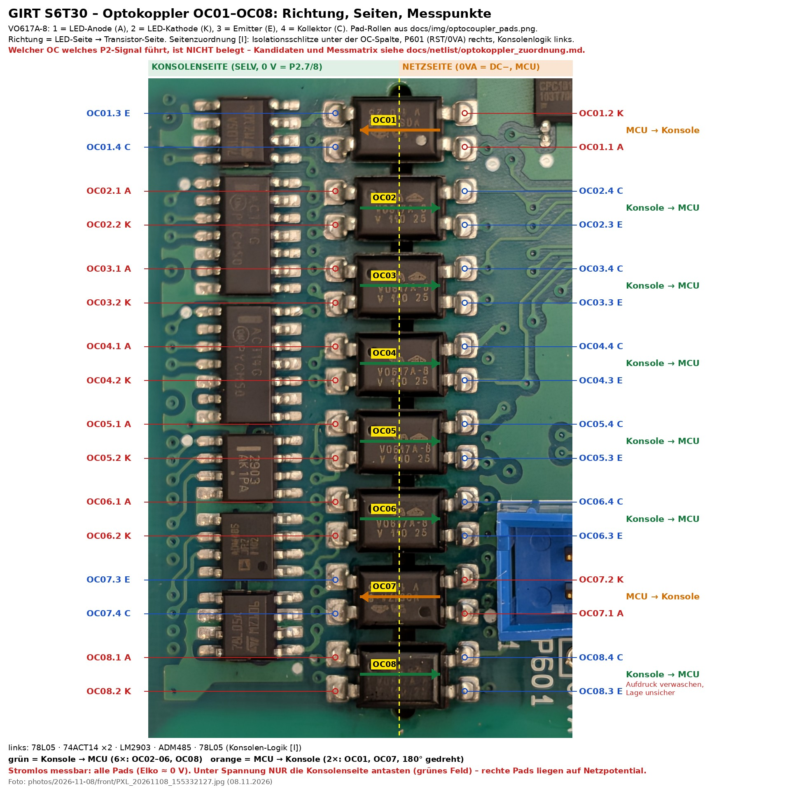

# Optokoppler OC01–OC08: Richtung, Kandidaten, Messplan (Stand 10.11.2026)

Grundlage: Pad-Rollen aus `../img/optocoupler_pads.png`, Bauteilliste `parts.csv`, Foto
`photos/2026-11-08/front/PXL_20261108_155332127.jpg`. Tags: **[O]** beobachtet, **[I]** gefolgert, **[H]** Hypothese.

## Was feststeht
- 8 × Vishay VO617A-8 (SMD-4): Pin 1 = LED-Anode, 2 = LED-Kathode, 3 = Emitter, 4 = Kollektor **[O]**.
- OC02–OC06 und OC08: LED-Pads links (Logikspalte), Transistor-Pads rechts **[O]**.
  OC01 und OC07 sind um 180° gedreht: LED rechts, Transistor links **[O]**. OC08: Aufdruck verwaschen, Lage unsicher.
- Unter der OC-Spalte verlaufen Isolationsschlitze; rechts liegen P601 (RST/0VA) und P602 (MCU-Debug, Netzseite) **[O]**.

## Gefolgert
- Linke Seite = Konsolenseite (SELV, Bezug 0 V = P2.7/P2.8 = P4.0V), rechte Seite = Netzseite (0VA = DC−, MCU) **[I]**.
  Die Logikspalte (2 × 78L05, 2 × 74ACT14, LM2903, ADM485) gehört damit zur Konsolenseite **[I]**
  (frühere Einordnung "mains-side logic" in `PHOTO_INVENTORY.md` ist damit fraglich).
- Richtung: 6 Kanäle Konsole → MCU (OC02–06, OC08), 2 Kanäle MCU → Konsole (OC01, OC07) **[I]**.
- P2.5 ↔ P2.7 = 3,83 kΩ auf der Platine (10.11.) passt zu "Vorwiderstand + Optokoppler-LED gegen 0 V Konsole" **[H]**.

## Kandidaten (nicht belegt)
| Richtung | Kanäle | P2-/P4-Signale, die in Frage kommen |
|---|---|---|
| Konsole → MCU | OC02, OC03, OC04, OC05, OC06, OC08 | P2.5 Enable/Not-Aus (über Motor-Thermoschalter), P2.6 PWM-Sollwert, Tacho (P4 liegt auf 0 V Konsole, die MCU braucht die Drehzahl für err 08), P2.15 Wake-up, P2.17 Sleep, P2.2/P2.3 Steigung ab/auf, RS-485 Empfang (ADM485) |
| MCU → Konsole | OC01, OC07 | P2.18 ERP (Status/Fehler), RS-485 Senden, ggf. Tacho-Rückmeldung an P2.9 |

## Messplan
### A – Zuordnung, stromlos (Netzstecker gezogen, P2-Kabel ab)
Nur Konsolenseite (linke Pads bzw. bei OC01/OC07 die linken Transistor-Pads) gegen P2-Lötpads messen.
Elko spielt dafür keine Rolle, Board trotzdem stromlos.

1. Kathoden-Bezug: OCx.2 (x = 02–06, 08) gegen P2.7 in Ω. ≈ 0 Ω → LED-Kathode liegt direkt an 0 V Konsole.
2. Matrix Widerstand P2-Pin → OCx.1 (Anode). Treffer = deutlich kleinster Wert (Vorwiderstand, typ. 0,2–5 kΩ).
   Kein Treffer bei einem Pin → Signal läuft über 74ACT14/LM2903 (kein DC-Pfad); dann B oder C verwenden.
3. OC01/OC07: P2-Pin → OCx.4 (Kollektor) und OCx.3 (Emitter) messen.

| P2-Pin → | OC02.1 | OC03.1 | OC04.1 | OC05.1 | OC06.1 | OC08.1 | OC01.4 | OC01.3 | OC07.4 | OC07.3 |
|---|---|---|---|---|---|---|---|---|---|---|
| 5 Enable | | | | | | | | | | |
| 6 PWM | | | | | | | | | | |
| 9 Tacho | | | | | | | | | | |
| 15 Wake-up | | | | | | | | | | |
| 17 Sleep | | | | | | | | | | |
| 18 ERP | | | | | | | | | | |
| 2 / 3 Steigung | | | | | | | | | | |
| P4 TACHO | | | | | | | | | | |

### B – Zustand der Koppler, stromlos (Elko < 1 V, Entladewiderstand kontrolliert)
1. Diodentest LED: Pin 1 (rot) → Pin 2 (schwarz). Erwartet ≈ 1,0–1,3 V, alle acht ähnlich; rückwärts OL oder hoch.
2. Funktionstest: 9-V-Block oder Netzteil über 1 kΩ an LED (+ an Pin 1, − an Pin 2, ≈ 5–8 mA).
   Gleichzeitig Diodentest Kollektor (rot, Pin 4) → Emitter (schwarz, Pin 3):
   LED aus → hoch/OL bzw. Wert der Beschaltung; LED an → deutlich tiefer (≈ 0,1–0,3 V).
   Acht Koppler vergleichen; ein Kanal, der kaum durchschaltet, ist verdächtig (schwacher CTR).
   Die Transistorseite von OC02–06/08 liegt auf Netzseite → nur stromlos und mit entladenem Elko.

| OC | Diode 1→2 [V] | 2→1 | C→E LED aus | C→E LED an | Bemerkung |
|---|---|---|---|---|---|
| OC01 | | | | | |
| OC02 | | | | | |
| OC03 | | | | | |
| OC04 | | | | | |
| OC05 | | | | | |
| OC06 | | | | | |
| OC07 | | | | | |
| OC08 | | | | | |

### C – Im Betrieb, nur Konsolenseite
Schwarze Messspitze an P2.7, gemessen wird nur auf den linken Pads von OC02–06/08 (LED-Seite).
Gleichspannung über der LED (Pin 1 gegen Pin 2) in den Zuständen: Ruhe → Konsole wach → START → Not-Aus-Magnet ab.
LED an ≈ 1,1–1,3 V, aus ≈ 0 V. Der Kanal, der bei START umschaltet, ist PWM bzw. Enable; der Kanal, der beim Abziehen
des Not-Aus fällt, ist Enable. Rechte Pads und OC01/OC07-LED **nicht** unter Spannung antasten (Netzpotential).
Messspitzen mit Schutzkappe, damit nichts über den Schlitz rutscht.

## Bezug zum Fehlerbild
Im aktiven Lauf 10.11. 13:50 fielen EM_POWENA, EM_STATUS, LOWKITENA/B und LK_ENABLE gemeinsam von 1 auf 0 (HF 902, err 9).
Ein Enable-Koppler mit nachlassendem CTR würde so ein Bild liefern; die Enable-Schleife über P2.5/Thermoschalter ebenso.
Erst A + B trennen das.
