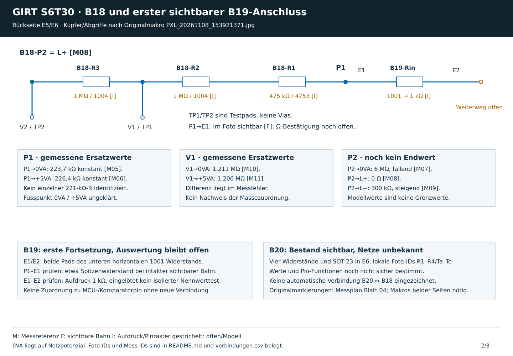
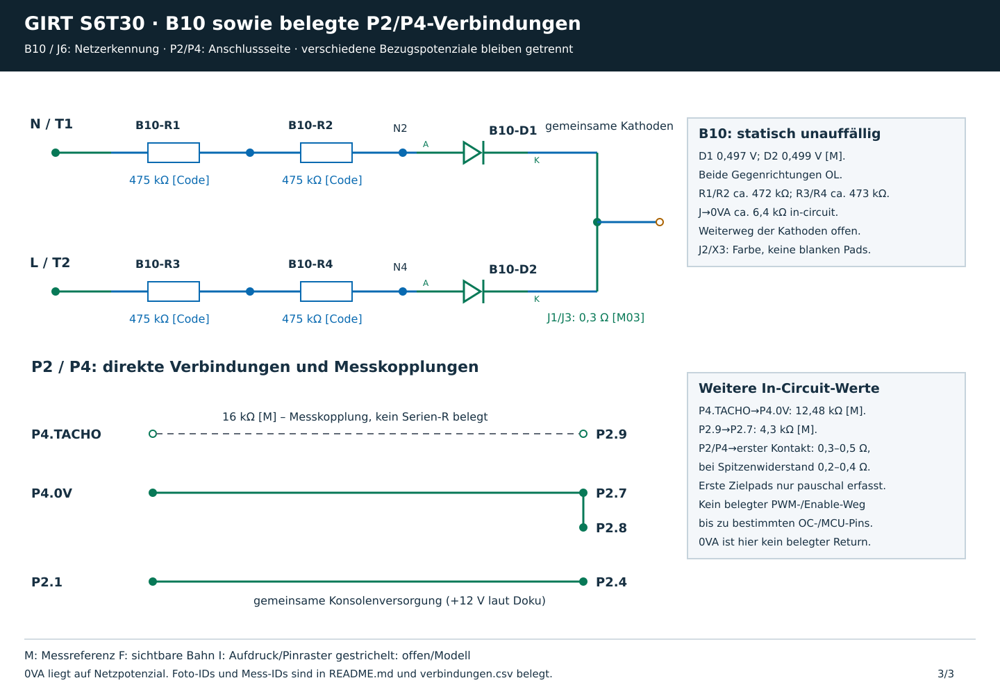

# GIRT S6T30: Teilschaltplan und weitere Fehlereingrenzung

Branch **110926**, auf Basis von `9d1f74617b602f57db36a1993998581de360b832`. Die vorhandenen Fotos, Messprotokolle und Claudes Raster bleiben erhalten. Nachtrag 09.11.2026: Nutzer-Messungen der Blätter 01–03 sind in den Ergebnisberichten dokumentiert; Blatt 2 wurde entsprechend korrigiert. Der Assistent hat selbst keine elektrische Messung ausgeführt.

[Schaltplan als PDF](teilschaltplan.pdf) · [Fotoatlas](../atlas_110926/README.md) · [Markierte Messkontakte und Messwertvorlage](../messplan_stromlos_2026-11-08/MESSPLAN.md) · [Verbindungsnachweis als CSV](verbindungen.csv)

## Was der Schaltplan abdeckt

| Blatt | Inhalt | Noch offen |
|---|---|---|
| [1: Motorstufe](blatt_1.svg) | L+/L−, Q2, Body-Diode, D3, 22-Ω-Gate-Pfad; NTC und Relais als getrennte Fragmente | Treibertyp und Pin-Funktionen, Versorgung/Freigabe, Relais-Netzanbindung |
| [2: B18/B19](blatt_2.svg) | B18-Kette, zwei B19-1003, 3922-Fusspunkt zu 0VA und gemessener Weg zu L4981AD Pin 14 VFEED | B19-1004-Einbindung, C-Weiterweg, P2–0VA-Endwert und B20-Netze |
| [3: B10 und Anschlüsse](blatt_3.svg) | Beide AC-Sense-Ketten mit Dioden; direkte P2/P4-Verbindungen | Kathoden-Auswertung, PWM-/Enable-/Tachoweg bis zu bestimmten IC-Pins |

**Ein vollständiger Schaltplan lässt sich aus dem vorhandenen Material noch nicht zuverlässig erstellen.** Bauteile unter dem Kühlkörper, verdeckte Bahnen, unlesbare IC-Typen und unbekannte Ebenenwechsel bleiben Lücken. Der Fotoatlas schließt diese Lücken nicht durch Vermutungen. Die Zeichnungen sind elektrische Teilschaltungen; sie sind keine erzeugten Platinenbilder.

## Belege und Grenzen

- **M:** vorhandene Messung, mit Mess-ID in `verbindungen.csv`. Ein Messwert zwischen zwei Punkten ist nicht automatisch eine direkte Verbindung.
- **F:** im Originalfoto sichtbare Bahn oder Anschlusslage. Sichtbare Bahnen bleiben als F gekennzeichnet. Zusätzliche Durchgangsmessungen konzentrieren sich auf unklare oder diagnostisch wichtige Verbindungen; F allein wird nicht als M ausgegeben.
- **I:** aus Aufdruck, Pinraster oder bisheriger Topologie abgeleitet. Ein gelesener Widerstandscode ist kein gemessener Einzelwert.
- **Offen/Modell:** gestrichelte Umrisse oder unbeschaltete Ports. Diese sind keine ergänzten Leiterbahnen.

Die gestrichelte graue Linie zwischen P4.TACHO und P2.9 auf Blatt 3 bezeichnet ausschließlich die gemessene 16-kΩ-Kopplung. Sie ist kein nachgewiesener Serienwiderstand. Ebenso werden 9,13 kΩ G–S, 223,7 kΩ P1–0VA und 226,4 kΩ P1–+5VA als **In-Circuit-Ersatzwerte** geführt; es wurden keine entsprechenden Einzelwiderstände identifiziert.

Die Zuordnung Q2-D = L− und Q2-S = 0VA folgt dem bisherigen Stand, dem Pinout und Diodentest. Ein neues separates Pad-zu-Klemmen-Durchgangsprotokoll liegt nicht vor. Bei D3 wurde Schwarz = L+ im ursprünglichen PW-M01-Protokoll angenommen. Dieser Vorbehalt bleibt erhalten.

B19-Rin bezeichnet E1–E2: **1003 = 100 kΩ**. Die frühere Lesung 1001 / 1 kΩ ist korrigiert. P1–E1 misst 0,4 Ω; E2 = B19-Pad A, der weitere Weg führt über den linken 1003 zu Pad B. B–L4981AD Pin 14 (VFEED) ist mit 0 Ω bestätigt. Der 3922-Fusspunkt liegt an 0VA. [Alle neuen Werte und Grenzen](../messplan_stromlos_2026-11-08/B19_ERGEBNISSE_2026-11-09.md). Am Treiber heißen die fünf Kontakte **A/B/C/D5/E**, entsprechend dem markierten Originalmakro. Das sind keine Hersteller-Pinnummern. E → RG-U ist als sichtbare Bahn eingezeichnet; die Funktion „OUT“ oder eine bestimmte Treiberversorgung wird daraus noch nicht abgeleitet.

Die Relais-Pinzuordnung basiert auf Gehäuselage und RT1-Pinraster. Ca/Cb sind das Spulenpaar; ihre individuelle A1/A2-Zuordnung bleibt offen. 11a/11b und 14a/14b sind abgeleitete Kontakt-Doppelpaare, keine neuen Messbefunde. Herstellerangaben: [TE RT334024](https://www.te.com/en/product-4-1393240-8.html), 24 V DC, 1,44 kΩ Spule, 0,4 W, Schließer. Der Nennwert gilt für die Spule allein, nicht beliebig für die eingelötete Umgebung.

## Was sich am Fehler bereits eingrenzen lässt

| Befund | Daraus folgt | Bleibt möglich |
|---|---|---|
| Q2-Body-Diode 0,444 V/OL; G–S 9,13 kΩ beidseitig; G–D 2,19 MΩ; Gate-R-Pfad ca. 22 Ω | Dauerhafter D–S-Schluss oder harter Gate-Schaden wird durch die statischen Werte nicht gestützt | Treiber-/Versorgungs-/Freigabefehler und temperatur-/lastabhängiger Q2-Fehler |
| D3 0,397 V/OL laut bisherigem Test | Statischer Diodenschluss wird nicht gestützt | Dynamischer/intermittierender Fehler; ursprüngliche Polungsangabe beachten |
| B10 beide Ketten und Dioden unauffällig | Keine nachgewiesene dauerhafte Unterbrechung dieser AC-Sense-Ketten | Kontakt-/Leck-/Auswertefehler hinter den Ketten |
| B18-P2 = L+ mit 0 Ω; P1 führt in B19 | PFC-Spannungsrückführung zu Pin 14 VFEED des L4981AD identifiziert; 3922-Fusspunkt 0VA | Dynamik, OVP-Pfad, zusätzliche B19-Netze und Fehlstartverhalten |
| NTC ca. 11 kΩ kalt, 10,75 kΩ warm | Sensor zeigte einen plausiblen NTC-Trend | Intermittierender Stecker-/Leitungs-/Buchsenfehler; keine genaue Kennlinienprüfung |
| Motorwicklung 1,5–1,6 Ω über viele Rotorstellungen; Generatorwirkung beobachtet | Dauerhaft offene Wicklung wird nicht gestützt | Bürsten-/Lastfehler; erklärt noch nicht die ausgebliebene Ansteuerung |
| P2/P4 bis zum jeweils ersten Kontakt 0,3–0,5 Ω bei 0,2–0,4 Ω Spitzenwiderstand | Die zuerst geprüften Teilstrecken waren leitend | Weiterer Signalweg, Leckströme, druck-/temperaturabhängige Kontakte |
| STS2 setzt beim dokumentierten Fehlstart vor dem Enable-Abfall der Konsole ein | Der Konsole-Abbruch allein erklärt den ersten GIRT-Fehlerhinweis nicht | Falsches Eingangssignal, Sperr-/Messpfad oder Versorgung auf der GIRT |

**Arbeitsrichtung:** zuerst Versorgung, Relais/Kontakte und Treiber/Freigabe von einem vermeintlichen Leistungs-MOSFET-Defekt unterscheiden. Den Tachosensor nicht allein wegen einer vermuteten Blinkcode-Deutung ersetzen. Der Sensor-/Signalweg bleibt eine offene, prüfbare Möglichkeit; ein eindeutiger defekter Bauteil ist bisher nicht belegt.

Das dokumentierte Multimeter/MAX-Verfahren konnte kurze Ausgangspulse unter etwa 0,5 s nicht sicher erfassen. „Anzeige blieb 0 V“ bedeutet deshalb nicht, dass es garantiert keinen kurzen Ansteuerungsversuch gab. Auch 4 bzw. 8 STS2-Pulse belegen ohne GIRT-spezifische Codetabelle weder Überspannung noch Encoderfehler. Die verwandten Technogym-Handbücher liefern dafür nur eine Hypothese.

## Nächste Messungen

Blätter 01–03 sind im dokumentierten Umfang abgearbeitet: [Relais](../messplan_stromlos_2026-11-08/ERGEBNISSE_2026-11-09.md), [P600](../messplan_stromlos_2026-11-08/P600_ERGEBNISSE_2026-11-09.md), [B18/B19](../messplan_stromlos_2026-11-08/B19_ERGEBNISSE_2026-11-09.md). Die historischen Werte in den übrigen Schaltplanblättern bleiben als Referenzen erhalten; die Ergebnisberichte haben für den Messstand Vorrang.

Als Nächstes **Blatt 04 B20**: scharfes Originalmakro der vier Widerstände und des SOT-23, Codes lesen und unklare Netze gezielt kartieren. Danach Q2-Treiber (Blätter 05/05b) und Hilfsversorgungen (06/07) gemäß [Messplan](../messplan_stromlos_2026-11-08/MESSPLAN.md). Keine pauschalen Sollwerte für unbekannte Halbleiterpins.

**Verschmutzung bleibt eine offene Hypothese.** Leitfähige/feuchte Rückstände können die hochohmige Rückführung verändern; das Foto beweist keine Leitfähigkeit. Eine spätere geeignete Reinigung mit dokumentiertem Vorher-/Nachhervergleich bei gleichen Messbedingungen kann den Verdacht prüfen. Sie wurde noch nicht durchgeführt und ersetzt keinen Nachweis des Fehlerverhaltens.

## Messgrenzen bleiben bestehen

Netz und externe Versorgung trennen; Restspannung am Zwischenkreis-Elko zuerst in V DC prüfen. Gemäß Repository erst nach bestätigtem Wert unter 5 V zu den stromlosen Arbeiten wechseln; Ω/Diode nur spannungsfrei. 0VA ist DC− auf Netzpotenzial. Keine Kontakte überbrücken, kein fremdes Netzteil an Treiber/Spule einspeisen, nichts allein aufgrund eines In-Circuit-Werts ersetzen. Die im Stand zurückgestellten Live-Messungen bleiben zurückgestellt. Das hier gezeichnete getrennte Fragment einer Versorgung oder eines Sensors beweist keine galvanische Trennung.

## Nachprüfbarkeit

`verbindungen.csv` enthält 77 Einträge mit Art, Status und Quellen. `Kupfer direkt`, `Widerstand`, `Diode` und `In-Circuit-Messung` bleiben verschiedene Kategorien. Nur direkte Kupferverbindungen dürfen beim Weiterzeichnen zu einem gemeinsamen Netz zusammengefasst werden; Werte im kΩ-/MΩ-Bereich dürfen das nicht.

Die Originalquellen bleiben maßgeblich: `STAND_2026-11-08.md`, die aktuelle Fassung `netlist/b18_spannungssense_kandidat.md` ohne verworfene Historie, `netlist/q2_zuordnung.md` mit Ergebnisstand 21:39, die Mess-CSV-Dateien und `HARDWARE.md`. Die ältere unbestätigte Annahme P2 = L− und die pauschale Gate-Pulldown-Erwartung aus einem Zwischenstand werden nicht übernommen.
