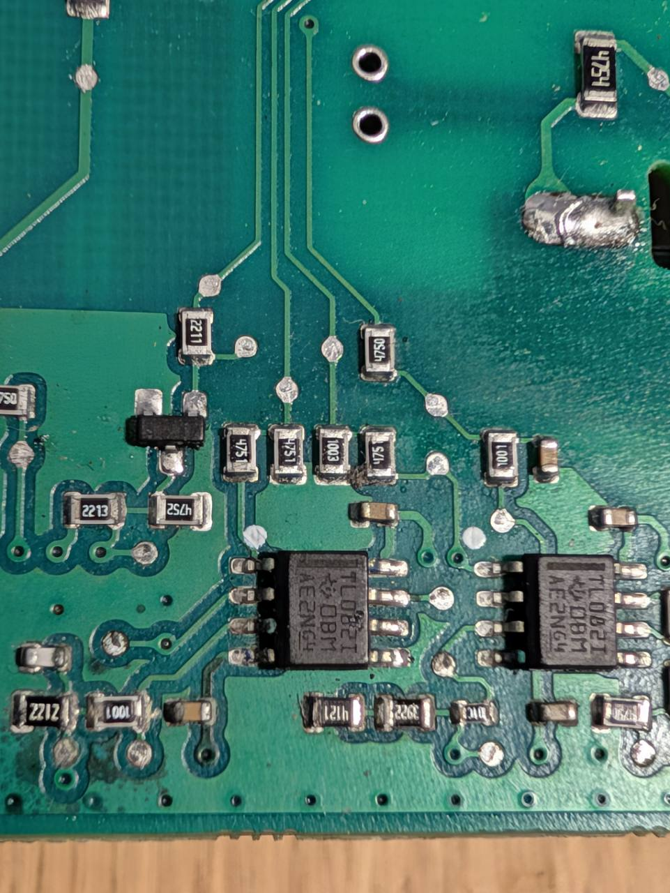

# B20 – neues Rückseitenmakro, 09.11.2026

[50370.jpg](50370.jpg) ist die neue Originalaufnahme des Nutzers, Zuordnung **B20 / E6** mit angrenzendem B19- und TL082I-Umfeld. Claudes Raster und vorhandene Bauteil-IDs bleiben unverändert. Das Foto ergänzt den historischen Atlas vom 08.11.; es ersetzt keine alte Aufnahme.

R1–R4 liegen hier von links nach rechts. Die Endkappen heißen entsprechend dem **ursprünglichen** Messplan **a unten, b oben**. SOT-23: **Ta unten einzeln, Tb oben links, Tc oben rechts**. Die frühere umgekehrte a/b-Beschreibung im Chat war ein Übertragungsfehler und ist korrigiert. Der Nutzer bestätigte ausdrücklich die Bezeichnungen des ursprünglichen Plans.

[Alle Messwerte und Grenzen](../../../docs/messplan_stromlos_2026-11-08/B20_ERGEBNISSE_2026-11-09.md) · [ursprünglich markierte Kontakte](../../../docs/messplan_stromlos_2026-11-08/makros/04.png) · [Metadaten-/Pixelnachweis](metadaten_pruefung.json)

Vor dem Hinzufügen wurden APP1 (EXIF/XMP), gegebenenfalls APP13 und JPEG-Kommentare entfernt. Der JPEG-Bildstrom wurde nicht neu kodiert; die dekodierten Pixel sind identisch. Die Upload-Datei mit ursprünglichen Metadaten wurde nicht ins Repository übernommen. Das Repository-Foto enthält keine generierten Platineninhalte.
