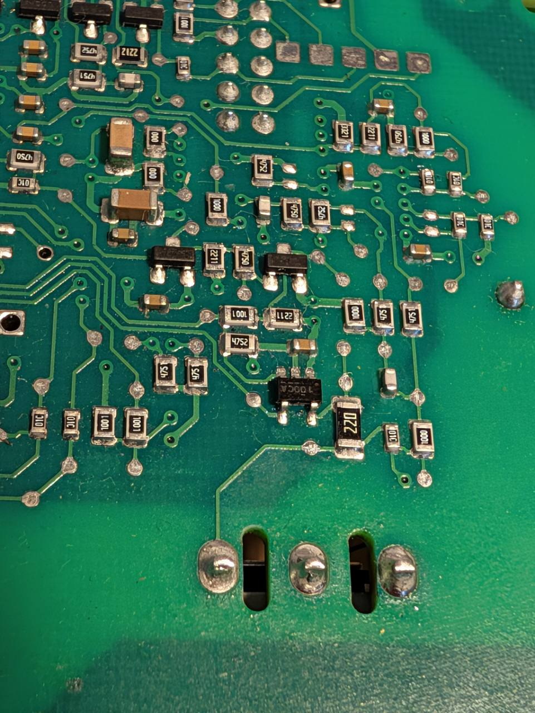

# Q2 und Gate-Ansteuerung – Rückseitenmakro 50386, 09.11.2026

[50386.jpg](50386.jpg) ist die neue Originalaufnahme des Nutzers für **Q2 / B21 / B5**. Claudes Raster und die vorhandenen Bauteil-/Kontakt-IDs bleiben unverändert. Das Foto ergänzt die historischen Aufnahmen vom 08.11.

Am fünfpoligen Bauteil gelten hier wie im alten Originalmakro: **A/B/C oben von links nach rechts, D5 unten links, E unten rechts**. G/D/S sind die drei großen MOSFET-Lötstellen darunter von links nach rechts. Für Messungen bleiben die [vorhandenen markierten Kopien Blatt 05](../../../docs/messplan_stromlos_2026-11-08/makros/05.png) und [05b](../../../docs/messplan_stromlos_2026-11-08/makros/05b.png) maßgeblich.

Der früher „R221“ genannte Widerstand trägt **2211 = 2,21 kΩ**, nicht 221 / 220 Ω. R2211 ist der verständliche Alias; alte Foto-ID R221 und ihre a/b-Pixel werden nicht verschoben. Die beiden anderen Aufdrucke sind 1001 und 4752. Der Nutzer liest den fünfpoligen Baustein als **1000CA**; eine sichere Hersteller-/Typ-/Pinout-Zuordnung ist noch nicht gelungen.

[Ergebnisse mit Korrekturen und Grenzen](../../../docs/messplan_stromlos_2026-11-08/Q2_TREIBER_ERGEBNISSE_2026-11-09.md) · [Metadaten-/Pixelnachweis](metadaten_pruefung.json)

APP1 (EXIF/XMP), gegebenenfalls APP13 und Kommentare wurden vor dem GitHub-Import entfernt. Der JPEG-Bildstrom wurde nicht neu kodiert; die dekodierten Pixel sind gegenüber dem Upload identisch. Die Upload-Datei mit ursprünglichen Metadaten ist nicht im Repository. Keine Platineninhalte wurden generiert, vorhandene Originalfotos wurden nicht verändert.
